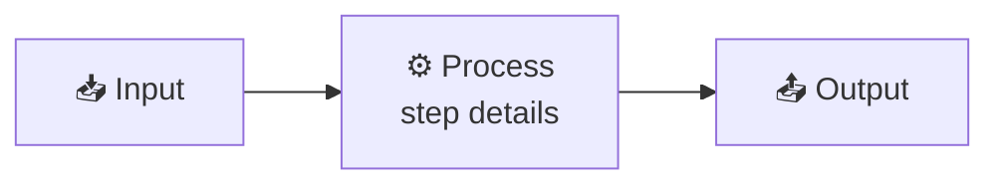
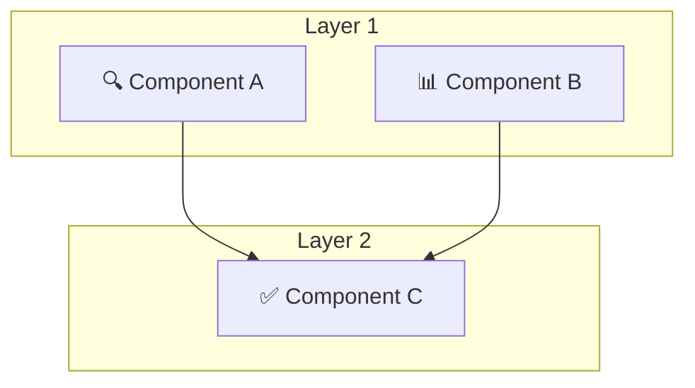
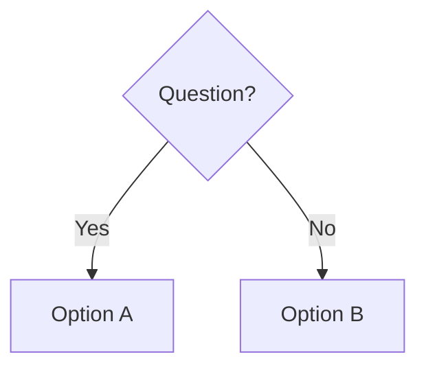

# AgentCenter Website

## Project

Next.js marketing site for AgentCenter (agentcenter.cloud). Blog posts are MDX files in `content/blog/`.

## Blog Writing Guide

Every blog post must read like it was written by a real person with hands-on experience — not by AI, not by a marketer.

### Voice

Conversational, grounded, natural. Like explaining something to a smart friend over coffee. You have opinions. You've built things. You've seen what works and what doesn't.

### Rules

- Simple, clear language. Short sentences. Fragments are fine.
- Write to one person, not "an audience."
- Every post needs at least one concrete detail — a number, a specific problem you hit, a decision you made, an observation from real usage.
- Show real-world context. "We had 14 agents running and couldn't tell which one was failing" beats "managing multiple agents can be challenging."
- Personality is good. Mild humor, opinions, even frustration — these are human. Use them.
- No generic or vague statements. If a sentence could appear in any blog post about any product, delete it.
- No formal essay structure. Skip "In conclusion" and "As we've seen."
- Don't over-polish. If a sentence sounds like it came from a press release, rewrite it.

### Banned Words and Phrases

Never use these. If you catch yourself reaching for one, find a plainer way to say it.

**Verbs:** leverage, utilize, optimize, streamline, foster, cultivate, navigate, empower, unlock, harness, elevate, supercharge, amplify, unleash, embrace

**Adjectives:** cutting-edge, revolutionary, game-changing, groundbreaking, transformative, robust, seamless, comprehensive, holistic, dynamic, versatile, elegant

**Transitions:** furthermore, moreover, additionally, notably, importantly, indeed

**Phrases:** delve into, shed light on, pave the way, deep dive, the landscape of, in today's fast-paced world, in the ever-evolving, the possibilities are endless

### What Good Looks Like

Bad: "In today's rapidly evolving AI landscape, organizations must leverage robust agent management platforms to unlock the full potential of their AI investments."

Good: "We deployed five agents last quarter. By month two, we had no idea which ones were actually doing useful work. That's the problem."

Bad: "This comprehensive guide will delve into the transformative strategies for seamless multi-agent orchestration."

Good: "Here's what we learned after spending three months wiring agents together — and what we'd do differently."

### Blog Frontmatter

```yaml
---
title: "Post Title Here"
description: "One-line summary for SEO and social cards."
date: "YYYY-MM-DD"
author: "AgentCenter Team"
tags: ["tag1", "tag2"]
---
```

### Mermaid Diagrams

Every blog post should include at least one Mermaid diagram where the content describes a flow, architecture, pipeline, hierarchy, or process. Diagrams render automatically — just use a ` ```mermaid ` code block.

**Rules:**

- Use `<br/>` for multi-line labels, never `\n`
- Add emoji prefixes to key nodes for visual clarity
- Use `graph TD` for top-down flows (hierarchies, architectures)
- Use `graph LR` for left-to-right flows (pipelines, sequences)
- Use `subgraph` to group related nodes
- Use `-->` for solid connections, `-.->` for dotted/optional connections
- Use `<-->` for bidirectional connections
- Use `style` to highlight error/warning nodes when contextually appropriate
- Keep diagrams focused — one concept per diagram, not the whole post
- Place the diagram right before the text it illustrates

**Example — Pipeline:**

````markdown

````

**Example — Architecture with subgroups:**

````markdown

````

**Example — Decision tree:**

````markdown

````

**What NOT to do:**

- No ASCII art diagrams (box-drawing characters like `┌ ┐ └ ┘ │ ─`). Always use Mermaid instead.
- No `\n` in labels — use `<br/>` for line breaks.
- Don't overload a single diagram with 10+ nodes. Split into multiple diagrams if needed.

### Date Rules

- Every blog post must have a unique timestamp — no two posts share the exact same date+time.
- For a single post on a given day, use `YYYY-MM-DD` format (treated as midnight).
- When multiple posts are scheduled on the same day, use full IST timestamps: `YYYY-MM-DDTHH:MM:00+05:30`. Start the first post at `08:00`, then space each additional post 6 hours later (`14:00`, `20:00`, and so on).
- Posts with future dates are automatically hidden from the site and sitemap until their date/time passes.
