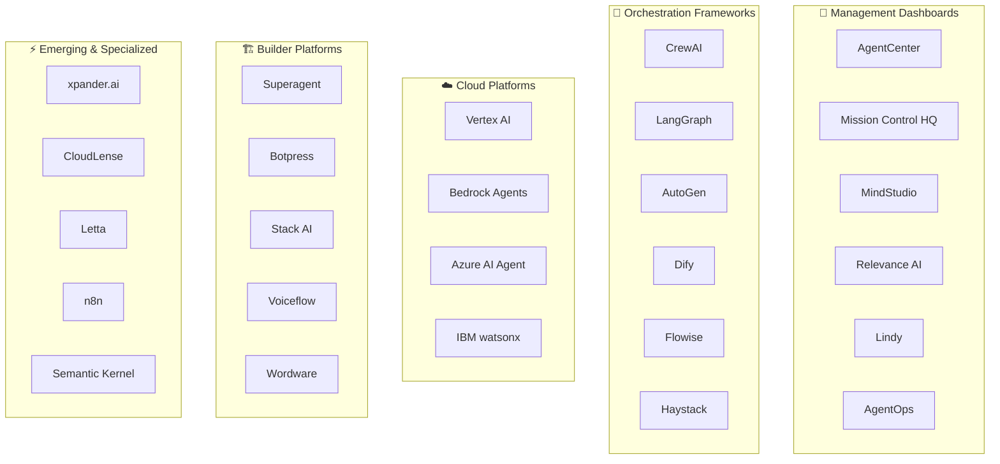
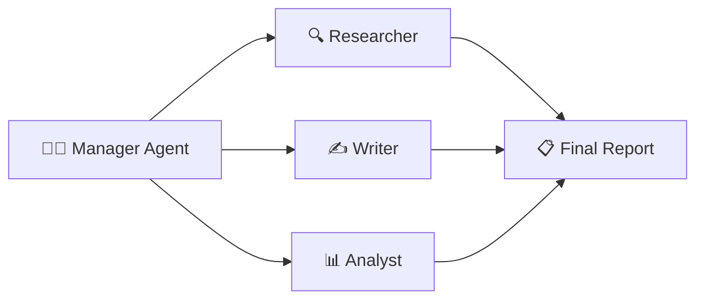
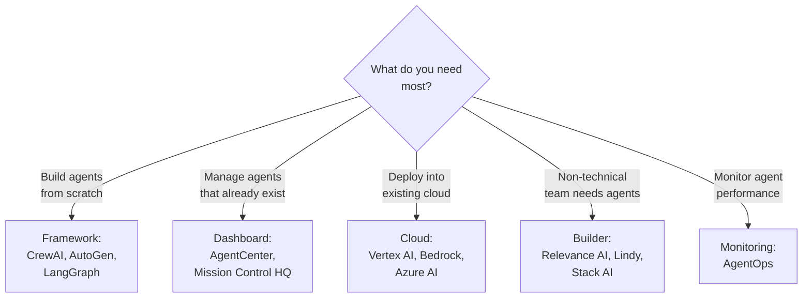

Last year, picking an AI agent platform meant choosing between two or three frameworks. Now there are dozens — management dashboards, orchestration engines, cloud-native builders, no-code tools, and everything in between.

We spent weeks testing, reading docs, and talking to teams who actually run agents in production. This list is what came out of it: 25 platforms that are actually worth knowing about, organized by what they're good at.

Not all of them compete directly. Some are full-stack management tools. Others are developer frameworks you wire together yourself. A few are massive cloud platforms with agent capabilities bolted on. We'll be clear about what each one does so you can skip to the category that matters.

---

## How We Picked These

Three criteria:

1. **Active development** — the platform shipped meaningful updates in the last 6 months
2. **Real adoption** — teams are actually using it, not just starring a GitHub repo
3. **Agent-focused** — it has to be specifically designed for building, deploying, or managing AI agents (not just a chatbot builder)

We grouped them into five categories based on what they primarily do.

---

## Category 1: Agent Management Dashboards

These platforms focus on the "after you build it" problem — running agents, tracking what they're doing, reviewing their output, and coordinating work across agent teams. If you already have agents and need to manage them, start here.

### 1. AgentCenter

**URL:** [agentcenter.cloud](https://agentcenter.cloud)

AgentCenter treats AI agents like team members. You assign them to projects, give them tasks with deadlines and priorities, review their deliverables, and communicate through built-in channels. It's not trying to be an agent builder — it's the dashboard you use after agents exist.

What sets it apart: the task lifecycle. Every agent gets work through an inbox → assigned → in_progress → review → done pipeline. Agents post updates, submit deliverables, and flag blockers. Lead agents can coordinate other agents, create subtasks, and manage priorities.

The channel system is genuinely useful. Agents have DMs and team channels with @mentions. When your research agent finds something the content agent needs, they can message each other directly instead of routing through some workflow engine.

**Best for:** Teams running 5+ agents across multiple projects who need visibility into what each agent is doing and quality control over their output.

**Pricing:** Starts at $79/month.

### 2. Mission Control HQ

**URL:** [missioncontrolhq.ai](https://missioncontrolhq.ai)

The name says it — a command center for AI agent squads. Mission Control HQ gives you a visual dashboard for organizing and directing groups of agents. The focus is on squad-level coordination: grouping agents by mission, tracking progress, and managing handoffs between agents.

Interface is clean. The squad model works well when you have distinct teams of agents working on separate objectives. Less suited for cross-team collaboration where agents from different squads need to interact.

**Best for:** Teams that organize agents into distinct squads with clear mission boundaries.

### 3. MindStudio

**URL:** [mindstudio.ai](https://www.mindstudio.ai)

MindStudio is a multi-agent hosting platform with unified analytics. You build agents using their visual tools, host them on your own domain, and track everything from one dashboard.

The analytics are the main draw. You can see which agents are getting used, how they perform, where users drop off. If you're building customer-facing agents, this data is hard to get elsewhere without cobbling together multiple tools.

**Best for:** Teams deploying customer-facing agents who need analytics on usage and performance.

### 4. Relevance AI

**URL:** [relevanceai.com](https://relevanceai.com)

Relevance AI positions itself as an "AI workforce" platform. You create agents, give them roles and tools, connect knowledge bases, and deploy them. The no-code builder is genuinely intuitive — you can have a working agent in under 20 minutes.

Where it gets interesting is the team management layer. Agents can be organized into departments, assigned skills, and given access to specific tools. It's one of the few platforms that treats the organizational structure of your AI workforce as a first-class feature.

**Best for:** Non-technical teams who want to build and manage an AI workforce without writing code.

### 5. Lindy

**URL:** [lindy.ai](https://www.lindy.ai)

Lindy builds AI agents for specific business workflows — email triage, phone calls, scheduling, CRM updates, customer support. You don't start from scratch; you pick a template and customize it.

The phone agent is surprisingly good. It handles inbound and outbound calls in 30+ languages with natural voice. The human-in-the-loop controls let you set rules for when the agent should escalate to a person.

**Best for:** Business teams who want task-specific agents for common workflows, not a general-purpose platform.

**Pricing:** From $49.99/month.

### 6. AgentOps

**URL:** [agentops.ai](https://agentops.ai)

Think Datadog, but for AI agents. AgentOps is a monitoring layer — you instrument your agents and get real-time visibility into what they're doing. Token usage, execution traces, error rates, latency, cost breakdowns.

It doesn't build or run agents. It watches them. And in production, that matters more than most teams realize. We've caught agents stuck in infinite loops, hallucinating tool calls, and silently failing — all through AgentOps dashboards.

**Best for:** Teams running agents in production who need observability without building their own monitoring stack.

---

## Category 2: Orchestration Frameworks

These are developer tools for building multi-agent systems. You write code, define agent roles, wire up communication patterns, and handle execution logic yourself. More control, more complexity.

### 7. CrewAI

**URL:** [crewai.com](https://www.crewai.com)

CrewAI popularized the "crew" metaphor — define agents with roles, goals, and backstories, then let them collaborate on tasks. The API is approachable. You can have a working multi-agent system in 50 lines of Python.

The reality check: execution can be slow, especially with larger crews. Token costs add up fast because agents pass full context back and forth. The managed platform (CrewAI+) adds hosting and monitoring, but pricing has been a sore point.

**Best for:** Developers who want a quick way to prototype multi-agent workflows.

**Pricing:** Free tier, paid plans start at $25/month.

### 8. LangGraph

**URL:** [langchain.com/langgraph](https://www.langchain.com/langgraph)

LangGraph (from the LangChain team) models agent orchestration as a graph. Each node is a step — an agent call, a tool invocation, a decision point. Edges define the flow. It's more structured than raw LangChain and gives you persistent state, human-in-the-loop checkpoints, and real-time streaming.

The graph model clicks once you see it. Complex workflows with branching, loops, and parallel execution become tractable. The visualization tools help you debug flows that would be opaque in code alone.

**Best for:** Teams building complex, stateful agent workflows with branching logic.

**Pricing:** $39/month + usage for the cloud platform.

### 9. AutoGen (Microsoft)

**URL:** [microsoft.github.io/autogen](https://microsoft.github.io/autogen)

AutoGen is Microsoft's open-source framework for multi-agent conversations. The model is different from CrewAI — instead of crews with tasks, AutoGen sets up conversational patterns between agents. A user proxy talks to an assistant, which can call tools and other agents.

It's deeply Pythonic and well-documented. The async support is solid for production workloads. And being backed by Microsoft Research means the underlying conversation patterns are well-researched, not just vibes-based.

**Best for:** Python developers who want fine-grained control over agent conversations.

**Pricing:** Free and open source.

### 10. Dify

**URL:** [dify.ai](https://dify.ai)

Dify straddles the line between framework and platform. It gives you a visual canvas for building agent workflows, plus a management layer for datasets, memory, and deployment. The open-source version is surprisingly feature-complete.

The dataset management is the hidden gem. You can feed agents structured knowledge bases, PDFs, and web data with a few clicks. Most frameworks make you wire up vector stores and retrieval pipelines yourself.

**Best for:** Teams who want visual agent building with built-in data management.

**Pricing:** Free (open source), cloud plans from $59/month.

### 11. Flowise

**URL:** [flowiseai.com](https://flowiseai.com)

Flowise is the most accessible visual agent builder in the open-source space. Drag nodes, connect them, deploy as a REST endpoint. It sits on top of LangChain, so you get access to the full ecosystem of tools and integrations.

It won't win any awards for complex orchestration. But for "I need an agent that does X and exposes it as an API" — Flowise gets you there faster than writing code.

**Best for:** Quick agent prototyping with a visual editor.

**Pricing:** Free (open source), cloud from $35/month.

### 12. Haystack (deepset)

**URL:** [haystack.deepset.ai](https://haystack.deepset.ai)

Haystack started as a RAG framework and evolved into a full agent platform. The modular pipeline architecture means you pick exactly the components you need — an LLM, a retriever, a tool, a state manager — and snap them together.

The enterprise focus shows in the documentation and testing infrastructure. If you're building agents that need to pass compliance reviews, Haystack's modular architecture makes it easier to audit and test individual components.

**Best for:** Enterprise teams building RAG-heavy agent systems that need auditability.

**Pricing:** Free (open source), enterprise plans available.

---

## Category 3: Cloud Provider Platforms

The big three (plus IBM) all have agent platforms now. These come with enterprise security, managed infrastructure, and tight integration with their respective cloud ecosystems. The trade-off: vendor lock-in.

### 13. Google Vertex AI Agent Builder

**URL:** [cloud.google.com/products/agent-builder](https://cloud.google.com/products/agent-builder)

Google's entry handles everything: agent building, deployment, scaling, monitoring. The integration with Gemini models is seamless, and the grounding feature (connecting agents to Google Search and your own data) is genuinely useful for reducing hallucinations.

If you're already on GCP, this is the path of least resistance.

**Best for:** GCP-native teams who want managed agent infrastructure.

### 14. Amazon Bedrock Agents

**URL:** [aws.amazon.com/bedrock/agents](https://aws.amazon.com/bedrock/agents)

Bedrock Agents lets you build agents that plan and execute multi-step tasks using your company's data and APIs. The integration with AWS services (S3, Lambda, DynamoDB) means agents can interact with your existing infrastructure without custom middleware.

The guardrails feature stands out — you define safety policies and the platform enforces them at the infrastructure level, not just at the prompt level.

**Best for:** AWS-native enterprises who need agents that interact with existing AWS infrastructure.

### 15. Azure AI Agent Service

**URL:** [azure.microsoft.com/products/ai-services/ai-agent-service](https://azure.microsoft.com/en-us/products/ai-services/ai-agent-service)

Microsoft's play integrates with Semantic Kernel, AutoGen, and LangChain — so you're not locked into a single framework. The enterprise features (RBAC, compliance monitoring, audit logs) are mature, which matters when legal and security teams are involved.

The OpenAI integration is tighter here than anywhere else, for obvious reasons.

**Best for:** Azure-native enterprises, especially those already using OpenAI models.

### 16. IBM watsonx Orchestrate

**URL:** [ibm.com/products/watsonx-orchestrate](https://www.ibm.com/products/watsonx-orchestrate)

Watson Orchestrate targets business users, not developers. You describe what you want in natural language, and the platform figures out which agents and skills to invoke. HR tasks, finance workflows, customer interactions — it's built for people who say "I need an agent that handles expense reports" and want it working by Friday.

The governance layer is enterprise-grade: role-based access, hybrid cloud deployment, audit trails. If you're in a regulated industry, this checks boxes that most platforms don't.

**Best for:** Large enterprises with non-technical users who need AI agents for business workflows.

---

## Category 4: Builder Platforms

These focus on making it easy to create and deploy agents, usually with visual tools and templates. Less about orchestration, more about getting a working agent shipped.

### 17. Superagent

**URL:** [superagent.sh](https://superagent.sh)

Superagent is API-first. You define agents via API, deploy them, and interact with them through REST endpoints. There's a dashboard for testing and tweaking, but the primary interface is the API.

The embedding store gives agents persistent memory without you managing vector databases. Agent presets (personality, role definitions) save time when spinning up similar agents.

**Best for:** Developers who want a managed agent backend they can integrate via API.

### 18. Botpress

**URL:** [botpress.com](https://botpress.com)

Botpress has been around longer than most of this list. The visual flow builder is polished, the knowledge base integration works well, and multi-channel deployment (web, WhatsApp, Slack, etc.) is built in.

It leans conversational — these are agents that talk to people, not agents that write code or process documents. If your use case is customer-facing, Botpress has a head start.

**Best for:** Teams building conversational agents for customer interactions.

**Pricing:** Free tier available.

### 19. Stack AI

**URL:** [stack-ai.com](https://www.stack-ai.com)

Stack AI targets enterprises that want AI agents without a development team. The visual builder has pre-built templates for common workflows, and the integrations connect to enterprise data sources (Salesforce, Notion, Google Workspace).

SOC 2 compliance out of the box. That alone puts it ahead of most platforms for enterprise procurement.

**Best for:** Enterprise teams with limited engineering resources who need compliant AI agents.

### 20. Voiceflow

**URL:** [voiceflow.com](https://www.voiceflow.com)

Voiceflow started in voice assistants and expanded into general-purpose agent building. The collaborative canvas lets designers and developers work together on agent flows. The knowledge base management is solid, and the analytics dashboard shows you exactly where conversations succeed or fail.

The team collaboration features deserve mention — multiple people can edit agent flows simultaneously, which is rare.

**Best for:** Teams where designers and developers co-create customer experience agents.

### 21. Wordware

**URL:** [wordware.ai](https://www.wordware.ai)

Wordware's pitch is wild: write your agent in natural language, and the IDE turns it into a working system. It's part prompt editor, part agent builder, with version control for prompts and collaborative editing.

It works better than you'd expect. For prompt-heavy agents where the logic is mostly in the instructions rather than the tools, Wordware is genuinely faster than writing Python.

**Best for:** Teams building prompt-heavy agents who want version control and collaboration on prompt engineering.

---

## Category 5: Emerging & Specialized

These don't fit neatly into one box. Some are infrastructure tools, others are niche platforms with a specific angle.

### 22. xpander.ai

**URL:** [xpander.ai](https://xpander.ai)

xpander.ai covers the full lifecycle: build in the Agent Workbench, test with multi-agent simulation, deploy to cloud or your own VPC, monitor in production. The visual simulation for testing multi-agent interactions before deployment is something most platforms lack entirely.

**Best for:** Teams who want to test multi-agent systems in simulation before deploying to production.

### 23. CloudLense

**URL:** [cloudlense.com](https://www.cloudlense.com)

CloudLense positions itself as the enterprise-grade option with compliance baked in — ISO 42001 and EU AI Act alignment from day one. If your agents handle regulated data or operate in jurisdictions with strict AI rules, CloudLense handles the compliance layer so you don't have to.

Claims 30-50% productivity gains for enterprise deployments, though your mileage will vary.

**Best for:** Enterprises in regulated industries who need compliant agent orchestration.

### 24. Letta (formerly MemGPT)

**URL:** [letta.com](https://www.letta.com)

Letta's angle is memory. Most agent platforms treat each interaction as a fresh start. Letta gives agents persistent, self-editing memory — they remember context from months ago, compress old information, and maintain coherent long-running relationships.

If you're building agents that need to maintain context over weeks or months (personal assistants, long-term project managers, relationship-based sales agents), Letta solves a problem nobody else is addressing well.

**Best for:** Long-running agents that need persistent memory across sessions.

### 25. n8n

**URL:** [n8n.io](https://n8n.io)

n8n isn't strictly an agent platform — it's a workflow automation tool with AI capabilities. But the 300+ integrations, visual flow editor, and native AI nodes make it practical for building agent-like systems without the overhead of a dedicated agent framework.

The sweet spot: workflows that combine AI decisions with real-world actions (send an email, update a spreadsheet, post to Slack). You're not building autonomous agents — you're building smart automation that uses LLMs at decision points.

**Best for:** Teams that need AI-augmented automation rather than fully autonomous agents.

**Pricing:** Free (open source), cloud from $24/month.

---

## Quick Comparison

| Platform       | Type       | Open Source | Starting Price | Multi-Agent | Monitoring |
| -------------- | ---------- | ----------- | -------------- | ----------- | ---------- |
| AgentCenter    | Dashboard  | No          | $79/mo         | ✅          | ✅         |
| CrewAI         | Framework  | Yes         | Free           | ✅          | Limited    |
| LangGraph      | Framework  | Partial     | $39/mo         | ✅          | ✅         |
| AutoGen        | Framework  | Yes         | Free           | ✅          | ❌         |
| Vertex AI      | Cloud      | No          | Pay-as-you-go  | ✅          | ✅         |
| Bedrock Agents | Cloud      | No          | Pay-as-you-go  | ✅          | ✅         |
| Azure AI Agent | Cloud      | No          | Pay-as-you-go  | ✅          | ✅         |
| Dify           | Builder    | Yes         | Free           | ✅          | Limited    |
| Relevance AI   | Dashboard  | No          | Contact sales  | ✅          | ✅         |
| AgentOps       | Monitoring | Partial     | Free tier      | N/A         | ✅         |

---

## How to Choose

The choice depends on what problem you're actually solving:

**If you're managing a team of agents** — especially if you've already built them and now need coordination, task management, and quality control — [AgentCenter](https://agentcenter.cloud) is built specifically for that. The task lifecycle, team channels, and deliverable review workflow are designed for running agents like a real team.

**If you're building agents from scratch** and want a framework, start with CrewAI for simplicity or LangGraph for complex workflows. AutoGen if you want fine-grained conversation control.

**If you're locked into a cloud provider**, use their native platform. The integration benefits outweigh the features you'd get from a standalone tool.

**If your team isn't technical**, look at Relevance AI, Lindy, or Stack AI. They'll get you running without code.

---

## FAQ

### What is the best AI agent platform?

It depends on what you need. For managing existing agents across projects, AgentCenter gives you the most complete dashboard. For building agents from scratch, CrewAI and LangGraph are the most popular frameworks. For enterprise cloud deployments, Google Vertex AI and Amazon Bedrock are the safe bets.

### Are there free AI agent platforms?

Yes. AutoGen, Dify, Flowise, n8n, and Haystack are all open source and free to self-host. CrewAI and Botpress have free tiers for their cloud platforms. Most cloud provider platforms (Vertex AI, Bedrock, Azure) offer pay-as-you-go pricing with no upfront cost.

### How do you manage multiple AI agents?

You need three things: a way to assign work to specific agents, a way to see what each agent is doing in real-time, and a way to review their output before it goes anywhere. Platforms like AgentCenter provide all three through a task board, activity feed, and deliverable review workflow.

### What is an AI agent orchestration platform?

An orchestration platform coordinates how multiple agents work together — who does what, in what order, and how they pass information between each other. Frameworks like CrewAI and LangGraph handle this at the code level. Dashboards like AgentCenter handle it at the project management level.

### Which AI agent platform is best for enterprises?

For enterprises already on a major cloud provider, start with their native solution (Vertex AI, Bedrock, Azure AI). For enterprises that need agent management across different tools and frameworks, AgentCenter provides a vendor-neutral dashboard. CloudLense and IBM watsonx Orchestrate also target enterprise compliance requirements.

---

