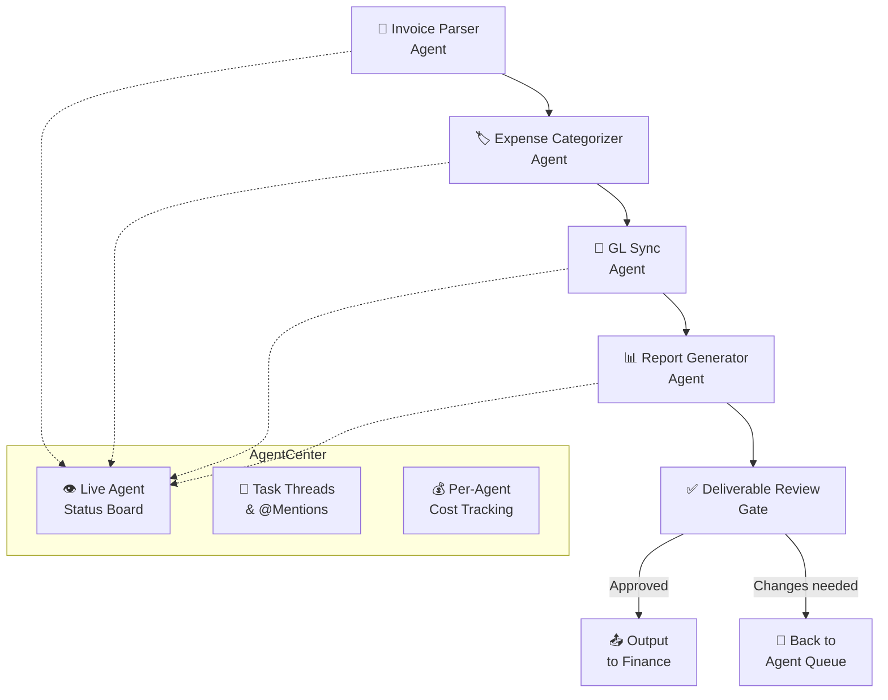

Accounting teams have been automating repetitive work for years. But there is a difference between a scheduled script and an AI agent running in production. When you have agents handling invoice parsing, expense categorization, bank reconciliation, and month-end report generation, you need to know which one is working, which one is stuck, and which one just silently miscategorized 400 line items.

Without a control plane, that answer is usually: nobody knows until month-end.

## The Bottleneck When Accounting Agents Scale

Running one agent is manageable. You check the output, fix issues, move on. But accounting workflows do not stay at one agent.

You end up with a chain: invoice parsing feeds expense categorization, which feeds the GL sync agent, which feeds report generation. Break one link and the downstream outputs are wrong. Often silently.

Here are three specific ways this breaks:

**Reconciliation findings disappear into a log file.** Your reconciliation agent runs, flags 14 discrepancies, and writes them to a file. No task is created. No alert fires. Nobody knows to check. The discrepancies sit there for three weeks until someone asks why the numbers look off at month-end.

**Parser errors cascade downstream.** The invoice parser hits a malformed PDF and produces partial output. The categorization agent processes it anyway, assigns everything to a catch-all category, and moves on. No error thrown. No flag raised. You find out when the GL sync produces totals that do not add up.

**Report agents have no gate.** The report generator creates a PDF and sends it automatically. The numbers look plausible. They are built on two weeks of silently bad categorization. Someone asks questions in the leadership meeting. Now you are debugging backward through three agents' logs.

These are not model failures. They are coordination failures.

## How AgentCenter Addresses the Coordination Gap

### Kanban Board: One View of the Entire Pipeline

The [Kanban board](/features/task-orchestration) shows every agent's task state in real time: pending, in progress, blocked, done. For accounting teams, this means you can see at a glance whether the invoice parser is still running, whether categorization is waiting on a blocked dependency, or whether the GL sync completed three hours ago.

You do not need to check individual logs or ping whoever set the agent up. The board tells you.

### Deliverable Review: A Gate Before Reports Ship

This is the most useful feature for accounting teams. Before any agent output reaches leadership, a human reviews it. When an agent submits output, AgentCenter creates a review task. A team member checks it, approves or rejects it, and only then does it move forward.

In practice: your report generator submits the month-end PDF. The controller gets a review task. They check the numbers, approve, and it goes out. If something looks off, they reject it with a note and the task returns to the queue. That is the gate that "send automatically" workflows do not have.

### Agent Monitoring: Catch Stuck Agents Before They Cost You

AgentCenter tracks live agent status. If the reconciliation agent stops responding or runs longer than its baseline, you see it on the dashboard. You can also configure recurring tasks so reconciliation runs every Monday without anyone triggering it manually.

Stuck agents are quiet. They do not throw errors; they just stop. The [agent monitoring](/features/agent-monitoring) view is how you find them before the next run is also missing.

### @Mentions: Pull a Human Into the Right Thread

When an agent flags an anomaly, you need a specific person to look at it. In AgentCenter, you add a @mention to the task thread, pulling that person into the context directly. They see what the agent found, when it ran, and what the raw output looked like. No back-and-forth on Slack. No "did you see my email about the variance?"

### Per-Agent Cost Tracking: See Where the Spend Goes

Invoice parser agents hitting large PDF batches use significantly more API tokens than a GL sync agent doing lightweight lookups. Without per-agent tracking, your total monthly API bill is just a number. With AgentCenter, you see cost per agent per task. That is how you find the expensive agent and decide whether to shrink batch sizes, switch to a lighter model for low-complexity work, or cut agents that are not delivering proportionate value.

## The Numbers for Accounting Automation Teams

A typical accounting automation setup runs 5-8 agents: invoice parser, expense categorizer, bank reconciliation agent, GL sync agent, report generator, and an anomaly detection agent. Some teams also run a variance analysis agent for budget vs. actuals work.

The [Pro plan](/pricing) at $29/month supports up to 15 agents and 15 projects, including recurring task automation. That covers most accounting teams without needing to upgrade to Scale.

What it replaces: spreadsheet-based agent tracking, Slack messages about "did the reconciliation agent run last night," and manual QA checklists that stop working the moment a fourth agent gets added.

## Before vs After AgentCenter

| | Without AgentCenter | With AgentCenter |
|---|---|---|
| **Visibility** | Check individual agent logs per run | One board showing every agent's live status |
| **Task handoffs** | Shared folder conventions, prone to drift | Structured task dependencies with blocking |
| **Error detection** | Found during month-end review, weeks late | Monitoring flags issues per run |
| **Cost tracking** | No visibility into per-agent API spend | Per-agent cost breakdown per task |
| **Debugging time** | 2-3 hours tracing logs across agents | Task history and decision trail in one view |

## Where to Start

Set up the deliverable review workflow for your report generator first. Even if the rest of your pipeline runs without a gate for now, catching problems before the final output ships prevents the worst outcome: bad numbers reaching people who act on them.

After that, connect the [Kanban board](/features/task-orchestration) for the full pipeline. That view usually reveals something: an agent that has been stuck for two days, a task that completed but never triggered the next step, or a job that ran but produced nothing reviewable.

Start with the gate. The rest of the visibility comes quickly once you can see the board.

---

*Accounting automation teams that add a control plane early spend less time firefighting later. [Start your 7-day free trial](/pricing).*
