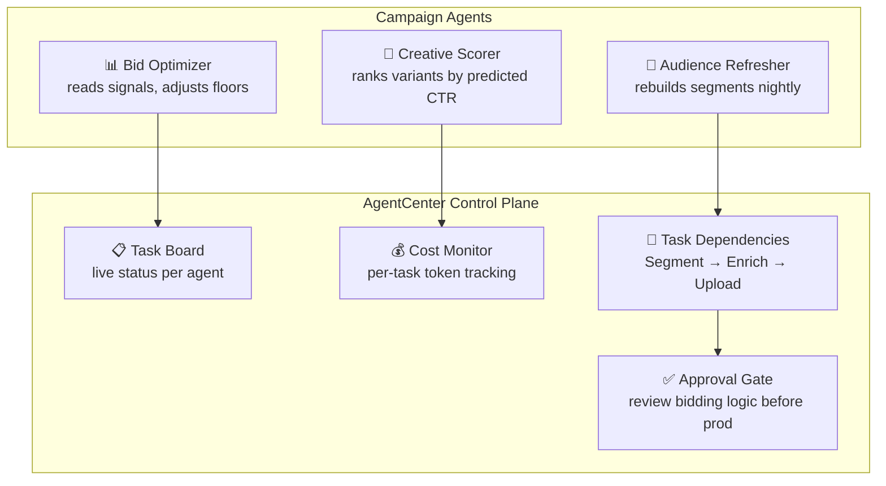

Ad tech engineering teams move fast. A bidding agent that runs stale models for six hours isn't just a technical problem — it's budget waste at scale. Creative rotation agents that silently fail overnight mean your highest-performing ads stop serving and nobody knows until Monday morning when the CTR report looks off.

The agents are already there. The visibility isn't.

## The Real Problem for Ad Tech Teams

Most ad tech teams didn't plan for a control plane. They deployed one agent to help with bid price optimization, then added a creative scoring agent, then an audience segment refresh agent, then a frequency cap monitor. Now there are a dozen agents touching live production traffic and the only way to know if one failed is to check logs manually.

Three specific things break without a control plane:

**Bid optimization agents drift silently.** The model powering your bid adjustments was valid three weeks ago. Since then, your campaign mix shifted, conversion windows changed, and three new competitors entered your top placements. The agent is still running. The bids are still going out. The ROAS is quietly declining and nobody can tell if it's market conditions or a stale agent.

**Token costs spike during creative analysis.** An agent processing ad creative — image metadata, copy variants, engagement signals — can consume 10x the expected tokens if it starts re-processing assets it already scored. Without per-agent cost tracking, this shows up as an unexplained spike in your LLM bill at the end of the month. By then, the agent has already burned through two months of budget in three days.

**Audience refresh pipelines fail at the handoff.** You have three agents in sequence: segment builder → score enrichment → DSP upload. If the enrichment step fails at 2am, the upload agent never runs. The DSP gets stale audiences. Your targeting degrades without a single alert firing because each agent completed its own task successfully — just never got valid input from the one before it.

## How Ad Tech Teams Use AgentCenter

### Real-time status across your agent fleet

The Kanban board in [AgentCenter's agent dashboard](/features/agent-dashboard) shows every agent's current state: working, idle, blocked, or errored. For ad tech teams, this matters most during peak hours. When a campaign is spending $50k/day, knowing your bid optimizer went idle at 9am — without a task assigned — takes seconds to spot instead of hours to debug through logs.

### Per-task cost tracking for creative and analysis agents

Creative analysis agents are expensive to run poorly. AgentCenter's [agent monitoring](/features/agent-monitoring) tracks token usage per task, per agent, per day. When your creative scoring agent's cost per task jumps from $0.04 to $0.38, you see it as a spike in the monitoring view. You can trace it to a specific task batch, identify the root cause (usually asset encoding or prompt expansion), and fix it before it compounds.

### Enforced task dependencies for multi-step pipelines

The segment → enrich → upload pipeline fails silently because each step doesn't know if the previous one produced valid output. AgentCenter's task dependency system blocks the downstream agent from starting until the upstream task is marked complete and reviewed. If the enrichment step errors, the upload agent stays paused and your team gets a blocked-task alert instead of a silent failure.

### Approval workflows before new bidding logic goes live

When your engineering team wants to change bid floor logic, that change needs to run through a review before it touches live spend. AgentCenter's deliverable review workflow lets you route the agent's output — the new bid parameters — to a named reviewer before the agent acts on them. A human approves or rejects the change. The audit trail records who approved it and when. No more "who pushed the bid change last Thursday" post-mortems.

## The Numbers for Ad Tech Engineering Teams

A typical ad tech team runs 8 to 20 agents covering bidding, creative, audience, reporting, and anomaly detection. Some teams run more during active campaign periods.

The **Pro plan** ($29/month) handles up to 15 agents and fits most ad tech teams that run 2–5 core pipeline agents plus 5–10 supporting monitors and report agents. Teams with full programmatic stacks — DSP integrations, multi-network bidding, real-time audience refresh — tend to hit the **Scale plan** ($79/month) for 50 agents and more projects.

AgentCenter replaces:
- Spreadsheets tracking which agents are live
- Slack threads to confirm if the nightly audience refresh ran
- Manual log checks to debug why the DSP upload got stale data
- Guesswork about which agent drove the LLM bill spike

## Before vs After: Ad Tech Teams Managing AI Agents

| | Without AgentCenter | With AgentCenter |
|---|---|---|
| **Visibility** | Check logs per agent, no unified view | Live task board shows all agent states at once |
| **Task handoffs** | Silent failures between pipeline stages | Blocked tasks alert immediately, upstream errors are visible |
| **Error detection** | Spotted during end-of-day reporting | Catch errors as they happen during the run |
| **Cost tracking** | Monthly LLM bill with no breakdown | Per-agent, per-task token spend in real time |
| **Debugging time** | 2–4 hours tracing logs across agents | 15 minutes in the activity feed and task history |

## Where to Start

Set up agent monitoring before anything else. Connect your highest-cost agent — usually the creative analysis or bid optimization agent — and track token cost per task for one week. You'll almost certainly find tasks costing 5–10x more than expected due to unintended re-processing or prompt expansion. Fixing that pays for the tool immediately.

Then set up task dependencies for your audience pipeline. It takes 20 minutes to configure in AgentCenter and eliminates the category of silent handoff failures that show up as unexplained targeting degradation in your campaign reports.

Everything else — approval workflows, cost alerts, recurring task automation — follows naturally once those two things are visible.

---

*Ad tech teams that add a control plane early spend less time firefighting and more time shipping. [Start your 7-day free trial](/pricing).*
