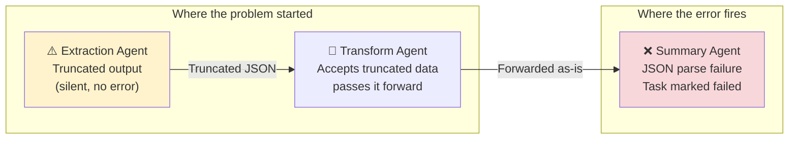

We had a pipeline agent fail on a Tuesday afternoon. The error was clear: `Tool call failed: unable to parse JSON response`. The agent was pulling extracted data from an upstream step and summarizing it into a structured report. The JSON it received was malformed. It couldn't proceed.

We spent four hours on the summarization agent. Rewrote the output parser. Adjusted the prompt. Added retry logic. Nothing changed.

The actual problem: an extraction agent three steps upstream had been returning truncated JSON for two days. Not because it was broken — because the documents it was processing had gotten longer after a product team updated a content template. The extraction agent hit a response size limit, truncated silently, and passed the result along. The summarization agent got garbage and reported a failure.

We'd been debugging the fire. The spark was somewhere else entirely.

## The gap between where errors surface and where they start

In single-agent systems, this doesn't happen much. The agent takes input, runs, and either succeeds or fails. The failure is usually local. You look at the agent that failed, and that's where the problem is.

Multi-agent pipelines break that assumption completely.

The error log says: `Summary Agent failed`. That's accurate. It's also misleading, because the summary agent did exactly what it was supposed to do. It received broken input and couldn't parse it. That's a reasonable failure. The cause is two agents upstream.

This pattern shows up in three ways:

**Silent data degradation.** An upstream agent produces output that passes a basic schema check but is subtly wrong — truncated, partially filled, missing fields. The downstream agent processes it without complaint, then fails later in a way that looks unrelated.

**Context contamination.** An agent carries state from a previous run that should have been cleared. It makes decisions based on that stale context. The failure surfaces a few steps later, in a completely different agent.

**Tool result drift.** An external API your pipeline depends on changes its response format — subtly, not in a breaking way. The first agent to call it accepts the new format. Every agent downstream that expected the old format starts failing.

In all three cases, the error log points you to the agent that failed. The actual cause is earlier in the chain.

## Why this is so hard to catch

Software debugging trains you to start at the exception. Stack trace points to line 47. You look at line 47. That's where your attention goes.

Agents don't have stack traces across steps. You get an error from agent C. Nothing in that error tells you that agent A is what caused it, or that agent B passed the bad data through without flagging it.

You also can't reproduce it easily. Multi-agent pipelines run asynchronously against live data. The document that caused the truncation may not be in your test set. The stale context may not appear until the pipeline has run a few times. You test the summary agent in isolation, it works fine, and you conclude the problem must be something else.

It usually isn't. The problem is usually right there — just two steps back from where you're looking.

## What you actually need to debug this

Logs from the failing agent won't get you there. You need three things:

**Full execution traces per task.** Not just the last step — every step, with the inputs that step received and the outputs it produced. If step 3 produced truncated JSON, that should be visible in the trace before step 5 even ran.

**Cross-agent task lineage.** When agent C fails, you should be able to pull up the full chain: which agent ran before it, what it sent, what came before that. Without lineage, you're guessing.

**Tool call audits.** What did the external API actually return, not what the agent reported back. An agent that gets a malformed response and silently passes it along will look clean in its own logs. The tool call record won't.

This isn't exotic observability. It's the minimum for a pipeline with more than two steps. AgentCenter's [agent monitoring](/features/agent-monitoring) captures execution traces and task lineage across connected agents, so when something fails, you can see the full chain, not just the final error.

## Who this hits hardest

Teams that built their monitoring around single-agent error alerts. One agent, one alert, one fix. That model works for the first few months. The moment you chain agents together into a real pipeline, it falls apart.

It also hits teams that test agents in isolation. You test the summary agent. You test the extraction agent. They both pass. You deploy them together and things break. The integration path — how agent A's output lands in agent B's input — is what you didn't test.

The teams that figure this out fastest are the ones who start instrumenting handoffs between agents, not just the agents themselves. Not what each agent did, but what each agent sent.

## The honest caveat

You can't trace upstream causes if your agent framework doesn't give you access to cross-step data. Some setups log per-agent and nothing else. If that's where you are, start manually logging the inputs each agent receives at the start of each run — before any processing. It's not elegant, but it gives you something to look at when step 5 fails and you need to know what step 3 actually sent.

The more agents you chain together, the more this matters. At 2 or 3 agents, you can trace it manually. At 8 or 10, you need the tooling.

## Who this matters for

If you're running connected agent pipelines — extraction, transformation, summarization, review in sequence — and your debugging process starts at the agent that failed, you'll spend a lot of time fixing the wrong thing.

It happens on the first real production incident. You debug the last agent. You fix the last agent. The incident happens again. You debug the last agent again. Eventually someone says "wait, what did the previous agent actually send?" and that's the moment things start making sense.

You don't have to wait for that moment. Build in the trace collection now, before the second incident.

---

*The dashboard won't fix a broken agent. But it will tell you which one is broken at 3am. [Try AgentCenter free](/pricing).*
