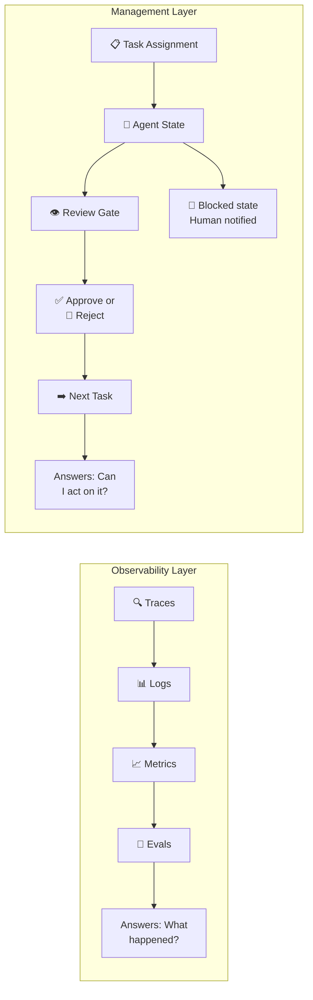

There's a category confusion happening in AI infrastructure right now. A lot of teams think they have agent management because they have traces. They have observability. That's not the same thing.

The distinction matters because it changes what you can actually do when something goes wrong.

## What Observability Gives You

Observability is about answering the question: "What happened?"

Good observability means you can trace an agent's behavior after the fact. You can see which tools it called. You can inspect the prompt that ran. You can look at the token counts and latency for each step. You can understand, in retrospect, why an agent produced a specific output.

Tools like LangSmith, AgentOps, and Langfuse are excellent observability tools. They're built for developers who need to debug and understand agent behavior. They give you detailed traces of what happened, when it happened, and what inputs produced what outputs.

That's genuinely valuable. But it's not management.

## What Management Gives You

Management is about answering the question: "What can I do right now?"

Agent management means you can assign tasks. You can see which agents are working, blocked, or idle. You can pause an agent before it processes more bad inputs. You can route a deliverable to a human reviewer before it goes downstream. You can reassign a task when an agent is stuck.

Management is operational control. The ability to intervene in real time, not just review what happened afterward.

## The Gap

Here's the problem: most observability tools don't give you management. You can see that an agent is in a retry loop. You can't pause it from the dashboard. You can see that an agent produced a low-quality output. You can't hold it for review before it propagates. You can trace that Agent B received bad input from Agent A. You can't reroute the pipeline.

You become an observer of a system you can't control.

This is fine for developer debugging workflows. It's not fine for production operational control. When something is going wrong at 2am, you don't want to read traces and make a Jupyter notebook. You want to click a button.

## Where People Get Confused

The confusion comes from the word "monitoring." Both observability tools and management platforms claim to do monitoring. They mean different things.

Observability monitoring: "Here are the metrics and traces from your agents."
Management monitoring: "Your agent has been blocked for 18 minutes. Here's what it's waiting for. Click here to resolve it."

The first is passive. The second is actionable.

## How AgentCenter Fits

AgentCenter is a management platform. It's designed for the operational question: "What is my agent doing right now, and can I act on it?"

The [agent monitoring features](/features/agent-monitoring) show current state, not historical traces. If an agent is blocked, you see it. If a deliverable needs review, it's in the queue. If a task has been running 3x longer than expected, it's flagged.

You can also use observability tools alongside AgentCenter. Use LangSmith to trace individual runs when debugging a specific behavior. Use AgentCenter to coordinate the fleet and intervene when something's wrong. They complement each other.

## What the Reader Should Take Away

If your current setup tells you what happened but doesn't let you do anything about it in real time, you have observability without management. That's useful for debugging, but it's not sufficient for running agents in production where things need human oversight and intervention.

Ask this question: if an agent goes off-track right now, how quickly can I notice and stop it? If the answer is "check the logs later," you have an observability gap.

## Who This Matters Most For

This distinction matters most for teams running agents that produce outputs that go directly to customers, systems, or decisions. When the downstream consequences of bad agent output are significant — a wrong customer communication, a bad financial calculation, an incorrect record written to a database — observability alone isn't enough. You need the ability to intervene.

## Honest Caveat

Management tooling helps you act on problems. It doesn't eliminate the need for good observability. You need both — observability to understand what happened, management to act on what's happening. The mistake is assuming one covers the other.

_The dashboard won't fix a broken agent. But it will tell you which one is broken at 3am. [Try AgentCenter free](/pricing)._
