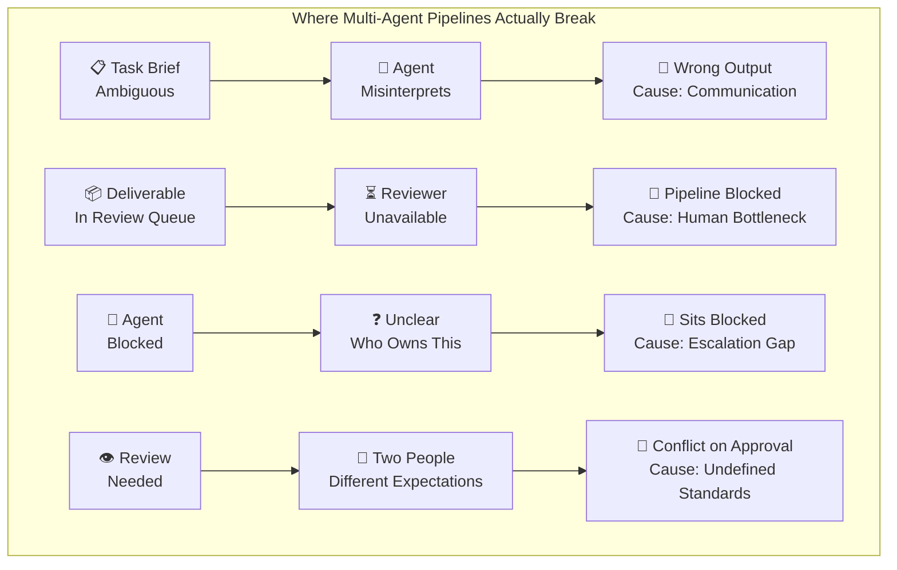

Most multi-agent pipeline failures get attributed to the agents. The wrong model. The bad prompt. The hallucinating LLM.

When we've actually traced production failures back to their root cause, the most common problem isn't the agents. It's the coordination between people around the agents.

This took me a while to see clearly.

## The Coordination Problems That Actually Break Pipelines

**The ambiguous brief.** Someone creates a task for an agent. The task description is clear to the person who wrote it. The agent interprets it differently. The agent produces the wrong output. This isn't an agent failure — it's a communication problem between the human who wrote the brief and the agent that received it.

**The slow reviewer.** An agent submits a deliverable for review. The reviewer is in meetings all day. The deliverable sits in the queue for 6 hours. The next agent in the pipeline is idle for 6 hours. The pipeline's throughput is determined by human review speed, not agent speed.

**The unclear escalation path.** An agent hits an edge case it can't handle. It marks itself as blocked. Nobody knows who's responsible for resolving the block. It sits blocked for two days before someone notices.

**The undocumented expectation.** Two people on the team have different expectations for what a deliverable should look like. One thinks the summary agent should produce 200 words. The other thinks 500. The agent produces 350. Both reviewers disagree on whether to approve it. The conflict is between the people, not the agent.

## Why This Framing Matters

If you think pipeline failures are agent problems, you invest in better models and prompts. Sometimes that helps. Often it doesn't, because the actual cause is elsewhere.

If you think pipeline failures are coordination problems, you invest in clearer task briefs, faster review workflows, documented escalation paths, and explicit quality standards. These interventions address the actual failure modes.

The agent is often working exactly as designed. The surrounding human process is the weak link.

## What Good Team Coordination Looks Like Around Agents

**Task briefs with acceptance criteria.** Every task assigned to an agent should include explicit acceptance criteria: what does "done" look like? What are the constraints? What should the agent do if it's uncertain? Brief-writing is a skill. It's worth investing in.

**Committed review windows.** If an agent submits a deliverable, someone reviews it within 4 hours during business hours. If nobody can commit to that SLA, the pipeline throughput is bounded by reviewer availability, and you should know that upfront.

**Named escalation owners.** For each type of agent block, there's a named person responsible for resolving it. "The team" is not a person. If the research agent hits an ambiguous source, [Name] makes the call. If the code agent hits a permissions issue, [Name] handles it. Write it down.

**Shared quality standards, written down.** What does an approved summary look like? What level of detail does the analysis agent need to include? These standards need to be explicit and shared. When reviewers disagree, they reference the written standard, not their gut.

## How AgentCenter Helps With Coordination

The [agent dashboard](/features/agent-dashboard) shows blocked agents in real time. When an agent is stuck, it's visible immediately. That changes the response from "we found out two days later" to "we see it now and can act."

The @mentions and chat threads in AgentCenter put conversations about specific tasks in context. Instead of Slack messages that lose their connection to the original deliverable, the discussion lives alongside the task. The escalation conversation, the clarification question, the review decision — all attached to the deliverable they're about.

The review queue with named reviewers and time-in-queue tracking makes slow reviews visible before they become pipeline blockages.

## The Honest Admission

Better agents don't fix coordination problems. A GPT-4 model won't resolve ambiguous task briefs any better than the model you're currently using — it'll just produce a wrong output more confidently.

The investment that improves multi-agent pipeline performance most reliably is in the human process: clearer briefs, faster reviews, better escalation paths. Agents amplify the quality of the coordination around them. If coordination is poor, adding better agents makes the problems larger and faster.

## Who This Matters Most For

This matters most for teams where agents and humans collaborate closely — where the pipeline isn't fully automated end-to-end and humans make decisions at multiple points. The more humans are involved in the pipeline, the more the coordination problem dominates.

Fully automated pipelines with no human review have different failure modes (mostly quality-related). Hybrid pipelines where humans review, approve, and escalate — those are coordination problems wearing the mask of agent problems.

_The dashboard won't fix a broken agent. But it will tell you which one is broken at 3am. [Try AgentCenter free](/pricing)._
