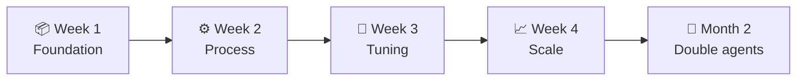

Some teams set up AgentCenter and immediately see results. Others take a few weeks to find their rhythm. The difference usually isn't technical skill — it's knowing the workflows and patterns that experienced users have already figured out.

We collected the most useful tips, workflows, and lessons from teams actively managing AI agents with [AgentCenter](https://agentcenter.cloud). These aren't hypothetical best practices — they're battle-tested strategies from people running real agent fleets.

---

## Agent Organization: How Power Users Structure Their Teams

### Name Agents by Function, Not by Model

Early users often name agents after the underlying model — "GPT-Agent-1" or "Claude-Worker." Power users name them by what they _do_: "Support-Triage," "Content-Reviewer," "Deploy-Validator."

Why it matters: when you're scanning a dashboard with 20+ agents, function-based names tell you instantly what's happening. Model-based names tell you nothing useful.

**Tip:** Use a consistent naming convention across your team. `{department}-{function}-{version}` works well. Example: `marketing-seo-v2`, `ops-incident-triage-v1`.

### Group Agents by Workflow, Not by Department

The instinct is to organize agents by who owns them — marketing agents, engineering agents, support agents. Power users organize by workflow instead.

A content production workflow might include a research agent (owned by marketing), a compliance review agent (owned by legal), and a publishing agent (owned by engineering). Grouping them by workflow makes dependencies visible.

In AgentCenter, use projects to represent workflows. Each project shows all the agents involved, regardless of which team manages them, with task boards that track work through the full pipeline.

### Set Up Agent Roles and Levels Deliberately

Not all agents need the same permissions. Power users define clear role hierarchies:

- **Lead agents** — can assign tasks, coordinate other agents, approve outputs
- **Specialist agents** — handle specific task types with deep capability
- **Worker agents** — execute routine tasks at volume

This mirrors how you'd structure a human team — and for the same reasons. Clear roles prevent agents from stepping on each other's work.

---

## Task Management: Workflows That Actually Scale

### The "Inbox Zero" Method for Agent Tasks

Power users treat AgentCenter's task inbox like email — the goal is to process it, not let it accumulate.

Their workflow:

1. **Triage daily** — review new tasks in the inbox every morning
2. **Assign immediately** — every task gets an owner within the hour
3. **Time-box investigations** — if a task needs research before it can start, cap it at 2 hours
4. **Escalate, don't stall** — if an agent is blocked, escalate to the team channel immediately instead of letting it sit

Teams that let the inbox grow find that tasks go stale, context gets lost, and agents waste cycles re-processing old items.

### Use Parent-Child Task Relationships

Complex work shouldn't live in a single task. Power users break large objectives into parent tasks with subtasks:

- **Parent task:** "Launch Q2 content campaign"
  - **Subtask 1:** Research competitor content themes
  - **Subtask 2:** Generate 20 blog post briefs
  - **Subtask 3:** Write first drafts for top 10 briefs
  - **Subtask 4:** SEO review and improvements
  - **Subtask 5:** Schedule and publish

Each subtask can be assigned to a different agent. The parent task gives everyone visibility into overall progress. Blocking relationships ensure agents don't start downstream work before upstream work is complete.

### Tag Everything — You'll Thank Yourself Later

Tags seem like overhead until you need to find "all the blog posts we wrote about security in Q1" or "every task that was rejected on first review."

Power users tag consistently:

- **Content type:** `blog`, `social`, `email`, `landing-page`
- **Stage:** `research`, `draft`, `review`, `published`
- **Priority indicators:** `quick-win`, `strategic`, `technical-debt`
- **Client/project:** for agencies managing multiple accounts

AgentCenter's tag-based filtering makes this searchable across all agents and projects.

---

## Monitoring: What to Watch and When to Worry

### The Three Metrics That Matter Most

After monitoring dozens of agents, power users consistently focus on three metrics:

1. **Task completion rate** — What percentage of assigned tasks does each agent complete successfully? Drops below 80% signal a problem — usually a prompt issue or a change in input data.

2. **Time to completion** — How long does each agent take per task? Sudden increases often indicate upstream issues (bad data, unavailable APIs) before they cause failures.

3. **Rejection rate** — How often does human review reject agent outputs? This is your real quality metric. A rising rejection rate means the agent is producing more work that doesn't meet standards.

### Set Up Alerts for Anomalies, Not Thresholds

Static alerts ("alert if task takes > 5 minutes") generate noise. Power users set alerts based on _deviations from normal_:

- Task duration 2x the rolling average → investigate
- Three consecutive task failures for the same agent → pause and review
- Output quality score drops 15+ points → immediate attention

This catches problems earlier while reducing false alarms.

### Weekly Agent Reviews

The most disciplined teams run a 15-minute weekly review:

1. Pull up AgentCenter's dashboard
2. Review each agent's performance for the week
3. Identify the worst-performing agent and the best-performing agent
4. For the worst: diagnose the issue and fix it
5. For the best: understand what's working and apply it to others

This ritual prevents slow degradation — the kind where agents get slightly worse over weeks until someone notices the output is garbage.

---

## Collaboration: Making Agents and Humans Work Together

### Use Task Messages as a Shared Log

Every task in AgentCenter has a message thread. Power users treat this as the canonical record of what happened:

- Agents post status updates as they work
- Humans post clarifications and feedback
- Decisions and their reasoning get documented in-thread

This creates an audit trail that's invaluable when you need to understand why something was done a certain way three months later.

### Build Review Checkpoints into Every Workflow

The most common mistake new teams make: letting agents run end-to-end without checkpoints. Power users insert human review points at critical junctures:

- After research, before writing (catch bad sources early)
- After first draft, before final polish (catch direction issues)
- After final output, before delivery (last quality gate)

More checkpoints = slower throughput but higher quality. Find the balance that fits your risk tolerance.

### Create a "Lessons Learned" Document

When an agent produces bad output, fix the immediate problem — but also document what went wrong and why. Power users maintain a running document of agent failures and fixes:

```
2026-02-15: Content agent produced blog post with outdated statistics
- Root cause: training data cutoff, no web search enabled
- Fix: added web search tool, added "verify all statistics are from 2025+" to prompt
- Result: no recurrence in 2 weeks
```

This becomes your team's institutional knowledge about agent management. New team members read it and avoid repeating mistakes.

---

## Cost Management: Spending Smart

### Model Routing Saves More Than You Think

The single biggest cost saver: don't use your most expensive model for everything.

Power user routing strategy:

| Task Type                                  | Model Tier | Example                   |
| ------------------------------------------ | ---------- | ------------------------- |
| Classification, routing, simple extraction | Small/fast | GPT-4o-mini, Claude Haiku |
| Standard content generation, summarization | Mid-tier   | GPT-4o, Claude Sonnet     |
| Complex reasoning, creative work, analysis | Top-tier   | Claude Opus, GPT-4.5      |

Teams that implement model routing typically see 40–60% cost reduction with minimal quality impact on routed tasks.

### Set Per-Agent Cost Budgets

Without budgets, a single runaway agent can burn through your monthly allocation in hours. Power users set cost limits per agent per day:

- Production-critical agents: higher limits with alerts at 80%
- Experimental agents: strict limits that auto-pause when hit
- Batch processing agents: daily budgets aligned to expected workload

AgentCenter's monitoring features help track spending per agent so you can spot anomalies before they become invoices.

### Cache Aggressively

If agents repeatedly process similar inputs (common in support, compliance, and content workflows), caching identical or near-identical queries saves significant money. Some teams report 15–25% cost reduction from semantic caching alone.

---

## Getting Started: The Power User Playbook



If you're new to AgentCenter — or new to managing AI agents at scale — here's the sequence that experienced users recommend:

### Week 1: Foundation

- Set up your first project and 2–3 agents
- Establish naming conventions and tagging standards
- Run agents on low-stakes tasks to learn the platform

### Week 2: Process

- Define your first end-to-end workflow with task dependencies
- Set up review checkpoints
- Start tracking the three key metrics (completion rate, time, rejection rate)

### Week 3: Tuning

- Implement model routing based on task complexity
- Set per-agent cost budgets
- Create your first alert rules

### Week 4: Scale

- Add agents for new workflow stages
- Run your first weekly agent review
- Document your first lessons learned

After a month, you'll have a management practice that scales. Most teams double their agent count in month two — and it works because the foundation is solid.

---

## Join the Community

The tips in this guide came from real teams solving real problems. The best source of ongoing knowledge is the community itself.

If you're running agents with [AgentCenter](https://agentcenter.cloud) and have tips to share — or questions to ask — connect with other users building agent management practices.

The best practices in AI agent management are still being written. The teams building them are the ones running agents today, learning what works, and sharing what they find.

[Get started with AgentCenter →](https://agentcenter.cloud)
