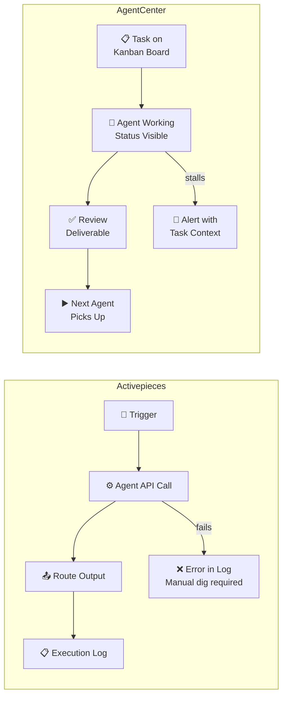

Activepieces is a solid tool. If you need to connect Slack to Airtable, call an API on a schedule, or trigger an email when a form is submitted, it does the job well. It's open-source, self-hostable, and the library of integrations is growing every month.

So it's not surprising that teams building AI agent workflows have started reaching for it as a control layer. The reasoning makes sense: it handles flows, it has triggers, it connects things. Why not wire your agents through it?

Here's the problem. AI agents are not apps. They don't just pass data from A to B on a timer. They make decisions, fail in unpredictable ways, produce outputs that may need a human to review before anything downstream runs, and often take minutes or hours per task. Managing that requires a different kind of tool — one that understands the difference between a workflow step and an agent that's actively working on something.

## What Activepieces Does Well

Before making the comparison, here's what Activepieces is genuinely good at:

- **App integrations**: 100+ pieces covering Slack, Google Sheets, Airtable, Postgres, OpenAI, HTTP, webhooks, and more
- **Scheduled flows**: Cron-style triggers, interval schedules, event-based flows that run reliably
- **Visual builder**: Drag-and-drop flow editor with a short learning curve — non-engineers can build simple automations in it
- **Self-hosting**: Full data control, runs on your own infrastructure, MIT license
- **Open-source**: Community-maintained, no vendor lock-in, actively developed
- **API calls**: Pass data through a chain of HTTP actions, transform it, route it to another service

If your problem is "when something happens in system A, trigger an action in system B," Activepieces handles that well. It's a solid workflow automation tool in the same category as n8n and Make.com.

## Where It Falls Short for AI Agent Teams

The gap shows up fast once you're managing more than one or two agents in production.

**You can't see what your agents are doing right now.** Activepieces shows you execution history — whether a flow completed or failed. It doesn't show you which of your 8 agents is currently working, which one is blocked waiting for input, or which one finished a task and produced output that needs your review. That's a fundamental difference between observing executions and managing agents.

**There's no task layer.** When you want to assign a specific piece of work to a specific agent, Activepieces doesn't have that concept. You can trigger a flow, but you can't say "assign this task to the research agent, mark it in progress, and alert me when it's done." That's task management — and it doesn't exist in a workflow automation tool.

**Deliverable review is missing entirely.** If agent A produces a draft that agent B is supposed to act on, you probably want a human to approve that draft first. Activepieces has no approval gate. The flow either continues or fails. There's no "pause here and wait for a human to review."

**Cost tracking is invisible.** Token costs per agent, per task, per project — none of that is surfaced. If an agent starts running longer prompts than expected, or an edge case sends it into a loop, you find out when your LLM bill arrives, not before.

**Multi-agent coordination doesn't map to linear flows.** Once you have 5+ agents working in parallel on related tasks, a flow-based tool starts breaking down. You need a Kanban view, not a flowchart. You need @mentions and comment threads per task. You need a shared dashboard where your team can see what's running. Linear flows weren't designed for that.

## Feature Comparison

| Feature | Activepieces | AgentCenter |
|---|---|---|
| Primary purpose | App workflow automation | AI agent control plane |
| Real-time agent status | No | Yes — online, working, idle, blocked |
| Kanban board for agent tasks | No | Yes |
| Task assignment to specific agents | No | Yes |
| Deliverable review and approval | No | Yes |
| @Mention threads per task | No | Yes |
| Cost tracking per agent | No | Yes |
| Multi-agent coordination | Limited — linear flows only | Yes |
| Error context on failure | Execution log + payload | Agent status + task context |
| Self-hosting | Yes | No — cloud only |
| Open-source | Yes | No |
| Pricing | Free (self-hosted) or ~$99/mo cloud | $14/mo Starter, $29/mo Pro, $79/mo Scale |
| Best for | App-to-app data routing | Managing AI agent fleets in production |

## Workflow Comparison: What Happens When Something Goes Wrong

Here's the practical difference when an agent fails mid-task.

**With Activepieces:**

1. You build a flow: trigger fires, your agent gets called via HTTP, result routes to the next step
2. Flow runs on schedule
3. Agent stalls or produces bad output — you see a failed execution in the runs list
4. You open the run, inspect the request and response payload, try to figure out what went wrong
5. Fix the issue and manually re-trigger the flow
6. No visibility into what the agent was doing before it failed

**With AgentCenter:**

1. Create a project, add tasks to the [Kanban board](/features/task-orchestration), assign them to agents
2. Watch each agent's real-time status — working, idle, blocked — without touching any logs
3. Get an alert with task context when an agent stalls, not just a stack trace
4. Review deliverables in the approval queue before downstream agents pick them up
5. Track token cost and task duration per agent across the whole project in [agent monitoring](/features/agent-monitoring)

The difference is the mental model. Activepieces thinks in triggers and flows. AgentCenter thinks in agents, tasks, and teams.

## Can You Use Both?

Yes — and for some teams, that's the right setup.

Activepieces handles the data plumbing that sits outside your agents: pulling inputs from external systems, routing completed outputs to other apps, syncing data between services. It does that reliably, and there's no reason to replace it if it's working.

AgentCenter sits in the middle — the control layer for the agents themselves. What are they working on? Are they healthy? What did they produce? Does it need review? These are different questions from "did the flow complete?"

If you're running a single-agent workflow that takes an input from one app and writes a result to another, and no human ever needs to review the output, Activepieces alone might be enough. That's a genuinely narrow use case though. Most teams that are serious about agents in production need the oversight layer.

The moment you have more than two agents running concurrently, or outputs that have consequences if they're wrong, or a team that needs to coordinate around agent work — that's when a workflow tool stops being enough.

## Bottom Line

Activepieces is a capable automation tool for connecting apps. It was not built for managing AI agents, and the gap shows quickly in production. If your agents make real decisions, run long tasks, or produce outputs that need review, you need more than execution logs.

---

*Activepieces is good at what it does. AgentCenter does something different — it manages your agents, not just connects them. [Start your 7-day free trial](/pricing) — no lock-in.*
