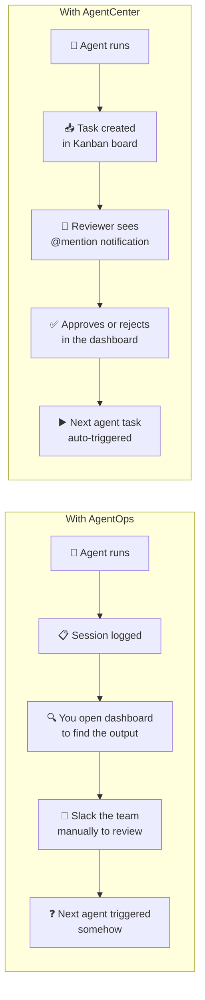

You've got a few agents running. Something fails, and you have no idea which one. A teammate asks what the agents did last Tuesday. You want to pause one agent while you fix a prompt, but there's no pause button.

AgentOps tells you what your agents did. AgentCenter lets you decide what they do next.

That's the core difference. Both tools are genuinely useful. They solve different problems.

## What AgentOps Does Well

AgentOps is an observability platform built specifically for AI agents. It's a solid tool for developers who want to see inside their agent runs.

- **Session recording**: Every LLM call, tool invocation, and token count is captured automatically
- **Error tracking**: Exceptions surface in a dashboard without extra instrumentation
- **Replay**: You can step through a session chronologically to understand what went wrong
- **SDK integrations**: Drops into most Python agent frameworks in under 10 lines
- **Cost tracking per run**: Token spend is visible per session, not just as a monthly total
- **Multi-agent tracing**: Follows events across agents in a single session graph

If you're debugging a failing agent run and want a trace, AgentOps is genuinely good at that.

## Where AgentOps Stops

Observability tells you what happened. It doesn't tell you what to do about it.

Your agents produce outputs. Someone on your team needs to review them. Tasks move through stages. New work gets assigned. Some agents should run on a schedule. One agent is blocked waiting for another. None of that is a trace problem.

AgentOps captures state. It doesn't manage it.

Once you have more than 3–4 agents running regularly, you stop debugging individual sessions and start coordinating work across a fleet. You need a place to see which agents are active, what they're working on, which outputs need review, and who owns what. That's a control plane, not an observability layer.

## AgentCenter vs AgentOps — Feature Comparison

| Feature | AgentOps | AgentCenter |
|---|---|---|
| LLM call tracing | Yes | No |
| Session replay | Yes | No |
| Error capture per run | Yes | Yes (task-level) |
| Cost tracking | Per session | Per task, per agent, per project |
| Task management (Kanban board) | No | Yes |
| Agent status (online / idle / blocked) | No | Yes |
| @Mentions and task comments | No | Yes |
| Deliverable review and approval | No | Yes |
| Recurring task automation | No | Yes (Pro+) |
| Multi-agent workflow coordination | No | Yes |
| Team collaboration features | No | Yes |
| Cloud VM provisioning | No | Yes (Scale) |
| Pricing | Free + usage-based | From $14/mo |
| Target user | Individual devs debugging | Teams managing agents in production |

## Workflow Comparison

Here's the same scenario handled two different ways.

**Scenario:** You have a content research agent that runs daily, produces a summary, and needs a human to approve it before the output goes to the next agent.

**Their way (AgentOps):** The agent runs, AgentOps captures the session, you open the trace dashboard to find the output, copy it somewhere, Slack your teammate to look at it, and manually kick off the next step when they respond.

**AgentCenter way:** The agent runs, a task card appears in the Kanban board, your teammate gets an @mention, they review and approve in the dashboard, and the next agent's task is triggered automatically.

The trace was never the bottleneck. The handoff was.

## Can You Use Both?

Yes, and for some teams it makes sense.

If you have complex agent runs where prompt debugging matters, AgentOps gives you visibility into LLM calls that AgentCenter doesn't capture. Run AgentOps for session-level debugging. Run AgentCenter for workflow coordination and team handoffs.

The overlap is minimal. AgentOps answers "why did this run fail?" AgentCenter answers "what is this agent supposed to do today, and did it?"

Most teams find they reach for AgentCenter daily and open AgentOps when something goes wrong. See [how AgentCenter compares to AgentOps](/compare/vs-agentops) on the dedicated comparison page.

## Bottom Line

AgentOps is a good trace tool. It's the right choice when you need to debug individual agent sessions or review LLM call chains. AgentCenter is a control plane for teams running agents in production. It handles task assignment, workflow coordination, deliverable review, cost visibility, and the day-to-day of keeping a fleet of agents working on the right things.

If your team is past the "debugging a single agent" phase, you need both layers, and they don't step on each other.

Explore AgentCenter's [agent monitoring](/features/agent-monitoring) and [task orchestration](/features/task-orchestration) features to see where it fits your workflow.

---

*AgentOps is good at what it does. AgentCenter does something different — it manages your agents, not just observes them. [Start your 7-day free trial](/pricing) — no lock-in.*
