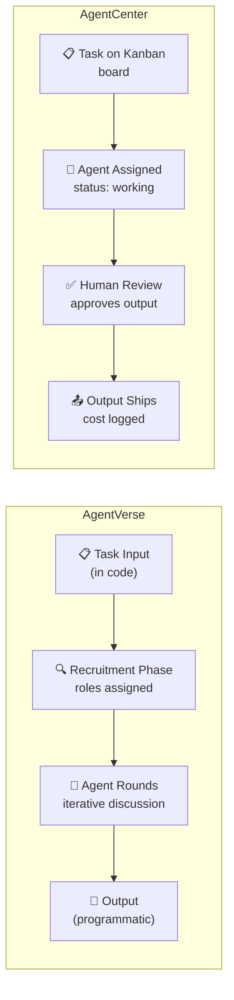

AgentVerse came out of real multi-agent research at OpenBMB. If you've worked through the papers or tested the demos, you'll know it solves a specific problem well: how do you get multiple LLMs to divide a complex task, take on different roles, and produce a coherent result? The framework handles that.

But once you're running agents in production, the problem shifts. You're not trying to choreograph a discussion between LLM instances. You need to know which agent is stuck, what it's costing you per task, and who signed off on the output before it reached your customer.

AgentCenter vs AgentVerse isn't a close comparison. They're built for different phases of the agent lifecycle. This post walks through exactly where each one fits.

## What AgentVerse Does Well

AgentVerse is a multi-agent collaboration framework. Here's what it genuinely gets right:

- **Role-based task decomposition**: You define a goal, AgentVerse recruits agents with specific roles (analyst, coder, reviewer, critic) and runs them through structured collaboration phases.
- **Controlled communication**: Agents exchange information through a message-passing protocol rather than unstructured API calls. This keeps the collaboration coherent across multiple rounds.
- **Simulation environments**: You can define bounded environments where agents interact and test behavior before exposing it to real workloads.
- **Open source with research depth**: The codebase is public and documented. If you want to understand how recruitment and decision phases actually work, you can read the source.
- **Flexible LLM backends**: AgentVerse works with multiple LLM providers, which matters if you're running comparison experiments.

For researchers exploring multi-agent dynamics and teams prototyping complex collaborative tasks, AgentVerse is a solid starting point.

## The Core Limitation for Teams Managing AI Agents

AgentVerse was designed for research and structured task solving. That design choice creates real gaps when you move to production.

There is no dashboard. When your agent pipeline stalls at 2am, you're reading log output. When a teammate asks how much your research-summarization pipeline spent on tokens last week, there's no view for that. When a compliance analyst needs to review and approve an agent's output before it goes to a client, there's no workflow for that either.

Think about what running 10 agents actually looks like. You have a research agent, a drafting agent, a QA agent, a data-extraction agent, and six more doing different work across different projects. At any point, any of them can stall, run over budget, or produce output that needs review. Knowing which one is broken and why requires visibility that a framework alone won't give you.

AgentVerse gives you the collaboration layer inside a single pipeline run. What's missing is the layer above: the dashboard that shows you what's running, what's blocked, what it's costing, and whether anyone approved the output.

That's the gap AgentCenter fills.

## AgentCenter vs AgentVerse

| Feature | AgentVerse | AgentCenter |
|---|---|---|
| Purpose | Multi-agent collaboration framework | Production control plane for AI agents |
| Interface | Python library, code-first | Web dashboard with real-time views |
| Task visibility | No built-in task board | Kanban board per project |
| Agent status tracking | Not included | Real-time: online, working, idle, blocked |
| Cost tracking | Not included | Per-agent and per-task token costs |
| Deliverable review | Not included | Approval workflows with human review |
| Multi-agent coordination | Core (recruitment + decision phases) | Task orchestration across agents |
| Team collaboration | Not designed for it | @Mentions, chat threads, shared views |
| Analytics | Not included | Activity feed, performance history |
| Recurring task automation | Not included | Pro+ plans |
| Pricing | Free, open source | Starter $14/mo, Pro $29/mo, Scale $79/mo |
| Best for | Research, prototyping, LLM experiments | Teams running agents in production |

## How Each Approach Works in Practice

The difference becomes real when you trace a task through each system.

**With AgentVerse:** You write Python to define roles, environment settings, and task parameters. Agents recruit, converse across rounds, and return output. You get the result as a function return value. What happens inside each round, how long it took, and what it cost are yours to instrument if you care about them.

**With AgentCenter:** You create a task on the Kanban board, assign it to an agent, and watch it progress in real time through the [agent monitoring dashboard](/features/agent-monitoring). When the agent finishes, the output lands in a review queue. A teammate approves or requests changes before it ships. The token cost is logged per task automatically.

### Handling a Failing Agent

**The AgentVerse way:**

1. Agent stalls or raises an exception mid-round
2. You check terminal output or add logging to your script
3. You identify the error from the trace
4. You modify the code, restart the run
5. No one else on your team knows this happened unless you tell them

**The AgentCenter way:**

1. Agent status flips to "blocked" in the dashboard
2. You see the failure context in the task thread
3. You fix the issue and reassign the task from the [task orchestration view](/features/task-orchestration)
4. The activity feed shows your teammate that the task was retried
5. The cost before and after the retry is tracked separately

The difference isn't just about tooling. It's about who can see what's happening and who can act on it without touching a terminal.

## What About Teams That Run Both?

You can. Some teams do.

AgentVerse handles collaboration logic inside a single complex pipeline. You define a multi-agent group that recruits, debates, and synthesizes. AgentCenter manages the fleet of agents running tasks across your projects and gives the team visibility into all of them.

One practical pattern: wire an AgentVerse pipeline as one of the agents in your AgentCenter setup. The AgentVerse group handles the internal task-solving collaboration. AgentCenter tracks whether that group started, how long it ran, what it cost, and whether the output passed review before it moved to the next stage.

The two layers don't step on each other. AgentVerse operates inside a single pipeline run. AgentCenter operates across your entire agent fleet.

## Where AgentCenter Fits in Your Stack

If you're at the prototyping stage, AgentVerse may be exactly what you need. You're running controlled experiments, you're reading output directly, and adding an ops layer would be overhead.

Once you're past that stage, the questions change fast. Your team grows from two engineers to five. Your agents go from three to fifteen. Someone in product wants a weekly summary of which agents ran, what they produced, and what they cost. An output went to a client before anyone reviewed it.

That's when a control plane pays off. AgentCenter is built for [teams managing agents at scale](/features/multi-agent-workflows), not for individual prototyping runs. The [pricing structure](/pricing) is designed to grow with you: Starter handles 5 agents, Pro handles 15, Scale handles 50.

## Bottom Line

AgentVerse is a legitimate research framework. For teams exploring multi-agent task decomposition and wanting to understand how LLMs can collaborate on a problem, it's worth testing.

AgentCenter sits at a different layer. It doesn't tell your agents how to think. It tells you what your agents are doing, whether they're blocked, what they're spending, and whether their output is ready to ship.

You need both layers. You just don't need to build the second one yourself.

---

*AgentVerse is good at multi-agent task solving. AgentCenter does something different: it manages your agents in production, not just runs them. [Start your 7-day free trial](/pricing) — no lock-in.*
