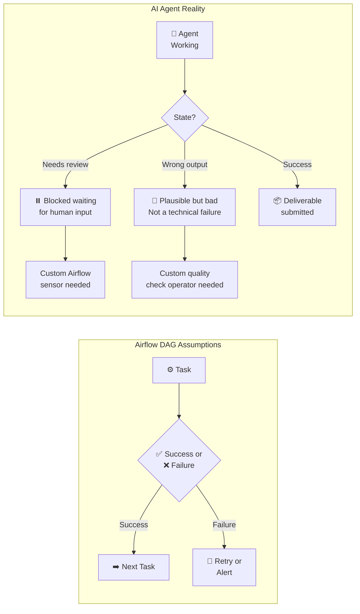

Apache Airflow has been the dominant orchestration tool for data pipelines for a decade. If your team already runs Airflow, it's natural to ask: can we use it for AI agents too? It has scheduling, retries, dependency management, and logging.

The honest answer is: you can. But Airflow was designed for deterministic data pipelines, and the friction with non-deterministic AI agents adds up.

## What Airflow Does Well

- DAG-based workflow orchestration for complex dependencies
- Mature scheduling: cron, sensors, event-based triggers
- Extensive operator library for data engineering tasks
- Strong retry and failure handling for deterministic steps
- Established operational patterns — most data engineers know it
- Good for ETL/ELT, ML pipeline triggers, batch data processing

Airflow is excellent for data engineering workflows where every task is deterministic and success/failure is binary.

## The Core Limitation for AI Agent Teams

Airflow's task model assumes determinism. A task either runs and succeeds, or it fails. "The task ran but the output quality is ambiguous" isn't a state Airflow has native support for.

AI agents introduce states that Airflow doesn't model well:

- The agent is running but may need human input to continue
- The agent produced a deliverable that needs review before the DAG continues
- The agent's output is plausible but probably wrong (not a failure, not a success)
- The agent needs to coordinate with another agent that's not in this DAG

Building these states into Airflow requires custom operators and sensors. Teams do it, but it's significant engineering work. You're building an agent management layer on top of a data pipeline tool.

## Comparison Table

| Feature                             | Apache Airflow                | AgentCenter           |
| ----------------------------------- | ----------------------------- | --------------------- |
| DAG orchestration                   | Yes (core)                    | Via task dependencies |
| Scheduling (cron, sensors)          | Excellent                     | Yes (Pro+)            |
| Deterministic pipeline support      | Excellent                     | Yes                   |
| Agent status (working/blocked/idle) | No (custom needed)            | Built-in              |
| Human-in-the-loop review            | No (custom needed)            | Yes, built-in         |
| Deliverable review workflow         | No                            | Yes                   |
| Non-engineer accessible             | No (code-first)               | Yes (dashboard)       |
| Cost per task tracking              | No                            | Yes                   |
| @mentions and team chat             | No                            | Yes                   |
| Self-hosting                        | Yes                           | Yes                   |
| Pricing                             | Free open source + infra cost | $14-$79/mo            |

## Workflow Comparison

**Running a multi-agent content pipeline in Airflow:**

1. Write DAG definition in Python
2. Write custom operator for human review step (with external task sensor)
3. Write custom operator for quality validation
4. Deploy and run
5. Check Airflow logs and DAG view for status
6. When agent state doesn't fit DAG model, work around it

**Same pipeline in AgentCenter:**

1. Create project, define task sequence
2. Agents run, status visible in dashboard
3. Deliverable review step built-in
4. Human approves or sends back from dashboard
5. Next agent starts after approval

## Can You Use Both?

For some architectures, yes. Airflow handles the data pipeline layer — ingesting, transforming, and loading data. An Airflow task triggers an agent via the AgentCenter API. The agent does its work. Another Airflow task checks the AgentCenter API for the result and continues the pipeline.

This pattern works when you have an existing Airflow investment and want to add agents to it without rebuilding. Airflow handles scheduling and data dependencies. AgentCenter handles agent execution, review, and status.

## When Airflow Makes Sense for AI Agents

Airflow is a reasonable choice for AI agents when:

- Your agent tasks are truly one-shot (run, produce output, done)
- You have a dedicated data engineering team that maintains Airflow
- The agents are a small part of a larger data pipeline, not the primary workload
- Output quality is validated programmatically, not by human review

Airflow becomes a poor fit when agents need persistent state, human review workflows, real-time status monitoring, or non-engineer accessible interfaces.

## Bottom Line

Airflow is a mature, powerful orchestration tool for deterministic data pipelines. It can be extended to handle AI agents, but that extension requires significant engineering investment. AgentCenter provides the agent management layer out of the box. If your primary problem is operating AI agents, not orchestrating data pipelines, starting with the purpose-built tool saves weeks of custom development.

_Airflow is good at what it does. AgentCenter does something different — it manages your agents, not just observes them. [Start your 7-day free trial](/pricing) — no lock-in._
