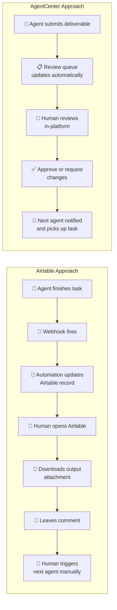

Airtable is genuinely flexible. If you need to track leads, manage a content pipeline, organize a product roadmap, or build a lightweight CRM, it will get the job done. The interface is polished. The automations are good enough for most teams. It sits in that sweet spot between a spreadsheet and a real database.

So when teams start running AI agents, Airtable is often the first tool they reach for. Create a table with columns for "Agent Name", "Task", "Status", and "Output". Add a kanban view. Feels reasonable. For a weekend project or a two-agent experiment, it might hold up.

The problems show up around agent three or four.

## What Airtable Does Well

Airtable earns its place in a lot of team stacks. Here is what actually works:

- **Flexible schema**: Build exactly the fields your team needs — dropdowns, file attachments, linked records, formulas. No code required.
- **Multiple views**: Switch between grid, kanban, gallery, and calendar on the same data. Useful when different people need different perspectives on the same records.
- **Automations**: Trigger actions when records change — send an email, call a webhook, update a status field. Good enough for simple notification workflows.
- **Collaboration**: Comments on records, @mentions in comment threads, and shared views let teams work on the same data without stepping on each other.
- **Integrations**: Connect to Slack, Zapier, and hundreds of other tools via native integrations. The ecosystem is mature.

These are real capabilities built for real use cases.

## The Core Limitation for Teams Running AI Agents

Airtable models your agents as rows in a table. The agent does not know the table exists. You update the row manually, or you build an automation to do it, after the agent finishes something.

That is the gap. Airtable tracks what happened. It does not manage what is happening.

When you are running 8 agents across 3 projects, here is what that looks like in practice:

- A webhook fires when an agent finishes. You built the automation yourself. It updates the status field.
- You open Airtable to check the output. There is an attachment. You download it, review it, leave a comment.
- The agent waiting on that output has no way to know it has been reviewed. You trigger it manually.
- Your cost data lives in a different sheet. You copy the numbers over at end of week.
- Two agents produced outputs on the same task. Both records exist. You have to figure out which one is authoritative.

None of this is Airtable's fault. It was built to track structured data, not to coordinate AI agents running in production. But teams in this situation end up with an agent-tracking spreadsheet that requires as much manual work as the agents were supposed to save.

## AgentCenter vs Airtable: Head to Head

| Feature | Airtable | AgentCenter |
|---|---|---|
| Agent status tracking | Manual or webhook update | Real-time (online, working, idle, blocked) |
| Task orchestration | Manual rows and trigger setup | Built-in multi-agent task queuing |
| Deliverable review | File attachments and comments | Native approval and review workflow |
| Agent cost visibility | Custom formula fields (manual setup) | Per-task cost tracking, automatic |
| @Mention coordination | Comment threads on records | Agent-aware mentions and task threads |
| Error and failure alerts | Automation triggers only | Native error monitoring |
| Kanban for agents | General-purpose kanban view | Agent-specific kanban with status lanes |
| Recurring agent tasks | Automation workarounds | Built-in recurring tasks (Pro+) |
| Pricing | Free to $45/seat/month | $14 to $79/month flat (not per seat) |
| Agent integration | API webhook (you build it) | Native OpenClaw agent connection |

The pricing difference matters at scale. Airtable charges per seat. If you have 5 engineers and 15 agents, you pay for 5 seats but still do all the coordination work manually. AgentCenter charges a flat monthly rate regardless of how many people are watching the dashboard.

## How the Workflow Actually Differs

Here is what one task cycle looks like in both tools:

With Airtable, coordination sits with humans. Someone has to check the table, process the output, and kick off the next step. With AgentCenter, agents and the platform handle handoffs. Humans review deliverables, not logistics.

### Airtable Workflow — 8 Agents, 3 Projects

1. Open Airtable. Filter to find tasks marked "In Progress."
2. Check each record for an output attachment or status change.
3. Download and review each output. Leave a comment if the agent needs to revise.
4. Update the status field to "Done" or "Needs Revision."
5. Manually trigger the automation or webhook to tell the next agent to start.
6. At the end of the week, pull cost data from a separate log and paste it into your tracking sheet.

That is six manual steps per task cycle. With 8 agents running across 3 projects, you are doing this continuously.

### AgentCenter Workflow

1. Open the [agent dashboard](/features/agent-dashboard). See which agents are working, idle, or blocked at a glance.
2. Click into tasks that have deliverables waiting for review.
3. Review the output in-platform. Approve it or leave inline feedback.
4. The next agent picks up automatically.
5. Cost per task is already tracked.

The review step is the only manual step. Everything else runs through the platform.

## Can You Use Both?

Yes. A realistic setup for teams already on Airtable:

Keep Airtable for project planning, stakeholder-facing status boards, and content briefs. It is genuinely good at structured records and works well when you need non-technical people to see project status without learning another tool.

Use AgentCenter for actual agent management: task assignment, real-time status, deliverable review, and cost tracking. You can pipe final outputs from AgentCenter into Airtable if your team wants to see agent deliverables alongside other project data. That is a valid hybrid.

What does not work well is using Airtable as the primary agent management layer. You will spend more time maintaining the tracking system than it saves you.

## Bottom Line

Airtable is a good tool for tracking structured data across a team. It is not built for managing AI agents in production. The difference shows up the moment your agents start completing tasks faster than you can update rows manually. If coordination is becoming a full-time job on top of running agents, that is the signal to look at a dedicated control plane.

Check the [AgentCenter feature overview](/features) to see how task management, monitoring, and deliverable review work together. Or go straight to [pricing](/pricing) to see which plan fits your agent count.

---

*Airtable is good at what it does. AgentCenter does something different — it manages your agents, not just tracks them. [Start your 7-day free trial](/pricing) — no lock-in.*
