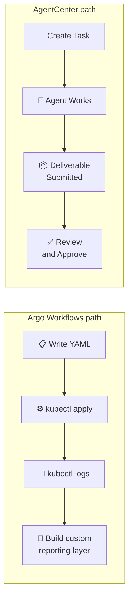

Argo Workflows has a solid reputation in the Kubernetes world. If you're running batch jobs, ML training pipelines, or CI/CD workflows on K8s, it's a serious tool used by serious infrastructure teams. It's open source, CNCF-backed, and widely understood by platform engineers.

So when a team starts running AI agents, reaching for Argo makes sense. You already have it running in your cluster. Your team knows the YAML. And agents are just workflows, right?

Not really. After running agents through Argo for a few weeks, most teams discover a long list of things they had to build themselves that they expected to already be there.

## What Argo Workflows Does Well

Argo earns its place on the stack for infrastructure-heavy work. Here's where it genuinely shines:

- **Kubernetes-native DAGs** — Define workflows as directed acyclic graphs, containerized, running natively in your cluster with full resource control
- **Parallel step execution** — Run multiple steps simultaneously with fine-grained dependency control, without writing any scheduling logic yourself
- **Retry and timeout handling** — Built-in retry policies, step-level timeouts, and failure handling that integrates with Kubernetes events
- **Template reuse** — Write a WorkflowTemplate once and reuse it across dozens of pipelines without duplication
- **Artifact management** — Pass data between steps using S3, GCS, or in-cluster storage without custom glue code
- **Audit trail** — Every workflow run is logged in Kubernetes, queryable via `kubectl` or the Argo UI
- **Event-driven triggers** — Kick off workflows from webhooks, cron schedules, or Kubernetes events without a separate scheduler

If your AI agents are truly Kubernetes containers that start, do one thing, and stop, Argo can orchestrate them.

## The Core Limitation for AI Agent Teams

Here's the problem: AI agents aren't batch jobs. They're not containers that start, process data, and exit. They're more like workers. They pick up tasks, ask clarifying questions, produce draft outputs, wait for feedback, and loop again. They operate in ongoing cycles, not single-run pipelines.

Argo Workflows was designed around steps and containers. AgentCenter was designed around agents, tasks, and deliverables. Those are different mental models, and the gap shows up fast when you're managing 8 or 10 agents in production.

With Argo, you can see whether a pod is running or failed. You can't see that an agent is "waiting because it hit an ambiguous requirement in step 3 and nobody noticed." You can't see that an agent finished three tasks yesterday but zero today because it's blocked on unreviewed output. You can't track which agent is consuming $40/day in tokens and whether that spend is actually producing useful work.

You end up building a second layer on top of Argo just to answer basic questions: what are my agents working on right now, who owns each one, and what did they produce?

The other friction point is the operator. Running Argo Workflows requires a Kubernetes cluster and someone who can maintain it. If your team is three developers shipping an AI product, standing up K8s just to schedule agent tasks is a lot of infrastructure overhead for what amounts to a task queue and a dashboard.

## AgentCenter vs Argo Workflows: Direct Comparison

| Feature | Argo Workflows | AgentCenter |
|---|---|---|
| Primary design | K8s workflow orchestration | AI agent control plane |
| Agent status | Pod status: running / failed | Real-time: online, working, idle, blocked |
| Task management | Workflow steps defined in YAML | Kanban board with assignable tasks |
| Deliverable review | Not supported | Built-in approval workflows |
| LLM cost tracking | Not supported | Per-agent cost and token monitoring |
| Human-in-the-loop | Custom implementation required | Native escalation and review flows |
| @Mentions / collaboration | Not supported | Chat threads per task |
| Requires Kubernetes | Yes | No |
| Self-hosted or cloud | Self-hosted (K8s) | Cloud dashboard |
| Starting cost | Infrastructure only (open source) | $14/month — Starter plan |
| Agent templates | Not supported | 120+ templates |
| Target operator | Platform / DevOps engineers | Developers, AI teams, founders |

## Workflow Comparison: Running a Research Agent

**With Argo Workflows:**

1. Write a YAML `WorkflowTemplate` specifying your agent container, input parameters, output artifacts, and retry policy
2. Apply it to your cluster with `kubectl apply -f agent-workflow.yaml`
3. Trigger runs via the Argo CLI, a webhook, or a cron WorkflowTemplate
4. Monitor pod status in the Argo UI or via `kubectl get pods -n argo`
5. Pull logs with `kubectl logs` to see what the agent actually did
6. Parse output artifacts from your artifact store if you want to review results
7. Build custom dashboards or alerts if you want anything beyond pod-level status
8. Repeat the whole process for each new agent you add

**With AgentCenter:**

1. Connect your OpenClaw agent to your AgentCenter workspace
2. Create a task on the kanban board and assign it to the agent
3. Watch real-time status updates as the agent works, with no polling required
4. Agent submits a deliverable when it's done
5. Review the output and approve, reject, or leave a comment requesting changes
6. Cost, performance, and error data shows up in the [monitoring dashboard](/features/agent-monitoring) automatically

The difference isn't just speed. With Argo, you're working at the infrastructure layer and you own every gap. With AgentCenter, the task management, review workflow, and cost tracking are built in and ready before you write a single line of agent code.

## Can You Use Both?

Yes, and it makes sense in some architectures.

If you're running AI agents inside a larger data platform that already lives on Kubernetes, Argo can handle the surrounding infrastructure: moving data between systems, triggering upstream jobs, managing cluster resources. AgentCenter then sits at the agent management layer on top, covering what each agent is working on, what it produced, and how much it cost.

The division is roughly:

- **Argo** handles when and how in terms of infrastructure (scheduling, containers, cluster resources)
- **AgentCenter** handles what and who in terms of work (tasks, deliverables, cost, team coordination)

If you don't already have Argo in your stack, you almost certainly don't need to add it just to run AI agents. AgentCenter handles recurring task scheduling without requiring Kubernetes at all, and the [task orchestration features](/features/task-orchestration) cover most of what teams try to wire together manually in Argo.

## Who Should Pick Which

**Argo Workflows** makes sense if you already run a K8s-native data platform, your "agents" are truly containerized batch jobs with structured I/O, and you have a platform team that owns the cluster.

**AgentCenter** makes sense if your agents produce human-reviewable outputs, you need visibility into what each agent is actually doing (not just whether its pod is running), and you'd rather not maintain Kubernetes infrastructure just to manage a handful of AI workers.

Most AI product teams land in the second category. The exception is large ML organizations with dedicated platform engineers who already live in Kubernetes and want to add agent workloads to existing pipelines.

## Bottom Line

Argo Workflows is a strong infrastructure tool. It was built for engineers who think in containers, DAGs, and cluster resources. AgentCenter was built for teams who think in agents, tasks, and deliverables. When you're running AI agents that produce work for humans to review, you need the second one. See [pricing](/pricing) to find the right plan for your team size.

---

*Argo Workflows is good at what it does. AgentCenter does something different — it manages your agents, not just the infrastructure running them. [Start your 7-day free trial](/pricing) — no lock-in.*
