Arize AI is a legitimate ML observability platform. If you're tracking LLM output quality, monitoring embedding drift, or running automated evaluations against golden datasets, it does that work well. Real product. Real users. Real use case.

Here's the question worth sitting with: you have 12 AI agents running in production. One of them has been returning wrong outputs for three days. What does Arize give you? A trace of the LLM call. A quality score. Maybe a flag. What it doesn't give you is which agent owns the task, who assigned it, whether the output has already been forwarded to a client, or who on your team should fix it right now.

Arize watches the model. AgentCenter manages the agent. That's not a small distinction when you're trying to run a fleet.

## What Arize AI Does Well

Arize is built for ML engineers who need visibility into model behavior:

- Traces every LLM call with full prompt and response logging
- Monitors output quality using automated scoring, LLM judges, and human annotations
- Detects embedding drift and model degradation over time
- Runs evaluation datasets and golden set comparisons
- Integrates with OpenAI, Anthropic, LangChain, and most ML frameworks
- Supports multi-modal model evaluation, not just text

If your question is "are my prompts getting worse over time?" or "did this model update change output quality?" — Arize is built for that work.

## The Core Limitation for Teams Managing AI Agents

Observing an LLM call is not the same as managing an agent.

An LLM call is one interaction. An agent is a worker with a task, a status, an owner, and a deliverable. When you're operating agents in production, the questions that actually matter are:

- Which agent owns this task right now?
- Is it stuck, blocked, or producing outputs no one has reviewed?
- Who on my team is responsible for this work?
- Has the deliverable been checked before it went anywhere?
- If something went wrong, who do I loop in?

Arize doesn't answer those questions. It can tell you an LLM call scored 2.1 out of 5 on faithfulness. It can't tell you that response was for a legal summary that already went to compliance.

The gap isn't technical — it's conceptual. Arize is a model evaluation tool. AgentCenter is a task management layer built for agents. They're solving different problems.

## Workflow Comparison: Catching a Bad Agent Output

Here's what "catching a problem" looks like with each tool.

```mermaid
graph TD
    subgraph "Arize AI Workflow"
        A1["🤖 Agent runs task"] --> A2["📊 LLM call traced"]
        A2 --> A3["🏷️ Output scored by LLM judge"]
        A3 --> A4["⚠️ Low-quality flag appears"]
        A4 --> A5["❓ Who owns the task?<br/>Was output acted on?<br/>What happens next?"]
    end
    subgraph "AgentCenter Workflow"
        B1["📋 Task assigned on Kanban"] --> B2["🤖 Agent picks up task<br/>Status: Working"]
        B2 --> B3["📤 Deliverable submitted<br/>Status: Review"]
        B3 --> B4["👤 Human reviews output"]
        B4 --> B5["✅ Approved or 🚩 Flagged"]
        B5 --> B6["Owner notified<br/>Task resolved"]
    end
```

**With Arize AI:**

1. Your agent runs a task and makes an LLM call.
2. Arize logs the prompt, response, and any tool calls.
3. An LLM judge scores the output on faithfulness, relevance, or whatever criteria you set.
4. If it scores low, you see a flag in the Arize dashboard.
5. You now need to figure out: which agent, which task, who owns it, whether it matters, and what to do.

**With AgentCenter:**

1. A task is created and assigned to an agent on the [Kanban board](/features/task-orchestration).
2. The agent works the task — you see the status update in real time.
3. When the agent finishes, the deliverable appears in the review queue.
4. A human reviewer approves or flags it before it goes anywhere.
5. If it's flagged, the task owner is notified immediately and the work stays in queue.

The difference isn't just UX. Arize catches bad outputs after the fact. AgentCenter puts a gate before the output leaves.

## AgentCenter vs Arize AI: Side-by-Side

| Feature | Arize AI | AgentCenter |
|---|---|---|
| LLM call tracing | ✅ Full tracing | Partial (task-level logs) |
| Output quality scoring | ✅ LLM judges + human annotation | ✅ Human review workflows |
| Embedding drift monitoring | ✅ | ❌ |
| Model evaluation datasets | ✅ | ❌ |
| Agent task assignment | ❌ | ✅ |
| Real-time agent status | ❌ | ✅ (online, working, idle, blocked) |
| Multi-agent coordination | ❌ | ✅ |
| Deliverable review + approval | ❌ | ✅ |
| @Mentions and task comments | ❌ | ✅ |
| Recurring task automation | ❌ | ✅ (Pro+) |
| Pricing | Custom / enterprise | $14–$79/mo |
| Free trial | Contact sales | 7-day trial, no credit card |
| Target user | ML engineers, data scientists | Dev teams managing AI agents |

## Can You Use Both?

Yes, and some teams do.

Arize and AgentCenter don't overlap much. Arize is a model-layer tool — it watches what your LLM is doing at the call level. AgentCenter is a workflow-layer tool — it manages what your agents are doing across tasks, teams, and projects.

If you're in a team where ML engineers care about output quality regression and prompt drift, and product/ops teams care about which tasks are getting done and by which agents, you could run both. Arize handles model health; AgentCenter handles agent operations.

That said, most teams with under 20 agents don't need both. If your primary concern is "are my agents producing reliable outputs and can my team manage them?" AgentCenter covers the review and approval side without needing a separate evaluation platform.

If you're running fine-tuned models at scale and tracking evaluation across model versions, Arize adds real value on top. But it won't replace the task management layer.

## Bottom Line

Arize AI is a strong choice if you need model-level observability — tracking LLM call quality, catching output regressions, and evaluating prompts at scale. AgentCenter is built for the question that comes after: once the agent runs, who owns the output, who reviews it, and what happens when something goes wrong?

If you're past the "is my prompt working?" stage and into "how do I actually operate 15 agents as a team?", you need a control plane, not just a trace log. See how AgentCenter handles [agent monitoring](/features/agent-monitoring) and task management at any scale. [Pricing starts at $14/mo](/pricing).

---

*Arize AI is good at what it does. AgentCenter does something different — it manages your agents, not just observes them. [Start your 7-day free trial](/pricing) — no lock-in.*
