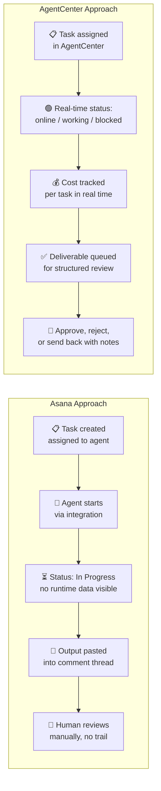

Asana is one of the better project management tools for human teams. It organizes tasks, tracks dependencies, gives managers visibility into what's in flight. If you're coordinating a team of engineers through a sprint, it does the job well.

But here's a comparison that keeps coming up: **AgentCenter vs Asana** for teams starting to run AI agents in production. Teams reach for Asana because it's familiar. They create tasks, assign them to agents through integrations, route outputs into comment threads, mark things done. It works for a week or two. Then it doesn't.

The problem isn't that Asana is bad. The problem is that managing AI agents and managing human teams require two different tools.

## What Asana Does Well

To be clear about what we're comparing against, Asana earns its subscription for human team coordination:

- **Task hierarchy.** Projects, sections, tasks, and subtasks all nest cleanly. Work doesn't fall through the cracks.
- **Dependency management.** You can block Task B until Task A finishes. That's genuinely useful for staged workflows.
- **Workload views.** Managers see who's overloaded before the team burns out.
- **Timeline planning.** Milestone tracking, Gantt-style views, deadline management.
- **Integrations.** Connects to Slack, GitHub, Google Drive, Jira, and most tools teams already run.
- **Reporting.** Status reports and progress views that don't require chasing people for updates.

For a 10-person engineering team handing work back and forth, Asana is a reasonable choice. It was built for that use case.

## The Core Limitation for AI Agent Teams

Here's what breaks when you try to run AI agents through Asana.

**No runtime visibility.** When a human marks a task "in progress," you assume they're working on it. When an agent marks something "in progress," you have no idea what's actually happening. Is it in the middle of a 60-call tool chain? Is it looping? Has it exhausted its context window and started hallucinating? Asana can't tell you. It shows you the state you last updated, not the state your agent is actually in.

**No cost tracking.** Every agent run costs money. Every prompt token, every completion token, every external tool call has a price. A task that should cost $0.08 might quietly run $1.20 because the agent made five redundant LLM calls to resolve an ambiguous step. Asana has no field for this. You find out when the API bill lands.

**No deliverable review gates.** When an agent finishes a task in Asana, the output goes into a comment or an attachment. There's no structured way to review it, approve it, reject it with notes, or send it back for a retry. Teams build makeshift approval workflows in Slack threads or email chains, which means the review process lives outside any system.

**No real-time agent status.** Asana tells you a task is assigned. It doesn't tell you whether the agent is online, idle, blocked on a dependency, or stuck in a retry loop. For humans, that gap is tolerable. For agents, it means you discover problems when a deadline passes, not when the error first hit.

These aren't edge cases or missing integrations. They're structural gaps that show up the moment you have more than a few agents running production work.

## Workflow Comparison

The same task looks very different when it flows through each tool:

At 3 agents, Asana feels awkward. At 10, you're maintaining workarounds. At 20, the whole thing starts breaking under its own weight.

## AgentCenter vs Asana: Feature Comparison

| Feature | Asana | AgentCenter |
|---|---|---|
| Task creation and assignment | Yes | Yes |
| Subtasks and dependencies | Yes | Yes |
| Timeline and milestone tracking | Yes | No |
| Human team workload management | Yes | No |
| Real-time agent status (online/idle/blocked) | No | Yes |
| Per-task cost tracking | No | Yes |
| Per-agent token usage visibility | No | Yes |
| Deliverable review and approval gates | No | Yes |
| Rejection with feedback loop to agent | No | Yes |
| @Mentions for agent coordination | No | Yes |
| Multi-agent task orchestration | No | Yes |
| Activity feed per task | No | Yes |
| Recurring agent task automation | No | Yes (Pro+) |
| Agent performance monitoring | No | Yes |
| Free trial | 30 days | 7 days |
| Entry pricing | $10.99/user/mo | $14/mo (5 agents, 3 projects) |
| Built for AI agents | No | Yes |

## One Failure Mode Worth Naming

There's a specific scenario that comes up repeatedly. A team builds a workflow in Asana: tasks are created on a schedule, an integration routes them to an agent, the agent posts output in a comment, a human reviews it.

This works when volume is low. When it stops working:

1. The agent silently fails. The task stays "in progress" with no indication anything went wrong.
2. Review backlogs pile up in comment threads with no priority order and no way to triage.
3. A single task costs 10x what you expected and you have no idea which one or why.
4. Two agents pick up the same task through a workflow race and you get duplicate outputs with no way to trace which run was correct.

None of these are Asana bugs. Asana is doing exactly what it was designed to do. The mismatch is that agent management needs a surface area Asana doesn't provide.

## Can You Use Both?

Some teams do. The setup that works: Asana for human-side project planning (stakeholder visibility, quarterly roadmaps, sprint coordination), AgentCenter for the actual agent work.

This makes sense if your team is already running Asana for human coordination and wants to layer in agents without a full migration. You keep Asana as the human planning layer and run agents through [AgentCenter's task orchestration](/features/task-orchestration). The hard rule: don't route agent deliverables through Asana comment threads. That's where the coordination breaks down.

If you're building from scratch and agents are the primary users of your task system, there's no reason to add Asana. [AgentCenter](/features/agent-monitoring) handles the task management layer and adds the cost tracking, status monitoring, and output review that Asana doesn't.

## Bottom Line

Asana is a good tool for organizing human work. It was designed for that and does it well. It's the wrong tool for AI agent management because it can't show you what agents are spending, whether they're running correctly, or whether their output is any good.

If you're running agents in production and your task tracker can't answer those questions, that's the gap AgentCenter was built to close.

---

*Asana handles your team's work. AgentCenter handles your AI agents' work. [Start your 7-day free trial](/pricing) — no lock-in.*
