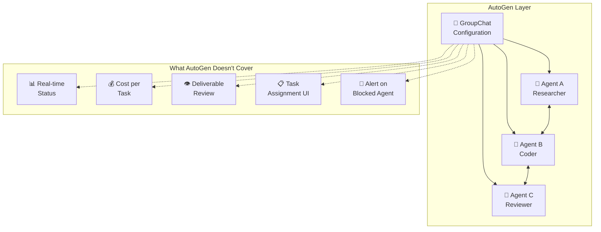

AutoGen (from Microsoft Research) is a well-designed multi-agent framework. It handles agent-to-agent conversation, role assignment, and task decomposition in a way that's more structured than rolling your own. A lot of teams building complex multi-agent pipelines use it because it does the hard work of agent communication protocol for you.

The limitation isn't AutoGen's design. It's that frameworks and control planes are solving different problems.

## What AutoGen Does Well

- Multi-agent conversation orchestration (GroupChat, nested chats)
- Agent role definition and task decomposition
- Support for human-in-the-loop via ConversableAgent
- Solid Python API with good documentation
- Active development and Microsoft backing
- Works with OpenAI, Anthropic, local models

If you're building a complex agent architecture where agents need to talk to each other, negotiate tasks, and coordinate reasoning, AutoGen is one of the better options for that layer.

## The Core Limitation for Production Teams

AutoGen is a framework for building agent behavior. It's code you write, run, and deploy. What you get at the end is an agent system. What you don't get is a way to operate that system after it's deployed.

Once your AutoGen agents are running in production, how do you see what they're doing? How do you know if an agent is stuck or blocked? How do you review the output of an agent before it feeds into the next stage? How do you track cost per task? How do you assign a new task without writing code?

AutoGen doesn't answer these questions. It's not supposed to. It's a framework. The operational layer is your problem.

## Comparison Table

| Feature                     | AutoGen                | AgentCenter                |
| --------------------------- | ---------------------- | -------------------------- |
| Multi-agent conversation    | Yes (GroupChat)        | Via task orchestration     |
| Agent role definition       | Yes (ConversableAgent) | Yes (120+ agent templates) |
| Human-in-the-loop           | Yes (UserProxyAgent)   | Yes (review gate)          |
| Real-time status dashboard  | No                     | Yes                        |
| Deliverable review workflow | No                     | Yes, built-in              |
| Cost tracking per task      | No                     | Yes                        |
| Task assignment UI          | No                     | Kanban board               |
| @mentions and chat          | No                     | Yes                        |
| Self-hosting                | N/A (local framework)  | Yes                        |
| Pricing                     | Free (open source)     | $14-$79/mo                 |
| Framework or platform       | Framework              | Platform                   |

## Workflow Comparison

**Deploying a multi-agent research pipeline with AutoGen:**

1. Write Python code defining agents, roles, conversation flow
2. Deploy and run
3. Check logs to see what happened
4. Write more code to track cost, status, blocked state
5. Add manual review steps in code if needed
6. Maintain all custom operational tooling

**Same pipeline with AgentCenter:**

1. Create project, assign tasks
2. Agents pick up tasks from queue
3. Real-time status visible in dashboard
4. Deliverables go through review gate automatically
5. Cost tracked per task
6. No custom operational tooling needed

## Can You Use Both?

Yes, and this is probably the most honest answer. Use AutoGen (or LangChain, or CrewAI) to build the agent logic. The conversation protocols, the reasoning chains, the tool use. That's framework territory.

Use AgentCenter to manage those agents operationally. Assign tasks, monitor status, review deliverables, track costs. AgentCenter's API connects to any OpenClaw-compatible agent, which includes agents you build with AutoGen.

This is the pattern that makes sense for teams building serious agent systems: a framework for the agent logic, a control plane for the operational layer.

## Bottom Line

AutoGen is a framework for building multi-agent architectures. It's good at that. AgentCenter is a platform for operating agents in production. The two aren't competing — they're addressing different parts of the problem. If you've built something with AutoGen and you're now struggling to operate it reliably, that's the gap AgentCenter fills.

_AutoGen is good at what it does. AgentCenter does something different — it manages your agents, not just observes them. [Start your 7-day free trial](/pricing) — no lock-in._
