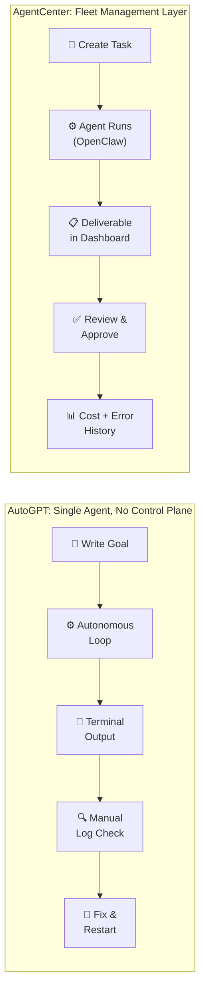

AutoGPT was one of the first tools to show developers what autonomous AI agents could actually do. You gave it a goal, it broke the task into steps, called tools, wrote files, and kept going until it finished — or crashed trying. That demo landed hard in 2023, and the core idea still holds up.

But a few months into running agents in production, you stop asking "can this agent run autonomously?" and start asking "which of my 15 agents failed at 3am, and why did no one know for four hours?"

That's where AutoGPT and AgentCenter stop overlapping.

## What AutoGPT Does Well

AutoGPT is a framework for building and running autonomous single agents. It earns its reputation in real ways:

- **Self-prompting loop**: The agent generates its own next steps without you writing each prompt. Works well for well-scoped tasks with a clear end state.
- **Tool use out of the box**: Web search, file read/write, code execution — wired in from the start. You don't build the scaffolding yourself.
- **Low barrier to start**: Clone the repo, add an API key, write a goal. You can have something running in under an hour.
- **Active community**: Plugins, forks, open-source experiments. If you're exploring what agents can do, there's a lot of prior art to draw from.
- **No vendor lock-in**: Open source. You own the code. Modify it, host it, fork it however you need.

These are real advantages. If you're prototyping an autonomous single-agent workflow, AutoGPT is a practical starting point.

## The Core Limitation for Teams

The issue isn't AutoGPT's execution loop. It's everything around it.

When you run one agent, you can watch the terminal. When you run 20 agents across three projects — some on hourly schedules, some triggered by webhooks, some on-demand — terminal output stops being a reasonable interface. You need visibility, coordination, and accountability across the whole fleet.

AutoGPT doesn't give you:

- A single view across all your running agents
- Task assignment and handoff between agents
- Per-agent, per-task cost tracking
- Approval gates before an agent writes to external systems
- Error alerting with context (not just a stack trace buried in logs)
- Agent performance history over time
- Team ownership — who's responsible for which agent, who reviews what

The result for most teams: a mix of cron jobs, custom Slack webhooks, and shared spreadsheets that technically works until two agents break on the same night.

## AgentCenter vs AutoGPT: Side by Side

| | AutoGPT | AgentCenter |
|---|---|---|
| **Primary purpose** | Build and run autonomous agents | Manage and coordinate agent fleets |
| **Setup** | CLI / self-hosted | Web dashboard, no install required |
| **Multi-agent visibility** | Not included | Kanban board across all agents and tasks |
| **Task management** | No — agent runs until done or fails | Full task assignment, status, and history |
| **Cost tracking** | No | Per-agent, per-task cost monitoring |
| **Error alerting** | Terminal output only | Real-time alerts with execution context |
| **Approval workflows** | Not included | Built-in review gates before agent acts |
| **@Mentions and threads** | No | Per-task chat, team coordination, agent logs |
| **Agent monitoring** | Logs only | Performance, latency, error rate dashboards |
| **Recurring tasks** | Cron job (manual setup) | Built-in recurring task scheduling (Pro+) |
| **Pricing** | Free / open source | From $14/mo — Starter plan, up to 5 agents |
| **Works with OpenClaw** | No | Yes — requires OpenClaw-compatible agents |

## Workflow Comparison: A Daily Research Agent

Say you need an agent that runs every morning, pulls relevant news, summarizes the top stories, and flags anything that needs human review before it goes out.

**The AutoGPT approach:**

1. Write the agent goal and tool config
2. Set up a cron job or trigger it manually each day
3. Read terminal output or log files to see what it produced
4. Build a custom notifier if something errors
5. When the agent drifts or starts producing noise, dig through logs to find where it went wrong
6. No record of yesterday's run cost, quality, or latency — every day starts fresh

**The AgentCenter approach:**

1. Assign the task to your agent in AgentCenter with a daily recurring schedule
2. The agent runs on schedule via the OpenClaw runtime — status shows live in the Kanban board
3. Output arrives as a deliverable in the task, ready for your review or approval before it goes anywhere
4. If the agent errors, you get an alert with the execution context — not a wall of terminal text
5. Token cost for the run is tracked automatically against the task
6. Next week you can compare this run's cost, latency, and output quality to the week before

The difference gets starker at scale. One agent running once a day is manageable with terminal output. Eight agents running at different intervals, owned by different people on the team, each producing outputs that feed into other workflows — that's when you need a [real monitoring layer](/features/agent-monitoring).

## Can You Use Both?

Yes. They're not competing for the same job.

AutoGPT handles the execution logic — the self-prompting loop, the tool calls, the goal decomposition. It's a solid framework for building and testing autonomous single-agent behavior.

AgentCenter is the layer that goes on top. If your agents are OpenClaw-compatible, you can build the execution logic using whatever framework you want — including your own — and use AgentCenter as the [control plane](/features/agent-dashboard) that manages tasks, monitors performance, tracks costs, and coordinates team review.

Most teams that use AgentCenter aren't abandoning their existing agent code. They're adding the management and visibility layer that was always missing. The question isn't "which one" — it's whether you've gotten to the point where watching a terminal is no longer enough.

## Frequently Asked Questions

### Does AgentCenter replace AutoGPT?

No. AutoGPT builds and runs autonomous agent logic. AgentCenter manages agents in production — task tracking, monitoring, approvals, and cost visibility. They operate at different layers.

### Can I use AutoGPT-built agents with AgentCenter?

AgentCenter works with OpenClaw-compatible agents. If your AutoGPT-based agent is wrapped in an OpenClaw interface, yes. If not, you'd need to adapt the execution layer.

### What's the cost difference?

AutoGPT is open source and free. AgentCenter starts at [$14/month](/pricing) for up to 5 agents. You're paying for the management layer — not the agent runtime itself.

## Bottom Line

AutoGPT is for building and running a single autonomous agent. AgentCenter is for managing a fleet of them in production. They answer different questions. If you're still figuring out whether agents can do a task at all, AutoGPT is a fast way to test it. If you already have agents running and you're spending time on log triage, cost guesswork, and manual error chasing — that's the AgentCenter problem.

---

*AutoGPT is good at what it does. AgentCenter does something different — it manages your agents, not just runs them. [Start your 7-day free trial](/pricing) — no lock-in.*
