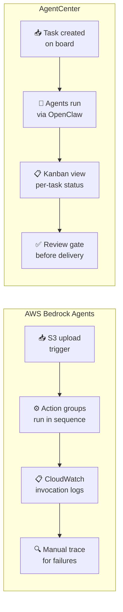

If you're already running workloads on AWS, AWS Bedrock Agents is an obvious first look. AWS manages the infrastructure, the model integrations, and the agent execution environment. You define the agent behavior, connect it to your data sources, and it runs inside the cloud stack you already trust.

That's a real advantage. The question is what you're left managing on your own once the agent is live.

## What AWS Bedrock Agents Does Well

Bedrock Agents isn't a toy. It's a managed service backed by Amazon's infrastructure, and it solves genuine problems:

- **Model access**: Direct integrations with Anthropic Claude, Meta Llama, Amazon Titan, and Mistral — no API key juggling across services.
- **Knowledge bases**: Built-in RAG with S3 and OpenSearch. If your data is already on AWS, this wires up fast.
- **Action groups**: Connect agents to Lambda functions and OpenAPI schemas without custom tool-calling code.
- **IAM integration**: Agents inherit AWS roles. If your org has strict access controls, Bedrock fits into them without extra work.
- **Audit logging**: Every invocation lands in CloudWatch. You can trace what ran and when.
- **Managed infrastructure**: No servers to maintain. AWS handles scaling, availability, and patching.

For a team building a contract Q&A agent on top of documents in S3, or an internal support agent backed by a Confluence knowledge base, this is a solid path to production.

## The Core Limitation for Teams Managing Multiple Agents

Here's where the picture changes.

Bedrock Agents was built to run agents. Not to manage them at scale across a team. The gap becomes visible around the 4th or 5th agent.

There's no central view where your team can see which agents are active, which are waiting for input, and which have silently stopped producing output. Tasks don't have shared status. There's no way to hold an agent's deliverable for human review before it goes downstream. If a contract extraction agent flags a high-risk clause at the wrong confidence threshold, that output moves forward — nobody sees it until a lawyer asks why the wrong document was flagged.

Cost visibility is per-invocation in CloudWatch. Tying that back to a specific project or workflow requires manual log queries. If you have 8 agents running across 3 projects, you won't get a per-task cost breakdown without building it yourself.

And debugging. When something fails in a multi-step Bedrock agent chain, you're in CloudWatch pulling invocation IDs, matching Lambda execution times, and correlating token counts across log groups. It works. It's just slow and manual at a moment when you want answers fast.

None of this is a flaw in AWS Bedrock. It's a runtime, and it does what runtimes do. The management layer is what's missing.

## AgentCenter vs AWS Bedrock Agents: Feature Comparison

| Feature | AWS Bedrock Agents | AgentCenter |
|---|---|---|
| Primary purpose | Agent runtime on AWS | Multi-agent control plane |
| Supported models | Claude, Llama, Titan, Mistral (AWS only) | Claude, GPT-4, Gemini, any OpenClaw provider |
| Unified agent dashboard | No | Yes — all agents in one view |
| Task status visibility | CloudWatch logs | Real-time Kanban board |
| Human review gates | Not built-in | Deliverable approval workflows |
| Team @mentions and chat | No | Per-task threads |
| Cost tracking | Per-invocation in CloudWatch | Per-task, per-project, per-agent |
| Pricing | Pay-per-token + invocation costs | $14/mo Starter · $29/mo Pro · $79/mo Scale |
| Cloud lock-in | AWS only | Works with any OpenClaw runtime |
| Setup path | AWS Console + IAM + Lambda | Dashboard + OpenClaw agent config |

## How the Same Workflow Looks in Each

Say you're running 5 agents to process incoming vendor contracts. One extracts key terms, one flags non-standard clauses, one checks jurisdiction compliance, one produces a summary for legal review, and one routes flagged contracts to a human approver.

**The Bedrock Agents path:**

1. An S3 event triggers a Lambda function
2. Lambda calls Bedrock to start the agent chain
3. Each action group runs in sequence — extraction, flagging, compliance check, summary
4. Outputs are written back to S3 or pushed to SNS for routing
5. Errors appear in CloudWatch — if someone is checking
6. There's no shared view of which contracts are in progress, complete, or failed
7. Routing to a human reviewer is a separate piece you built in Lambda or Step Functions

**The AgentCenter path:**

1. A task is created on the [Kanban board](/features/task-orchestration) with the contract attached — visible to the whole team from the start
2. The task is assigned to the agent workflow; status updates in real time
3. Each agent updates task status as it completes its step
4. When the summary is ready, it lands in a review queue — the legal reviewer sees it, approves it, or sends it back with a comment
5. Cost for the full workflow is logged against the task
6. If the compliance agent stalls, the board shows it blocked — no log queries needed
7. The reviewer gets an @mention notification and can comment directly in the task thread

You can build a version of the second workflow with Bedrock if you're willing to write the review UI, routing logic, notification system, and cost aggregation yourself. Most teams ship the agents first and plan to add the operational layer later — usually right after something breaks and nobody can tell which agent caused it.

## Can You Use Both?

Yes, and this is the most practical setup for teams already running on AWS.

Bedrock handles the compute: model calls, Lambda execution, knowledge base retrieval, and IAM access control. AgentCenter handles the operations layer: task management, team visibility, deliverable review, and cost tracking across projects.

The two layers don't conflict. Your Bedrock agents still run on AWS. AgentCenter sits above the runtime as a [control plane for your agents](/features/agent-monitoring), not a replacement for it. You're not changing how the agents execute — you're adding a layer that makes it visible and manageable for your team.

The main consideration is a second console. If your team is 2 engineers who already live in CloudWatch, you may not feel the pain of its absence immediately. If you have non-engineers who need to interact with agent outputs — legal, ops, content, finance — giving them CloudWatch access is not realistic. That's where a proper dashboard pays off fast.

One note on pricing: Bedrock charges per token and per invocation, which adds up. AgentCenter is a flat monthly fee starting at $14/mo for up to 5 agents. That control layer often pays for itself by surfacing which agents are burning budget on redundant work.

## Bottom Line

AWS Bedrock Agents is a capable runtime for teams already on AWS. It's not built to manage agents across a team, give non-engineers visibility into what's running, or hold outputs for human review. AgentCenter fills that gap — task management, review gates, real-time status, and cost tracking — without touching what Bedrock does well.

If you're running more than 3 agents and anyone besides the original builder needs to know what's happening, that gap gets expensive fast.

---

*AWS Bedrock Agents is good at what it does. AgentCenter does something different — it manages your agents, not just runs them. [Start your 7-day free trial](/pricing) — no lock-in.*
