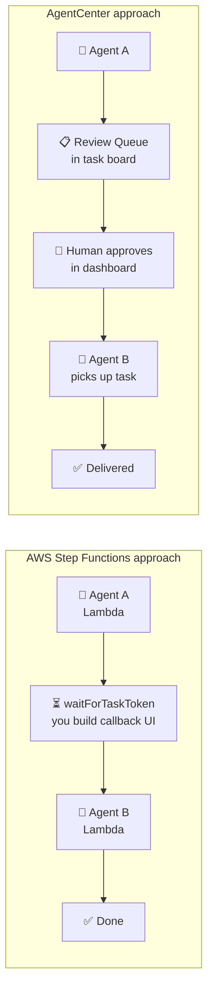

If you're running AWS infrastructure, Step Functions is the natural first move for orchestrating AI agents. It's already in your account. Your team knows IAM. You can wire it to Lambda, Bedrock, and S3 without writing much glue code. For a simple two-step pipeline, it works fine.

The problem shows up around agent 3 or 4 — when you have multiple agents running on different schedules, some waiting on human review, some failing silently, and no single view of what's actually happening. That's where Step Functions shows its limits. Not because it's broken, but because it was built for a different problem.

## What AWS Step Functions Does Well

Step Functions is a solid tool for what it was designed to do:

- **State machine visualization**: The console graph shows exactly which state succeeded, which failed, and where execution stopped. Much easier to debug than raw Lambda logs.
- **Retry logic built in**: Exponential backoff, per-error-type catch blocks, fallback states — all configured in the workflow definition, no custom retry logic in your agent code.
- **Native AWS integrations**: Direct SDK integrations with over 200 AWS services. Lambda, Bedrock, DynamoDB, SQS — wired together without boilerplate.
- **Execution history**: Every state transition is logged and queryable. You can compare runs, replay history, and audit what happened when.
- **IAM access control**: Plugs into your existing AWS security posture. Fine-grained permissions enforced at the state level.
- **Scales to zero**: No servers to manage. You pay only when executions run.

If your agents are deterministic Lambda functions that run in a known sequence with predictable inputs and outputs, Step Functions handles this well.

## The Core Limitation for Agent Teams

Step Functions was built for deterministic workflows — defined in advance, predictable, structured. AI agents don't behave that way.

They produce variable outputs. They need human review before passing work downstream. They fail in ways that look like success — returning empty results, hallucinating data, quietly timing out. The longer you run them, the more you need visibility into what agents are doing, not just whether their Lambda invocations returned 200.

Here's what breaks in practice:

**No agent status layer.** Step Functions tracks execution states. If your `research-agent` Lambda returns garbage because of a prompt drift issue, Step Functions marks that state succeeded. You won't know until a human notices the output.

**No task board.** There's no concept of "tasks waiting for review" or "tasks assigned to Agent B." You have executions — which either succeed, fail, or time out. Anything that needs tracking across the lifecycle of a task lives outside Step Functions.

**Human-in-the-loop is a workaround.** AWS has a `.waitForTaskToken` callback pattern to pause a workflow until an external signal arrives. But building the review UI, the approval endpoint, and the notification flow is entirely on your team. That's a small product to build, not a configuration change.

**Multi-agent coordination requires custom glue.** You can run agents in parallel or sequence. But if Agent B needs Agent A's output to be reviewed and approved before starting, you're wiring that with SQS, DynamoDB, and Lambda callbacks. It works. You also own it forever.

**Costs don't map to agents.** Standard Workflows charge $0.025 per 1,000 state transitions. When agents run many small steps, you accumulate transitions fast. CloudWatch gives you execution-level metrics, not per-agent cost per task.

## Side-by-Side Comparison

| Dimension | AWS Step Functions | AgentCenter |
|---|---|---|
| Primary purpose | State machine workflow orchestration | AI agent control plane and task management |
| Agent status visibility | Execution states only (running/success/failed) | Real-time: online, working, idle, blocked |
| Task management | No concept of tasks | Kanban board with states and assignments |
| Human-in-the-loop | waitForTaskToken callback (custom build) | Built-in review and approval workflow |
| Multi-agent coordination | Sequential/parallel states + SQS | Task handoffs, @mentions, dependencies |
| Per-agent cost tracking | None (CloudWatch by execution) | Built-in cost tracking per agent and task |
| Deliverable review | Not supported natively | Task-level review with approval gating |
| Pricing | $0.025/1K transitions (Standard Workflows) | $14–$79/mo flat; 5–50 agents |
| Setup time | 30–60 min + IAM policy work | Minutes, no infrastructure |
| Debugging | State transition logs | Task-level errors with agent context |

## Workflow Comparison: A Review-Gated Agent Pipeline

The gap is most visible when human review gates work before the next agent starts.

**With AWS Step Functions:**

1. Write the state machine in ASL — define each agent as a Lambda task, add a `.waitForTaskToken` pause state where review happens
2. Build a separate UI or API to surface review requests to humans — Step Functions doesn't provide one
3. Implement a callback endpoint that resumes execution when a reviewer approves
4. Set up CloudWatch alarms for failure states — Step Functions won't alert on failures by default
5. Query CloudWatch Insights or build a dashboard to see what's running across all executions
6. When an agent is added or removed, update the ASL definition, test it, and redeploy

**With AgentCenter:**

1. Connect your OpenClaw agents — takes a few minutes from [the dashboard](/features/agent-dashboard)
2. Create a task and assign it to Agent A
3. When Agent A finishes, the deliverable surfaces in the task board for review
4. Reviewer gets notified, approves directly in the AgentCenter dashboard
5. Agent B picks up the approved task automatically
6. Both agents are visible in real-time — status, errors, and cost per task — from the same view

The Step Functions version works. It's also several weeks of engineering to build the review flow, the callback endpoint, the notification system, and the monitoring dashboard. AgentCenter ships all of that as features.

## Can You Use Both?

Yes. They operate at different layers.

Step Functions makes sense if you're using Lambda-based agents and want orchestration logic embedded in AWS infrastructure. It handles the "what runs when" question — sequencing, retries, branching.

AgentCenter sits on top of that. It manages agents after they're running: task assignment, human review, error visibility, deliverable tracking, per-agent cost. If Step Functions is executing your agents but your team has no view into what those agents are actually producing — or which one keeps failing — AgentCenter fills that gap.

You can use Step Functions to trigger and sequence your agents while using AgentCenter for [agent monitoring](/features/agent-monitoring) and task coordination. They're not redundant. One is the engine; the other is the control panel.

## Bottom Line

AWS Step Functions is a solid workflow orchestrator. It's not an agent management platform. If you're running more than a few agents and you care about task visibility, human review flows, and error accountability — you'll spend significant time building the infrastructure that Step Functions doesn't provide. AgentCenter ships that as a product. [See the full feature set](/features) and decide if the build is worth it.

---

*AWS Step Functions is good at what it does. AgentCenter does something different — it manages your agents, not just runs your workflows. [Start your 7-day free trial](/pricing) — no lock-in.*
