Azure AI Foundry is Microsoft's platform for building, deploying, and evaluating AI agents inside Azure. If your team already runs on Azure and uses OpenAI or other Microsoft-backed models, it's a natural starting point. Foundry gives you a model catalog, a playground, built-in safety evaluation, and deployment infrastructure on top of Azure's compliance stack. That's a real set of tools to build with.

But here's the question that matters once your agents go live: who's watching what they're doing?

Building an agent and managing it in production are two different problems. Azure AI Foundry is good at the first one. Most teams discover the second problem around agent number five or six.

## What Azure AI Foundry Does Well

- **Cloud-native deployment**: Agents run inside your existing Azure infrastructure. No new cloud accounts or separate compute to wrangle. If your team is already in Azure, the security and networking setup is already done.
- **Model variety**: Access to OpenAI GPT-4o, Phi-4, Mistral, Meta Llama, and others through one unified catalog. Switching models is a config change, not a refactor.
- **Built-in evaluation tooling**: Foundry includes groundedness, coherence, and relevance evaluation flows. You can benchmark agent output against test datasets before pushing to production.
- **Enterprise compliance**: Azure's IAM, RBAC, audit logging, and compliance certifications carry over automatically. HIPAA, SOC 2, and FedRAMP coverage if your industry requires it.
- **Prompt flow builder**: Foundry's visual prompt flow tool lets you wire together LLM calls, Python steps, and external tools. Good for teams building multi-step reasoning workflows without writing orchestration code from scratch.
- **Connected to Microsoft ecosystem**: Teams, SharePoint, Copilot Studio, and Power Automate integrations come naturally. If your org lives in Microsoft 365, that matters.

These are genuine strengths. If you're in Azure and need to build and launch agents without standing up fresh infrastructure, Foundry removes a lot of friction.

## The Core Limitation for Teams Managing Agents

Here's what Foundry doesn't give you: visibility into what your agents are doing after they ship.

Once agents are live and working on real tasks, you need answers to questions like:

- Which agent is stuck right now, and on what task?
- Why did the research agent fail at 2pm yesterday, and has it recovered?
- Which agent spent $40 in tokens today producing output nobody has reviewed?
- Who last approved the deliverable from the data extraction agent, and when?

Foundry answers "is my deployment healthy?" It doesn't answer "is my agent doing useful work, and does my team know what it's doing?"

That gap is manageable with one or two agents. It becomes a real problem at five or ten. One team running 14 agents said they spent more time digging through Azure Monitor logs to figure out which agent failed than on the actual work those agents were supposed to handle. Foundry shows deployment metrics and endpoint availability. It doesn't surface task-level state, blocked agents, pending deliverables, or who on your team needs to review what.

That's not a design flaw in Foundry. It's a different tool solving a different problem. But if you're treating Foundry as your complete agent operations layer, you're going to feel that gap.

## AgentCenter vs Azure AI Foundry: Side-by-Side

| Feature | Azure AI Foundry | AgentCenter |
|---|---|---|
| Build and deploy agents | Yes | No (manages OpenClaw agents) |
| Real-time agent status | Basic (deployment health) | Full (online, working, idle, blocked) |
| Task-level visibility | No | Yes (Kanban board per agent) |
| @Mentions and task threads | No | Yes |
| Deliverable review and approval | No | Yes |
| Cost tracking per agent per task | No | Yes |
| Multi-agent coordination | Partial (orchestration APIs) | Yes (visual, team-facing) |
| Recurring task automation | No | Yes (Pro+ plan) |
| Pricing | Azure compute + model costs (variable) | From $14/mo — see [pricing](/pricing) |
| Best for | Building and launching agents in Azure | Managing agents in production |

## How It Works in Practice

Same scenario, two different tools.

Your team runs a research agent that pulls competitive data every six hours, summarizes it, and produces a deliverable for a human to review before it reaches the client.

```mermaid
graph TD
    subgraph "Azure AI Foundry Approach"
        A1["🔧 Build agent<br/>in Foundry"] --> A2["🚀 Deploy to<br/>Azure endpoint"]
        A2 --> A3["📊 Monitor via<br/>Azure Monitor"]
        A3 --> A4["📧 Alert fires<br/>on failure"]
        A4 --> A5["🔍 Engineer<br/>digs into logs"]
        A5 --> A6["📤 Output sent<br/>via webhook"]
    end
    subgraph "AgentCenter Approach"
        B1["🤖 Agent runs<br/>on OpenClaw"] --> B2["📋 Task appears<br/>in Kanban board"]
        B2 --> B3["✅ Deliverable<br/>awaits review"]
        B3 --> B4["👤 Reviewer approves<br/>or leaves feedback"]
        B4 --> B5["📤 Output delivered<br/>to client"]
    end
```

**The Foundry path:** The agent is deployed and running. When it produces output, it goes wherever your webhook points. If it fails, Azure Monitor fires an alert. An engineer pulls logs, traces the error, restarts the agent. The client-facing review step happens outside Foundry, probably in Slack or email, tracked by nobody in particular.

**The AgentCenter path:** The agent creates a task on the Kanban board when it starts a run. When the deliverable is ready, it moves to a review column. The assigned reviewer gets a notification, opens the task, reads the output, and either approves it or leaves a comment. The agent sees the feedback and knows what comes next. The whole loop is visible to the team in one place, with timestamps and a full history.

The difference isn't which tool is better. It's that they're managing different layers of the same system. See [agent monitoring](/features/agent-monitoring) and [task orchestration](/features/task-orchestration) for a closer look at what the operations layer covers.

## Can You Use Both?

Yes, and it makes practical sense.

Azure AI Foundry handles the infrastructure layer: model selection, deployment, evaluation pipelines, and enterprise compliance. AgentCenter handles the operations layer: what your agents are working on, who's reviewing output, and how much each task is costing you.

You'd use Foundry to build and deploy the agent. You'd connect it to AgentCenter (via OpenClaw) to manage it once it's running in production. The two tools don't overlap. Foundry doesn't try to be a task management system for agent teams. AgentCenter doesn't try to be a model deployment platform.

If you're running more than five agents in production, you'll likely want both. One without the other leaves a gap somewhere in the stack. The teams that feel the gap most acutely are the ones where non-engineers, product managers, or clients need visibility into what the agents are actually doing. Foundry doesn't give that. AgentCenter does.

## Bottom Line

Azure AI Foundry is a solid platform for getting AI agents built and deployed inside Azure. Once those agents are live and handling real work, it doesn't give you the task-level visibility, review workflows, or per-task cost tracking that production operations need. AgentCenter picks up where Foundry stops.

---

*Azure AI Foundry is good at getting agents built and shipped. AgentCenter does something different — it manages your agents once they're working. [Start your 7-day free trial](/pricing) — no lock-in.*
