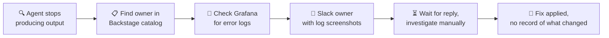
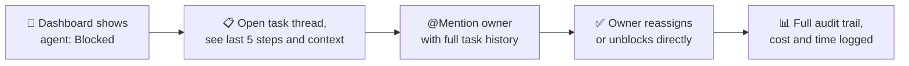

Backstage is how most engineering teams build their developer portals. Spotify open-sourced it, and thousands of companies now run it as a software catalog, documentation hub, and golden-path framework for internal tooling.

When a team first deploys AI agents, registering them in Backstage looks like the obvious move. You already have the catalog. Everyone knows how it works. So you add a "Research Agent" entry, link the repo, assign an owner, and call it done. Covered.

Then on a Tuesday afternoon your Research Agent stops producing output, and nobody notices until a manager asks where the weekly report is.

## What Backstage Does Well

Backstage solves a problem that gets worse as engineering organizations grow: nobody knows what's running, who owns it, or where the code lives. It gives teams:

- A **software catalog** that maps every service, API, and library with its owner, dependencies, and lifecycle status
- **TechDocs** for inline documentation that lives in the same place as the catalog entry
- **Scaffolding templates** to spin up new services with a consistent, approved starting point
- A **plugin ecosystem** that lets teams embed Grafana dashboards, CI/CD status, and cost reports into the portal
- **API registry** so teams can discover what's published, who owns it, and whether it's still supported

For large engineering organizations managing hundreds of microservices, Backstage is genuinely useful. It's the answer to "where is the thing, who built it, and how do I get started?"

## The Problem Once Your Agents Are Actually Running

Backstage's model is built on static metadata. A catalog entry tells you an agent exists, who owns it, and where the repository lives. That's the entire value proposition.

AI agents are different from REST APIs and microservices. They run tasks. They produce outputs that need human review before those outputs go anywhere important. They fail in non-obvious ways — not always with clean error codes, often by producing wrong output rather than throwing an exception. They cost money per run, and that cost varies by task complexity, model selection, and retry behavior. They depend on each other, so one stuck agent can block three downstream tasks you didn't know were waiting.

None of this maps onto a catalog entry. What you actually need to know when an agent is in production:

- Is this agent currently running, blocked, or stuck in a retry loop?
- What tasks has it worked on in the last 6 hours, and what did they produce?
- Was the last output reviewed and approved, or did it ship without anyone reading it?
- How much did it cost this week, and is that higher than normal?
- Which upstream agent blocked it, and since when?

With Backstage alone, answering those questions means tab-switching between Grafana, your log aggregator, Slack, and whatever spreadsheet your team uses to track agent tasks. Each tool shows a piece of the picture. Nobody has the whole thing in one place, and the picture is always a few minutes stale.

You can build Backstage plugins to pull in external monitoring data — but that's a development project, not something that ships out of the box. And even a well-built plugin only reads data. It doesn't let you reassign a blocked task, approve a deliverable, freeze an agent mid-run, or leave a note for whoever picks this up at 6am.

## AgentCenter vs Backstage: Feature by Feature

| Feature | Backstage | AgentCenter |
|---|---|---|
| Agent catalog / registry | Yes (static metadata) | Yes (live, with status) |
| Real-time agent status | No | Yes — online, working, idle, blocked |
| Task queue management | No | Kanban board per project |
| Task history | No | Full thread with context per task |
| Deliverable review | No | Submission and approval workflow |
| Per-task cost tracking | No | Yes, logged per run |
| Human approval gates | No | Yes, with @mentions |
| Multi-agent coordination | No | Yes, with task dependencies |
| Alerting on agent failures | Plugin-dependent | Yes, native |
| Infrastructure to manage | Yes (Kubernetes) | No (SaaS) |
| Starting cost | Free (hosting not free) | From $14/mo |

## Two Different Workflows

Here's what checking on a failing agent looks like when Backstage is your primary view:

Here's the same situation in AgentCenter:

The difference isn't just fewer steps. It's whether non-engineers can see what's happening, and whether there's a record of what was done when something went wrong. A catalog entry doesn't explain why an agent went quiet. A live control plane does.

## Can You Use Both?

Yes — and for larger teams, that's often the right setup.

Backstage handles the static layer well. What agents exist, who owns them, links to source repositories, TechDocs for how to configure each one, and scaffolding templates for creating new agents with your team's standards baked in. That catalog value doesn't disappear because you added a control plane. If anything, it becomes more useful when the catalog is accurate and the operational layer handles everything else.

AgentCenter handles the runtime layer: live status, task assignment and tracking, deliverable review, cost visibility by agent and project, and coordination across multi-agent workflows. These two tools don't step on each other.

Where teams go wrong is treating Backstage as a substitute for operational visibility. Registering an agent in a catalog means you've documented it exists — that's step one. Managing it in production is everything that comes after.

If you want to see what runtime agent management looks like, the [features page](/features) covers the full picture. [Agent monitoring](/features/agent-monitoring) shows specifically how status and cost tracking work once agents are live.

## Bottom Line

Backstage is good at what it was built for: making large engineering organizations legible. It wasn't built for operational AI agent management, and using it as a substitute means assembling visibility manually from several other tools.

If you're running agents and need to know what they're doing right now — not where their code lives, but what tasks they're on, what they cost, and whether their last output was any good — that's what AgentCenter is for.

---

*Backstage is good at what it does. AgentCenter does something different — it manages your agents, not just catalogs them. [Start your 7-day free trial](/pricing) — no lock-in.*
