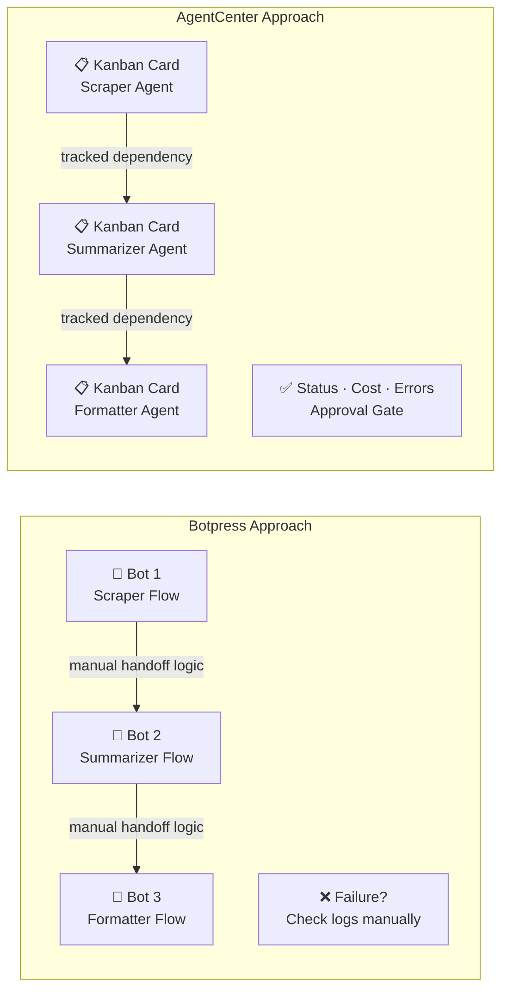

Botpress is a solid tool. If you need to build a customer service chatbot, wire up a FAQ assistant, or design multi-turn conversation flows that deploy across Slack, Teams, and your website, it genuinely does the job. The visual flow builder is approachable, the NLU works, and the open-source core means you can self-host if you need to.

But there's a point where teams running AI agents in production stop reaching for Botpress and start asking a different question: "How do I know what my agents are actually doing right now?" That's not a Botpress question. That's a control plane question.

## What Botpress Does Well

Before comparing, it's worth being honest about where Botpress earns its reputation:

- **Visual conversation design**: The flow editor lets you build multi-turn dialogues without writing much code. Non-engineers can contribute, which matters in small teams.
- **Built-in NLU**: Intent classification, entity extraction, and slot filling work out of the box. You're not stitching together separate ML pipelines for basic understanding.
- **Multi-channel deployment**: One bot, multiple surfaces. Web chat, Slack, Teams, WhatsApp, Telegram — Botpress handles the channel routing so you don't have to.
- **Open-source core**: The self-hostable version is actively maintained. If your org has strict data residency requirements, this matters.
- **Conversation analytics**: Drop-off rates, intent match percentages, unhandled messages — Botpress shows you where conversations break down, which is useful for iterating on dialogue design.
- **Community and templates**: There's a marketplace of pre-built integrations and a large community, so common use cases (support bots, lead capture, scheduling) have starting points.

If your goal is a well-designed conversational interface, Botpress is a reasonable choice. The problem is when teams try to use it as their operations layer for agents doing real work.

## The Core Limitation for Teams Managing AI Agents

Botpress thinks in conversations. You design a flow — user says X, the bot does Y, the system branches on Z. The whole mental model is about dialogue paths.

When you're running AI agents in production, the mental model is completely different. You have agents processing tasks in parallel. Some finish fast. Some get stuck. Some fail silently and keep appearing to run. Some cost $0.03 per run and some cost $4.20. You need to see all of that, in one place, in real time.

Botpress gives you none of it.

There's no task queue. There's no per-agent cost breakdown. There's no dashboard where you can see that agent #7 has been in a stuck state for two hours while agents #1-6 finished before lunch. There's no way to gate deliverables behind a review step before they reach your users or customers. There's no @mention system so your team can discuss a specific output before it goes out.

Teams reach for Botpress for agent workflows because the flow designer looks close enough to what they need. You can build sequences. You can call APIs. You can handle errors. But "close enough" breaks down the moment you hit production with 10 agents running simultaneously and no visibility into their state.

We've heard from teams who tried to manage agent pipelines through Botpress's conversation logs. You end up reading raw JSON. Manually searching for failed runs by timestamp. Calculating costs by pulling API usage reports from your model provider. It works until it doesn't, and it stops working at exactly the moment you most need it.

## AgentCenter vs Botpress at a Glance

| Feature | Botpress | AgentCenter |
|---|---|---|
| Primary use case | Conversational AI / chatbot design | AI agent fleet management |
| Task visibility | Active conversation count | Per-agent Kanban: working, idle, blocked |
| Real-time status | No dedicated agent status view | Live status across all agents |
| Cost tracking | Not built in | Per-agent, per-task token costs |
| Multi-agent coordination | No cross-bot task dependencies | Task dependencies, @mentions, shared projects |
| Deliverable approval | No output review workflow | Review and approval gates per task |
| Error handling | Flow-level error branches | System-level failure alerts and retry tracking |
| Activity feed | Conversation logs per bot | Cross-agent timeline with annotations |
| Agent framework | Botpress bots only | Any OpenClaw-compatible agent |
| Self-hosting | Yes (open-source core) | No |
| Pricing | Free tier; Team at $495/mo | Starter $14/mo, Pro $29/mo, Scale $79/mo |

The pricing difference reflects what each product is doing. Botpress scales with conversation volume and team seats. AgentCenter scales with the number of agents you're managing and the complexity of your workflows — starting at $14/month for up to 5 agents on the [Starter plan](/pricing).

## Workflow Comparison: Research Pipeline Example

Say you've built a three-agent research pipeline. Agent A scrapes sources, Agent B summarizes, Agent C formats the output for your content team.

**The Botpress approach:**

You'd wire up three separate bots with handoff logic between them. You'd track intermediate state yourself, probably in a database or a shared object. If Agent B (the summarizer) fails mid-run, there's no dashboard alerting you. You're checking conversation logs. Filtering by timestamp. Reading JSON to find the failed payload. Cost per run? You're pulling usage reports from your model provider's console and doing the math yourself.

**The AgentCenter approach:**

Each agent has a card on the [Kanban board](/features/task-orchestration). You see at a glance: Agent A (done), Agent B (stuck — 2h 14m), Agent C (waiting). You click the stuck card, read the error, and decide to restart or hand it off. Before Agent C's formatted output reaches the content team, it goes through an approval step. The run cost is visible on the card. You don't touch a log file.

The difference is instrumentation. Botpress makes you build your own. AgentCenter ships it as the product.

## Can You Use Both?

Yes, and some teams do exactly that.

Botpress handles the user-facing conversation layer — the bot your customers talk to, the intake form, the guided interaction. AgentCenter manages the backend agents that do the actual processing that conversation triggers.

A customer messages your support bot. Botpress routes the intent. That triggers an AgentCenter agent that looks up the account, checks entitlements, drafts a response, and routes it through a review step. The customer sees a clean response. The team sees the agent's work, cost, and review status in AgentCenter.

In that setup, they're not competing. Botpress is the front door. AgentCenter is [the control plane for what happens behind it](/features/agent-dashboard).

Where you shouldn't use Botpress: as the operations layer for managing agents producing real outputs. If an agent is running tasks that affect customer data, financial records, or published content, you need a dedicated place to see its status, catch its failures, and review its work. A conversation flow designer isn't that place.

## Bottom Line

Botpress is built for designing conversations. It does that well. AgentCenter is built for managing agents in production. If your AI work has grown past a single bot handling support tickets and into a fleet of agents running tasks, producing deliverables, and consuming real budget, you need the visibility that Botpress doesn't offer. A [dedicated agent monitoring and management layer](/features/agent-monitoring) isn't optional at that scale — it's the thing that keeps the whole operation from running blind.

---

*Botpress is good at what it does. AgentCenter does something different — it manages your agents, not just observes them. [Start your 7-day free trial](/pricing) — no lock-in.*
