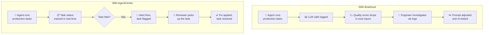

Braintrust is good at what it does. If you're running evals on LLM prompts, scoring outputs, and comparing model versions before shipping changes, it's one of the cleanest tools available for that job. Teams serious about output quality use it to catch regression before it reaches users.

But here's where things get fuzzy: once your agents are in production, running real tasks, failing in real ways — Braintrust isn't built to manage that. It's built to measure it. And there's a difference.

## What Braintrust Does Well

Braintrust is an LLM evaluation platform built for the prompt engineering and pre-deployment phase of agent work.

- **Eval suites**: Run structured tests against LLM outputs with scoring functions you write
- **Human review**: Route outputs to human raters for judgment-heavy tasks
- **Prompt comparison**: Compare two prompts on the same dataset to see which performs better
- **Experiment tracking**: See how quality scores shift as you iterate on prompts or models
- **LLM logging**: Capture inputs, outputs, tokens, and latency across model calls
- **Dataset management**: Build golden test sets and regression suites you can run repeatedly
- **CI integration**: Block a deployment when eval scores fall below a threshold you set

If you're doing serious prompt engineering work, Braintrust fits well into that loop. It gives you signal on whether a prompt change helps or hurts before you push it live.

## The Core Limitation for Agent Teams

Braintrust answers one question: is this LLM call producing good output?

That matters. But when you're running agents in production on real work, the questions shift to something more operational:

- Which agent is working on what task right now?
- Why did this agent's task fail — the model, the input, or a dependency?
- Who needs to review this deliverable before it ships downstream?
- What did this batch of tasks cost, and which agent caused the spend spike?
- Can I pause this agent's queue without breaking the pipeline?

Braintrust doesn't answer these. It wasn't built to. It lives at the development and quality layer, not the runtime coordination layer.

When teams realize they need both kinds of visibility, they end up reaching for a second tool. That second tool is what AgentCenter is.

## AgentCenter vs Braintrust: Side-by-Side

| Feature | Braintrust | AgentCenter |
|---|---|---|
| Primary purpose | LLM eval and prompt quality | AI agent task management and control plane |
| When it's used | Pre-deploy and post-deploy eval | Runtime — while agents are working |
| Task tracking | No | Yes — Kanban boards per agent and project |
| Real-time agent status | No | Yes — online, working, idle, blocked |
| Deliverable review | No | Yes — submission workflow with human approval |
| Cost tracking per agent | No | Yes — per-task cost attribution |
| Multi-agent coordination | No | Yes — dependencies, @mentions, orchestration |
| Human review gates | Yes (for eval scoring) | Yes (for production output approval) |
| Pricing | Free tier; paid plans scale with usage | Starter $14/mo, Pro $29/mo, Scale $79/mo |

The overlap is real — both tools involve humans reviewing LLM outputs. But the context is different. In Braintrust, that review happens on synthetic or sampled data to tune prompts. In AgentCenter, that review happens on actual production deliverables before they go to customers or downstream systems.

## How Each Tool Handles a Failing Agent

This is where the difference becomes practical.

**With Braintrust**, you find out a task failed when it shows up in your eval dashboard as a low-scoring entry. If you're logging everything, you might catch it quickly. If you're spot-checking, it could be hours.

**With AgentCenter**, the agent's status turns red immediately. The task shows up in the blocked column. A reviewer gets notified via @mention. The response happens in the tool where the work is happening, not in a separate dev tool.

## Workflow Comparison: Handling a Bad Agent Output

**Their way (using Braintrust alone):**

1. Agent runs 50 tasks overnight
2. LLM calls get logged to Braintrust
3. Next morning, you check the eval dashboard
4. Three tasks scored below threshold
5. You pull up the logs, find the problematic outputs
6. You adjust the scoring function or the prompt
7. You re-run evals to confirm the fix
8. You deploy — tasks may already be downstream by now

**AgentCenter way:**

1. Agent runs 50 tasks overnight
2. Each task status is tracked in real time on the [Kanban board](/features/task-orchestration)
3. Two tasks hit errors and get flagged automatically
4. Reviewer gets an @mention at 2am or queues it for morning triage
5. Reviewer checks the deliverable, decides whether to retry or escalate
6. Task resolved before the downstream system pulls it

The difference isn't just speed. It's that AgentCenter makes the work visible to the whole team, not just the engineer who checks the eval dashboard.

## Can You Use Both?

Yes — and for serious agent teams, you probably should.

Braintrust belongs in your development loop and CI pipeline. When you change a prompt, run it against Braintrust before pushing. When you switch models, eval the change before deploying. That pre-deployment quality gate is real value.

AgentCenter belongs in your production runtime. Once agents are live, you need task visibility, status tracking, deliverable review, and cost attribution — none of which Braintrust provides.

They don't compete. They live at different points in the agent lifecycle. Braintrust fires before and after deployment; [AgentCenter](/features) manages what happens in between.

Where teams get into trouble is treating Braintrust as their only agent management tool. They end up with great eval scores and no idea which agent is failing at 11pm, which deliverable needs review, or which task blew through the cost budget.

## Bottom Line

Braintrust is a strong tool for prompt quality and LLM evaluation. It's not an agent management platform — it doesn't track tasks, coordinate teams, or give you a runtime view of what your agents are doing right now.

If you're serious about running agents in production, you need both layers. Use Braintrust to catch quality regressions in your dev loop. Use AgentCenter to manage the agents once they're live.

The question isn't which one to pick. It's knowing which one handles which job.

---

*Braintrust is good at measuring agent output quality. AgentCenter manages what agents are doing while they produce it. [Start your 7-day free trial](/pricing) — no lock-in.*
