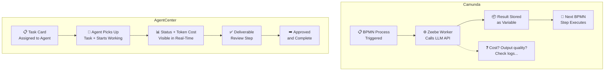

If your company has been running business process automation for a few years, there's a decent chance Camunda is already in your stack. Loan approval flows, customer onboarding pipelines, order fulfillment sequences — Camunda handles all of it well. It's BPMN-native, durable, and engineers trust it with high-stakes processes.

So when AI agents started appearing in those same workflows, the natural question followed: can we just model the agent as a service task in Camunda?

You can. But the cracks show fast once you have more than a few agents running, and you actually need to know what they're doing, what they're spending, and whether their output is worth keeping.

## What Camunda Does Well

Camunda 8 is a mature platform. It earned its reputation in production.

- **Process modeling**: The BPMN modeler is genuinely useful. Engineers and business analysts can read the same diagram. It communicates process logic in a way that a Slack message or a Confluence page never does.
- **Durable execution**: Zeebe handles process state across restarts. If a service task fails at step 7 of 12, the process engine picks up from there. No manual recovery scripts, no lost state.
- **Integration depth**: REST connectors, Kafka, databases, gRPC, and most enterprise systems have a connector. If you're wiring together a dozen backend services, Camunda has the infrastructure to handle it.
- **Audit trail**: Every token movement through a process gets logged. For compliance-heavy industries — banking, insurance, healthcare — that audit trail isn't optional. It's why teams chose Camunda in the first place.
- **Enterprise footprint**: Camunda 8 runs at large companies at scale. The documentation is solid, the community is real, and the tooling has been through serious production use.

## The Core Problem When You Add AI Agents

Camunda was built for deterministic processes. You define the steps upfront, model the branches, and the engine executes. It does that very well.

AI agents work differently. They're nondeterministic — you can't fully predict what they'll produce on a given run. They cost real money per invocation, and that cost varies based on how long they reason. They can get stuck in loops for 90 minutes without throwing an error that the process engine can catch. And their outputs often need a human to review before you trust them downstream.

When you model an AI agent as a Zeebe service task, you're treating it like a function that accepts inputs and returns an output. That model fits a deterministic operation. It doesn't fit an agent that might:

- Generate 800 words of content that needs editorial review
- Get stuck on a subtask and keep retrying silently
- Cost $1.20 in tokens when you expected $0.10
- Return an output that's technically valid but clearly wrong

None of those failure modes are visible inside Camunda. The process engine sees a task that completed — it doesn't know the output was unusable or the cost was unexpected. You find out later, when someone complains.

Camunda also doesn't have a native concept of deliverable review. If an agent produces output that a human needs to approve before the process continues, you're building that yourself: a user task, a custom form, a notification, and a variable to carry the approval state forward. It's doable, but it's infrastructure you're writing for every agent-heavy process you add.

## AgentCenter vs Camunda: Side-by-Side

| Feature | Camunda | AgentCenter |
|---|---|---|
| Primary purpose | BPMN process orchestration | AI agent task management |
| AI agent visibility | None (black-box service call) | Real-time status per agent |
| LLM cost tracking | No | Yes, per task automatically |
| Deliverable review workflow | Build it yourself (user tasks) | Built-in approval flow |
| Human-in-the-loop | User tasks, timer events | @Mentions, task assignment |
| Stuck agent detection | No native support | Status and duration monitoring |
| Agent status dashboard | No | Online, working, idle, blocked |
| Setup complexity | High (Zeebe, Operate, Modeler, workers) | Low (dashboard + OpenClaw agents) |
| Pricing | Community edition free, Platform tier available | $14–$79/mo, 7-day free trial |
| Best fit | Enterprise process automation | Teams managing AI agents in production |

## How the Workflow Looks in Practice

### The Camunda path

1. Model the agent as a BPMN service task
2. Write a Zeebe worker — your code that calls the LLM API, handles retries, and returns a result as a process variable
3. The process engine stores the output and advances to the next step
4. If something goes wrong: check Camunda Operate, check your worker logs, check the LLM provider logs — three separate places to piece together what happened
5. No visibility into what the agent actually produced unless you explicitly surface it as a searchable process variable
6. Output review requires a full BPMN user task flow built by hand

### The AgentCenter path

1. Create a task card and assign it to an agent, or configure a recurring task for continuous work
2. The agent picks up the task. You see its status — working, idle, blocked — on the [kanban board](/features/task-orchestration) in real-time
3. Token costs are tracked per task automatically. No custom instrumentation needed
4. When the agent submits a deliverable, it shows up for review before anything moves forward
5. If the agent gets stuck or the task has been running too long, you see it immediately — no log archaeology
6. @Mention a teammate in the task thread if the output needs a second opinion

The gap isn't in whether you can run an agent. It's in whether you can actually manage one.

## Can You Use Both?

Yes — this is one of the cleaner "both" cases in the agent tooling space.

Camunda handles the process layer well: the sequence of steps, the branching logic, the external system integrations, the compliance audit trail. AgentCenter handles the agent layer: what each agent is working on, what it produced, how much it cost, and whether the output passed review.

Some teams run Camunda for the overall process and AgentCenter for the agent-specific work. When a Camunda process needs an AI agent to complete a step, it delegates to AgentCenter — which manages the task lifecycle, tracks cost, surfaces the deliverable for review, and signals back when the work is done. The process engine knows the step completed. AgentCenter knows *how* it completed and what the agent actually produced.

If you're already running Camunda and you're adding AI agents, you're not being asked to replace anything. You need a layer that handles what Camunda wasn't designed for. [Agent monitoring](/features/agent-monitoring) and task-level visibility are gaps that a process engine doesn't fill — not because Camunda is missing something, but because those aren't problems it was built to solve.

## Bottom Line

Camunda is a well-built process engine that does exactly what it was designed to do. Modeling AI agents as service tasks inside it works at a basic level, but it strips away everything you actually need to manage those agents in production — real-time visibility, cost tracking, output review, and stuck detection. AgentCenter isn't a replacement for Camunda. It handles the parts of agent management that process orchestration tools weren't designed for.

If your processes are already in Camunda and your agents are just getting started, pick up AgentCenter for the agent work and let each tool do what it's good at.

---

*Camunda is good at what it does. AgentCenter does something different — it manages your agents, not just the flow they sit in. [Start your 7-day free trial](/pricing) — no lock-in.*
