Celery is one of those tools that just works. You add it to a Python project, wire it to Redis, and suddenly your slow synchronous code runs in the background. For a team spinning up its first AI agent pipeline, Celery feels like the obvious answer — it handles retries, distributes work across workers, and ships with a monitoring UI called Flower.

But there's a moment — usually around your 6th or 7th agent — when you realize Celery answers a different question than the one you're actually asking. Celery tells you whether a task ran. It doesn't tell you what that task produced, whether the output was useful, what it cost, or who's supposed to review it.

## What Celery Does Well

To be fair: Celery is excellent at what it was built for.

- **Reliable background execution** — automatic retries with configurable backoff, task timeouts, and dead letter queues
- **Distributed worker pools** — scale horizontally without changing application code; drop in more workers as load grows
- **Beat scheduler** — built-in cron-like scheduling for recurring tasks, no extra infrastructure needed
- **Broker flexibility** — works with Redis, RabbitMQ, and several other backends; swappable without rewriting tasks
- **Flower dashboard** — real-time view of worker status, task history, queue depth, and error rates
- **Mature ecosystem** — 10+ years in production, battle-tested by large companies, excellent documentation
- **Language-native** — if your agents are Python, Celery integrates without a protocol boundary

If you're running background jobs — sending emails, processing uploads, syncing databases, triggering webhooks — Celery is a solid choice. The problem is that AI agents aren't background jobs. They're closer to team members with tasks, and managing them requires a different toolset.

## The Core Limitation

Celery tracks task state: `PENDING`, `STARTED`, `SUCCESS`, `FAILURE`, `REVOKED`. That's exactly right for a job that resizes an image. For an AI agent, that's about 10% of what you actually need to know.

When an agent task completes with status `SUCCESS`, Celery's job is done. But yours isn't. You still need to know:

- What did the agent actually produce?
- Does the output meet quality expectations?
- Which team member needs to review it before it ships?
- How many tokens did that run consume, and what did it cost?
- Is this agent running slower than it did last week?
- If it failed 3 times this sprint, why?

None of that lives in Flower. You'd need to build it — logging outputs to a database, writing dashboards, wiring up alerts, building review workflows. By the time you've done all that, you've rebuilt the control plane that AgentCenter already ships.

## AgentCenter vs Celery — Side by Side

| Feature | Celery + Flower | AgentCenter |
|---|---|---|
| Background task execution | Yes | No — needs OpenClaw agent runtime |
| Distributed worker management | Yes | No |
| Task retry and backoff | Yes, configurable | Via OpenClaw runtime |
| Real-time task status | Worker-level (queue depth, worker state) | Agent-level (online, working, idle, blocked) |
| Output/deliverable review | No | Yes — capture, review, and approve outputs |
| Per-task cost tracking | No | Yes — LLM token cost per task |
| Team @mentions on tasks | No | Yes — tag teammates in task threads |
| Agent health monitoring | No — worker health only | Yes — error rates, latency, performance trends |
| Kanban board for task management | No | Yes |
| Recurring agent tasks | Yes (Beat scheduler) | Yes (Pro+ and above) |
| Multi-project management | No | Yes — up to 50 projects on Scale |
| Pricing | Free (open-source) | $14/mo Starter — $79/mo Scale |
| Setup complexity | Broker (Redis/RabbitMQ) + workers + Flower | Account + OpenClaw agent |

## Workflow: Agent Failure at 2am

```mermaid
graph TD
    subgraph "Celery Approach"
        A1["⚙️ Agent task runs"] --> A2{"Task result?"}
        A2 -->|Failure| A3["🔴 Marked FAILED<br/>Retries attempted"]
        A3 --> A4["❓ Retries exhausted<br/>Task sits in FAILURE"]
        A4 --> A5["🌅 Engineer checks Flower<br/>next morning"]
        A5 --> A6["📋 Parses logs manually<br/>No output captured"]
    end

    subgraph "AgentCenter Approach"
        B1["⚙️ Agent task runs"] --> B2{"Task result?"}
        B2 -->|Failure| B3["🔴 BLOCKED status<br/>on Kanban board"]
        B3 --> B4["📣 Activity feed alert<br/>with error context"]
        B4 --> B5["👥 @mention teammate<br/>to pick it up"]
        B5 --> B6["💰 Failed run cost<br/>tracked separately"]
    end
```

The difference isn't just aesthetics. When you're running 15 agents across 5 projects, "check Flower in the morning and parse logs" stops scaling. You need the failure to surface to the right person immediately, with enough context to act on it without an archaeology session.

## Step-by-Step: Handling a Degraded Agent

**With Celery:**

1. Agent task starts producing lower-quality outputs — Celery still marks it `SUCCESS`
2. No one notices because Celery doesn't inspect output quality
3. Bad outputs accumulate downstream
4. Someone catches it in a manual review 3 days later
5. Engineers spend half a day tracing which tasks were affected
6. Cost of degraded runs is unknown — not tracked anywhere

**With AgentCenter:**

1. Agent task completes — output is captured as a deliverable for review
2. Reviewer flags the output in the task thread
3. Agent is marked BLOCKED — no new tasks assigned until reviewed
4. Cost of affected runs is visible in [agent monitoring](/features/agent-monitoring)
5. Pattern is visible: same agent, 12 affected tasks, $4.20 extra spend this week
6. Root cause investigation starts from a specific, bounded problem

## Can You Use Both?

Yes, and many teams do. Celery is excellent for the parts of your system that aren't AI agents — sending notification emails, running data sync jobs, processing file uploads. If those jobs live alongside your OpenClaw agents, keep Celery for them.

What you probably don't want to do is use Celery as your agent management layer. Flower shows queue depth and worker utilization. That's genuinely useful for infrastructure health. It doesn't show agent productivity, output quality, cost trends by agent, or team coordination. Those gaps grow painful as the number of agents grows.

A common pattern: Celery for infrastructure-level background jobs, AgentCenter as the [control plane](/features/agent-dashboard) for the AI agents themselves. The two don't overlap — they cover different layers of the stack.

## Bottom Line

Celery is a distributed task queue. It's been doing that job reliably for over a decade, and it's good at it. AgentCenter is a control plane for AI agents — task management, output review, cost tracking, and team coordination. They're solving different problems.

If you're managing AI agents in production and the question is "what are my agents doing, what did they produce, and what did it cost" — that's AgentCenter's job. If the question is "how do I run Python functions reliably in the background" — that's Celery's job. Knowing which question you're asking saves a lot of rebuilding.

---

*Celery is great at running tasks reliably. AgentCenter tells you what those agents are actually doing. [Start your 7-day free trial](/pricing) — no lock-in.*
