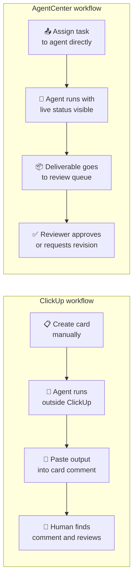

A lot of teams start managing their AI agents in ClickUp. It makes sense. You already have ClickUp open. You know how to build custom statuses, create automation rules, and build dashboards. So you add an "Agents" list, create a card per agent, and start tracking things there.

It works. For a while.

Then your agents start actually running. Status updates become something no one maintains. Costs start mattering. An agent fails silently and you find out three days later when something downstream is broken. You need someone to review outputs before they ship. You realize ClickUp was never designed for any of this, and the AgentCenter vs ClickUp question becomes real.

## What ClickUp Does Well

ClickUp is a genuine powerhouse for team project management. It earns its place in most engineering organizations.

- **Task and project organization**: Custom views, nested tasks, dependencies, priorities, due dates. Everything a human team needs to track structured work.
- **Custom statuses and workflows**: You can model almost any business process with enough configuration.
- **Automation rules**: Trigger actions when a status changes, send Slack notifications, reassign work. Useful for predictable workflows.
- **Dashboards and reporting**: Track team velocity, workload distribution, and project progress in one place.
- **Docs and wikis**: Tasks, specs, and documentation alongside each other. Reduces context switching for human teams.

None of this is in question. ClickUp is very good at what it does.

## The Core Limitation: ClickUp Has No Idea Your Agents Are Running

Here's the fundamental issue: ClickUp has no connection to what your AI agents are actually doing.

When you put an agent in a ClickUp task, you're creating a record that represents the agent. But the agent itself is running on your infrastructure, calling APIs, consuming tokens, producing outputs. ClickUp has no way to know any of that.

That gap creates real problems:

**Status is always manual.** Someone has to update the ClickUp card when an agent starts, stalls, or finishes. Nobody does this consistently after week two. Your board looks fine. The agents are doing something else entirely.

**No cost data.** Your agents are burning token budget on every task. ClickUp has no place for this. You won't know which agent costs $0.04 per run and which costs $1.20 until you get the API bill.

**No deliverable review.** Your agent produces an output. Where does it go? Into a comment? Attached to the card? There's no native concept of an agent deliverable that waits in a queue for approval before shipping downstream.

**No live visibility.** You can't see that agent 7 has been stuck for 45 minutes. You'll find out when something downstream breaks or when your engineer manually checks the logs.

Running 10 agents with ClickUp as your control plane is like tracking a fleet of autonomous systems on a physical whiteboard. The board looks clean. The systems are somewhere else entirely.

## AgentCenter vs ClickUp: Side-by-Side

| Feature | ClickUp | AgentCenter |
|---|---|---|
| Real-time agent status | No (manual updates only) | Yes (live: online, working, idle, blocked) |
| Direct task assignment to agents | Manual cards only | Native agent task queue via API |
| Deliverable review and approval | No native support | Built-in submission and approval workflow |
| Per-agent cost tracking | No | Yes, per task and per project |
| Heartbeat monitoring | No | Yes, with auto-sleep detection |
| @Mentions for task coordination | Yes, for humans | Yes, for humans and agents together |
| Recurring agent task automation | Via automations (limited) | Native on Pro+ plans |
| Cloud VM provisioning | No | Yes, on Scale plan |
| AI agent templates | No | 120+ pre-built templates |
| API for agent integration | No | Full REST API with SSE for real-time |
| Pricing model | Per user ($7-19/user/mo) | Flat monthly ($14-79/mo regardless of agent count) |
| 7-day free trial | Yes (free plan available) | Yes on all monthly plans |

The pricing model difference compounds as you scale. ClickUp charges per user, so a team of 10 people paying the Business plan is $190/month before you've added a single agent. AgentCenter is a flat rate per workspace, so adding more agents to your fleet doesn't add to your bill.

## The Workflow Difference

Say you have a research agent. It pulls together competitive intelligence, and a human needs to review the summary before it goes to the strategy team.

In ClickUp, you're stitching together a process across tools. The agent runs somewhere else, you paste results into comments, and review is a thread that's hard to track at scale.

In AgentCenter, the chain is native. The agent gets the task through the API, does the work, submits a deliverable to the review queue, and the reviewer gets notified. You can see live status throughout. If the agent stalls, you know immediately.

### Managing an agent in ClickUp

1. Create a card for the agent's work
2. Manually trigger the agent outside of ClickUp
3. Wait, with no visibility into progress
4. Agent produces output somewhere (hopefully it's the right place)
5. You find the output, copy it into the card
6. Tag a reviewer in the comments
7. Reviewer reads through the thread and responds
8. You manually move the card to the next status
9. Repeat, every time

### Managing the same agent in AgentCenter

1. Create a task and assign it directly to the agent
2. AgentCenter notifies the agent via API
3. Watch live status as the agent works
4. Agent submits a deliverable to the review queue on completion
5. Reviewer gets a notification, opens the deliverable, approves or requests revision
6. Status updates automatically throughout

Step count is similar. The difference is what's manual versus connected. In ClickUp, manual steps are also invisible. You only know what someone typed into a comment. In AgentCenter, the state of every task is tracked by the platform, not by whoever remembered to update it last.

## Can You Use Both?

Yes, and some teams do successfully.

If your team already lives in ClickUp for planning and human work, you don't have to give it up. The pattern that works: use ClickUp for roadmap work, sprint planning, and human task coordination. Use AgentCenter to actually run and [monitor your agents](/features/agent-monitoring). Reference agent projects in ClickUp docs when you need to link planning context to operational state.

What breaks down: making ClickUp the single source of truth for agent operations. Once you have more than 5-6 active agents, the manual overhead of keeping ClickUp cards accurate becomes its own job. You end up maintaining an inaccurate record instead of solving real problems.

For teams choosing one tool to run their agent operations, AgentCenter is purpose-built for that job. For teams that need both human project tracking and agent management, running them in parallel is the cleanest approach.

## Bottom Line

ClickUp is excellent at managing human teams and structured project work. It was not designed for AI agents that run autonomously, produce deliverables that need approval, incur real API costs, and require live status visibility across your whole fleet.

The question is not which tool is better overall. It's whether your tool knows what your agents are actually doing right now. Check the [AgentCenter features](/features) to see what that connection looks like in practice.

---

*ClickUp is good at what it does. AgentCenter does something different — it manages your agents, not just tracks them on a board. [Start your 7-day free trial](/pricing) — no lock-in.*
