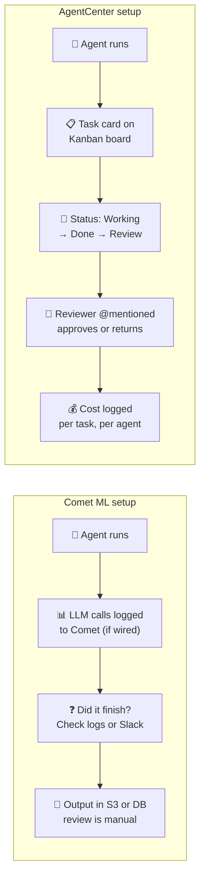

Comet ML is a solid tool. If you're training models and want to know which run hit the best validation loss, Comet handles that well. It logs your experiments, compares hyperparameters across runs, versions your artifacts, and gives you a clean UI to dig into what went wrong. For data science teams running training jobs, it earns its place.

But teams building production AI systems often hit a wall when they try to use Comet ML as their agent control plane. That's where AgentCenter comes in — and the difference is sharper than most people expect.

When your AI agents are running in production — pulling data, generating reports, processing documents, handing off tasks to other agents — Comet ML doesn't have an answer. That's not a knock on the product. It was built for a different problem. The issue is teams keep reaching for the tool they already know instead of recognizing they've entered a different phase.

## What Comet ML Does Well

- **Experiment tracking**: Automatically logs training runs with metrics, hyperparameters, code state, and environment details
- **Model comparison**: Side-by-side views of multiple runs, so you can find what's actually improving performance
- **Artifact management**: Store and version datasets, models, and checkpoints alongside the run that produced them
- **LLM evaluation**: Newer features track prompt/response pairs, let you score outputs, and compare prompts across runs
- **Collaboration for ML teams**: Share experiments, annotate specific runs, leave comments where the data is
- **Framework integrations**: Works with PyTorch, TensorFlow, Hugging Face, Keras, and most of the popular ML stack

If you're in the phase where your team is iterating on models and tracking what changes improve performance, Comet ML makes sense.

## The Core Limitation for Teams Managing AI Agents

Training runs finish. Agents don't.

Once you deploy an AI agent, the job shifts completely. You're no longer asking "which hyperparameters worked?" You're asking: what is this agent doing right now? Has it finished the task it was assigned three hours ago? Why is the invoice parsing agent stuck on the same document? Which task is blocked because it's waiting on output from another agent?

Comet ML tracks training metrics. It doesn't track any of this. Three things specifically break when teams try to use it as an agent management layer:

**Task visibility.** There's no view of what your agents are currently working on. "The agent is running" tells you nothing actionable. You can't see if it's stuck, waiting, done, or silently erroring. You check logs. You ping a Slack channel. You wait.

**Deliverable review.** When an agent finishes a piece of work, someone needs to look at it before it goes anywhere. Comet has no workflow for that. The output lands in a database or gets dropped into a folder. It gets reviewed when someone remembers to check, or not at all until something downstream breaks.

**Cost tracking per task.** Comet can capture LLM call metadata if you manually wire it in. AgentCenter tracks cost per task automatically, across every agent, without extra setup. When you have 12 agents running concurrently, you want to know which one is eating 60% of your monthly budget.

## AgentCenter vs Comet ML: Feature Comparison

| Feature | Comet ML | AgentCenter |
|---|---|---|
| ML experiment tracking | Yes (core feature) | No |
| Model versioning and artifacts | Yes | No |
| Real-time agent status | No | Yes |
| Task queue and Kanban board | No | Yes |
| Deliverable review and approval | No | Yes |
| Multi-agent workflow coordination | No | Yes |
| Per-task cost tracking | Partial (manual setup) | Yes (automatic) |
| @Mentions and task threads | No | Yes |
| Recurring task automation | No | Yes (Pro+) |
| Agent error alerting | No | Yes |
| Pricing (entry-level) | Free tier / ~$49/mo for teams | $14/mo (Starter) |
| Built for | Model training and evaluation | Production agent management |

## Workflow Comparison

Here's a concrete example: a research agent that pulls news daily, summarizes it, and hands off to a report-writing agent.

**Running with Comet ML:**

1. Agent fires on a cron schedule
2. LLM calls get logged to Comet if you set up the integration
3. Output goes to an S3 bucket or database row
4. You check a Slack message or monitoring alert to see if it ran
5. Someone reviews the output manually, if they remember
6. At month end, you reconcile costs from your LLM provider's billing dashboard

**Running with AgentCenter:**

1. Agent runs and a task card appears on the [Kanban board](/features/task-orchestration) automatically
2. Status updates in real time: Working, Blocked, Done
3. When the agent finishes, the task moves to Review and the assigned reviewer gets @mentioned
4. Reviewer approves or sends it back with a comment
5. The cost for that specific run is attached to the task card, no extra setup needed

Same agents underneath. Completely different level of control.

## Can You Use Both?

Yes. There's a natural division of labor here.

Comet ML is for the development phase: training, evaluating, comparing model versions, tracking which prompt changes moved the needle. If your team iterates on models, Comet fits that part of the work.

AgentCenter is for what comes after: the agents are deployed, they're running tasks in production, and you need to know what they're doing, what they've produced, and what it's costing you. That's the [agent monitoring](/features/agent-monitoring) and task management layer.

A team building LLM-based agents might reasonably use Comet during development to evaluate outputs and compare approaches, then switch to AgentCenter once those agents are live and handling real work. The two tools don't overlap much in practice.

What doesn't work is treating Comet as a substitute for production agent management. It doesn't have task queues, deliverable review, real-time status, or multi-agent coordination. Those primitives aren't on the roadmap because it's solving a different problem.

## Bottom Line

Comet ML and AgentCenter operate at different stages of the agent lifecycle. Comet covers the pre-production side: experiments, evaluation, model tracking. AgentCenter covers production: what are your agents doing, what have they built, and what's it costing you.

If you're moving from "we trained a model" to "we have agents running tasks every day," that's the moment to add a control plane. See [AgentCenter's plans](/pricing) — Starter is $14/month with a 7-day free trial and no lock-in.

---

*Comet ML is good at tracking ML experiments. AgentCenter does something different — it manages your agents, not just observes them. [Start your 7-day free trial](/pricing) — no lock-in.*
