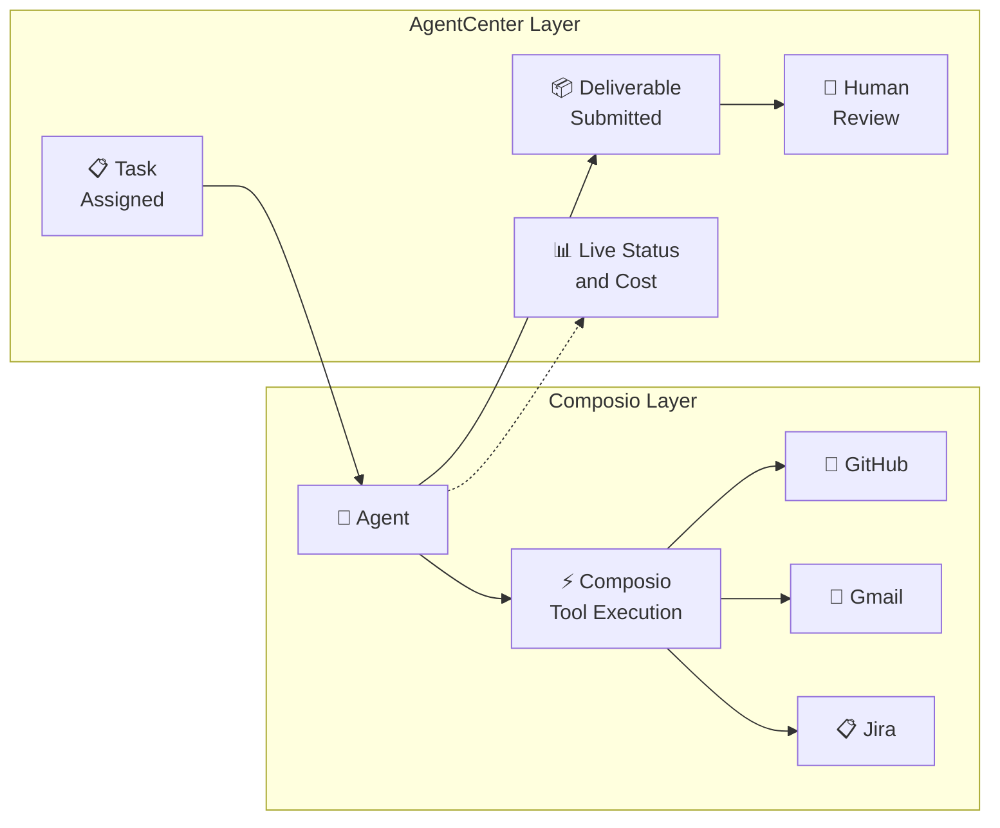

Composio solves a real problem. Connecting AI agents to GitHub, Slack, Salesforce, or any of 200+ other services by hand is tedious and brittle. OAuth flows, API versioning, action schemas — Composio handles all of that so your agent can call a tool and get a result. That's genuinely useful.

But "my agents can take actions in external tools" and "I know what my agents are doing" are two different problems. One is about capability. The other is about control.

## What Composio Does Well

Composio is a tool layer for AI agents. Here's where it earns its place:

- **200+ pre-built integrations.** GitHub, Gmail, Jira, Notion, Slack, HubSpot, and others. Each comes with action schemas designed for LLMs — less prompt engineering, more reliable tool calls.
- **Auth management.** Composio stores credentials and handles OAuth so your agents don't need to. That's a meaningful chunk of infrastructure you don't have to build.
- **Framework compatibility.** Works with LangChain, CrewAI, AutoGen, OpenAI Assistants, and most other agent frameworks out of the box.
- **Managed execution.** Composio runs the action server-side. Your agent sends a call, gets a result. The underlying HTTP plumbing is their problem.
- **Free tier.** Low barrier to get started.

If you're building an agent that needs to touch external APIs, Composio removes a real class of problems.

## The Core Limitation for Teams Managing AI Agents

Composio is a tool layer, not a management layer. It answers "what can my agent do?" — not "what is my agent doing right now?"

When you have 5 agents calling Composio actions in parallel, you still don't know:

- Which task each agent is working on
- Whether they completed or got stuck waiting for a tool response
- How much each agent's work is costing in LLM spend
- Whether their outputs are any good
- Who on your team is reviewing what came back

Composio logs tool calls. It doesn't give you a [Kanban board](/features/task-orchestration), real-time agent status, deliverable review workflows, or cost breakdowns by project or agent.

You end up building that layer yourself — spreadsheets, Slack pings, custom dashboards — and it doesn't scale.

## AgentCenter vs Composio: Side by Side

| Feature | Composio | AgentCenter |
|---|---|---|
| Primary purpose | Tool integrations for agents | Agent control plane for teams |
| External tool integrations | 200+ (GitHub, Slack, Jira, etc.) | Not in scope — pair with Composio |
| Agent status visibility | No | Real-time (online, working, idle, blocked) |
| Task management | No | Kanban board, priorities, deadlines |
| Deliverable review | No | Full submit, review, and approval workflow |
| Cost tracking | No | Per-task and per-agent LLM spend |
| Multi-agent coordination | No | Task dependencies, cross-agent @mentions |
| Auth management | Yes (OAuth, API keys per service) | Not in scope |
| Team collaboration | No | Channels, @mentions, task threads |
| Recurring automation | No | Yes (Pro+ plan) |
| Pricing | Free tier; paid plans available | Starter $14/mo, Pro $29/mo, Scale $79/mo |
| Works with OpenClaw agents | No | Yes |

## Workflow Comparison: Debugging a Stuck Agent

Here's what happens when an agent stops producing output.

**With Composio only:**

1. Agent goes quiet — no task updates
2. You check Composio's dashboard and find logged tool calls
3. You identify which tool call failed or timed out
4. You dig through your own application logs to trace what the agent was trying to accomplish
5. You cross-reference timestamps between Composio logs and your app logs manually
6. No view of the task context, what the agent already delivered, or what's still pending
7. Reassigning the work means touching code

**With AgentCenter:**

1. Agent shows "blocked" status in the real-time [agent monitoring](/features/agent-monitoring) dashboard
2. You open the task — see what it was assigned, what it already submitted, what's still open
3. @mention a teammate to take over, or reassign to another agent in two clicks
4. Review partial deliverables and decide whether to approve, reject, or continue
5. See cost spent on this task vs. budget — no digging through logs

The two layers are separate by design. Composio handles what the agent can do. AgentCenter handles what the agent is doing — and whether you trust the result.

## Can You Use Both?

Yes, and it's often the right setup.

If your agents need to call external APIs or take actions in third-party tools, Composio is a reasonable choice for the integration layer. Your OpenClaw agents use Composio to execute actions in GitHub, Slack, or Gmail. AgentCenter sits above that — managing the agents, their tasks, their outputs, and your team's review process.

One team we've seen use this combination: a content operations team running 12 agents. The agents use Composio to pull data from Notion and push drafts to their CMS. AgentCenter tracks which drafts are in review, who approved what, and how much each content piece is costing in LLM tokens. Neither product is trying to do the other's job.

The separation makes sense. Tool integrations and agent management are different problems. Composio has built a solid answer to one. AgentCenter is the answer to the other.

## Bottom Line

If your agents need to interact with external tools and services, Composio reduces the integration work. If your team needs to see what those agents are actually working on and review what they produce, that's a different job — one that Composio wasn't built for.

The two fit together cleanly. The only problem is thinking that one replaces the other.

---

*Composio is good at what it does. AgentCenter does something different — it manages your agents, not just the tools they call. [Start your 7-day free trial](/pricing) — no lock-in.*
