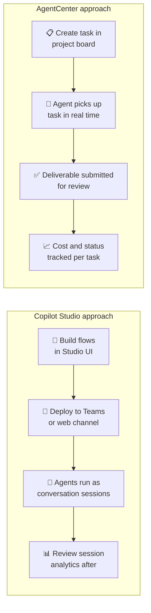

Microsoft Copilot Studio is a real tool. If your team runs on Teams, uses Microsoft 365, and wants a customer-facing chatbot deployed without much code, Copilot Studio will get you there faster than most alternatives.

But there's a question it can't answer: once your agents are live, how do you know what they're doing?

## What Microsoft Copilot Studio Does Well

Copilot Studio is built for a specific job: creating and deploying conversational AI agents inside the Microsoft ecosystem.

- **Visual flow builder**: design conversation flows without code, using a drag-and-drop topic editor
- **Microsoft 365 integration**: native connections to Teams, SharePoint, Dynamics 365, Outlook, and Power Automate
- **Generative AI answers**: pull responses from uploaded documents or SharePoint sites without hardcoding every answer
- **Multi-channel publishing**: push your agent to Teams, embedded websites, mobile apps, and email channels in a few clicks
- **Built-in analytics**: session volume, escalation rates, topic resolution, and CSAT scores in one dashboard
- **Pre-built templates**: Microsoft ships templates for HR bots, IT help desks, customer service, and internal FAQ agents

For enterprise teams already paying for Microsoft licensing, this is the path of least resistance. You don't need a developer to ship a working chatbot to Teams.

## The Problem for Teams Running AI Agent Fleets

Copilot Studio is a builder and a channel publisher. Once agents are deployed, what you get back is session-level analytics.

That works for a help desk bot answering password reset questions. It doesn't work when you're running agents that do research, generate deliverables, pass work between each other, and consume real API tokens on every run.

Here's what teams actually run into:

**No task-level visibility.** You can see how many conversations happened. You can't see which specific task is in progress right now, which agent has been idle for three hours, or which one got stuck waiting on a dependency.

**No per-task cost tracking.** Copilot Studio shows general usage metrics tied to Microsoft licensing consumption. If costs go up this week, you can't trace which agent, which task type, or which step is responsible.

**No native multi-agent coordination.** Running a research agent that hands off to a writing agent that routes to a QA agent isn't a Copilot Studio problem. Power Automate can stitch together some automation flows, but it's not designed to manage AI agents as persistent entities with task queues, priority lanes, and status states.

**Deliverable review is manual.** If an agent produces a draft, a report, or structured data, Copilot Studio has no built-in way to submit that output for human review, track it against acceptance criteria, or gate it before it moves downstream.

**Locked to the Microsoft stack.** If your agents use Anthropic Claude directly, OpenAI GPT-4 via your own keys, or any model outside Azure OpenAI, Copilot Studio's integrations aren't built for that. AgentCenter works with any OpenClaw-compatible provider.

## Side-by-Side Comparison

| Feature | Copilot Studio | AgentCenter |
|---|---|---|
| Primary purpose | Build and deploy chatbot agents | Manage agents in production |
| Real-time agent status | Session aggregates only | Working, idle, blocked, error |
| Task-level visibility | Not available | Per-task status, timing, logs |
| Cost tracking | Microsoft licensing consumption | Per-task token cost visibility |
| Multi-agent coordination | Power Automate flows required | Native task dependencies and handoffs |
| Deliverable review | Not built in | Submission workflow, approvals, version history |
| LLM provider support | Azure OpenAI and Microsoft models | Any OpenClaw-compatible provider |
| Starting price | ~$200/mo for 25k messages plus M365 | $14/mo (5 agents, 3 projects) |
| Free trial | Limited via Microsoft ecosystem | 7-day free trial, cancel anytime |
| Works outside Microsoft | Limited | Yes |
| Best for | Microsoft enterprise chatbots | Dev teams running AI agent fleets |

## Workflow Comparison

Say you're running a content production pipeline: a research agent gathers sources, a writing agent drafts the piece, a QA agent fact-checks it, and a publishing agent queues it for release.

**Copilot Studio path:**
1. Build each agent as a conversation topic or generative AI flow in the visual editor
2. Connect to Power Automate to pass data between agent steps
3. Deploy to your chosen Microsoft channel
4. Monitor through the session analytics dashboard
5. Debug failures by manually exporting conversation transcripts

**AgentCenter path:**
1. Configure your OpenClaw agents and connect them via the AgentCenter API
2. Create tasks in the [task orchestration board](/features/task-orchestration) with context, output spec, and acceptance criteria
3. Watch real-time status as each agent picks up its task
4. Review submitted deliverables through the approval workflow before they move downstream
5. Track per-task cost and duration from the [agent monitoring dashboard](/features/agent-monitoring)

The difference shows up most when something breaks. With Copilot Studio, you know a session completed or escalated. With AgentCenter, you know which task stalled, which step it was on, how long it ran, what it cost, and whether the output met your acceptance criteria.

## Can You Use Both?

Yes, and some teams do.

Copilot Studio is the right tool for a Teams chatbot that answers HR questions or routes IT tickets. It's a front-end conversation layer, and it does that job well inside the Microsoft ecosystem.

AgentCenter manages what runs behind that chatbot: the research agents, writing agents, and data agents doing the actual work. If the chatbot triggers downstream agents that produce deliverables, those processes need a control plane, not a chat analytics dashboard.

Some teams build the Microsoft-facing interface in Copilot Studio and wire the backend agent pipeline to AgentCenter. They're not competing for the same role. Copilot Studio manages the conversation channel. AgentCenter manages the operational pipeline.

If your entire agent stack lives inside Teams and consists of FAQ bots or IT help desks, Copilot Studio covers you. If you're running anything more complex, like pipelines that generate deliverables, route work between agents, or run overnight without a human in the loop, you need visibility tools that Copilot Studio doesn't provide.

## Bottom Line

Copilot Studio is good at building and publishing agents inside the Microsoft ecosystem. AgentCenter manages what agents do after they're live: task assignment, real-time status, cost tracking, deliverable review, and multi-agent coordination. If you need to know right now which agent is working, which is blocked, and what the last task cost in tokens, session analytics won't tell you that.

---

*Copilot Studio handles the build phase well. AgentCenter handles the run phase. [Start your 7-day free trial](/pricing) — no lock-in.*
