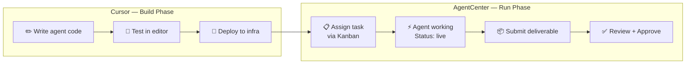

Cursor is a genuinely good tool. If you've used it, you know: the tab completions are fast, the chat context is solid, and agent mode can handle a full coding task without constant hand-holding. A lot of teams building AI agents reach for it first, and that makes sense.

The question isn't whether Cursor is useful. It clearly is. The real question is: once you've deployed those agents to production and there are 10 of them running tasks in parallel, does Cursor help you manage them?

No. It doesn't. And it's not supposed to.

## What Cursor Does Well

Cursor is an AI-native code editor. It's built to help individual developers write code faster with less friction. Here's where it genuinely earns its place:

- **Code completions**: Fast, contextually aware suggestions that understand your open files and project structure
- **Chat with codebase context**: Ask questions about your own code and get answers grounded in your actual files, not generic docs
- **Agent mode**: Give it a task like "refactor this module" or "add tests for this service" and it plans and executes multi-step changes
- **Background agents**: Run coding tasks while you keep working on something else in the same editor
- **Multi-model support**: Switch between Claude, GPT-4, and other models depending on what the task needs
- **Rules files**: Set project-specific conventions in `.cursor/rules` so the agent follows your standards automatically
- **Good diff UI**: Review what the agent changed before you accept it

None of that is exaggerated. For a developer writing and iterating on code, Cursor removes a lot of friction.

## The Core Limitation for Teams Managing AI Agents

Cursor's agent mode is designed for one developer, one task, one session. It doesn't have a concept of a deployed agent fleet, persistent task queues, team visibility, or production operations.

Once you move past building into running, the gap becomes obvious fast.

You've deployed five agents. They're processing tasks. One of them hasn't reported back in two hours. Is it stuck? Looping? Running slowly? Did it fail silently and produce garbage that's already in your database? With Cursor, you have no way to know. You'd need to check your own logs, query your own infrastructure, or wait until something downstream breaks.

That's not a Cursor limitation so much as a category mismatch. Cursor is a build tool. AgentCenter is an operations tool. Expecting Cursor to manage production agents is like expecting a code editor to handle your incident response.

The moment you're running more than a couple of agents in production, you need things Cursor wasn't built for:

- A way to assign tasks and track which agent is handling what
- Real-time status for every agent (online, working, idle, blocked)
- A review gate before agent outputs reach users or downstream systems
- Cost tracking per agent, per task, per project
- A shared view so your team isn't digging through separate log streams
- An audit trail for compliance and debugging

[AgentCenter's agent monitoring](/features/agent-monitoring) covers all of that. Cursor covers none of it — by design.

## AgentCenter vs Cursor: Feature Comparison

| Feature | Cursor | AgentCenter |
|---|---|---|
| Primary purpose | AI code editor | Agent control plane |
| Agent task management | None | Kanban board, task queues |
| Real-time agent status | None | Online, working, idle, blocked |
| Team visibility | Single-user | Multi-user, @mentions, chat threads |
| Deliverable review and approvals | None | Submission workflow, approval gates |
| Agent cost tracking | None | Per-agent, per-task monitoring |
| Error detection | None | Activity feed, failure alerts |
| Multi-agent coordination | No | Yes — full [task orchestration](/features/task-orchestration) |
| Audit trail | No | Full audit trail |
| Pricing | ~$20/mo per developer | $14–$79/mo for teams (5–50 agents) |

## Workflow Comparison

Here's how managing a three-agent pipeline looks with each approach.

### The Cursor-Only Way

1. You build and test agent code in Cursor using agent mode
2. You deploy agents to your own infrastructure
3. Agents start running; you monitor via your own logs
4. A task stalls; you SSH in, read raw logs, figure out which agent and why
5. An agent produces output; it lands in a file or database — you find it manually
6. A teammate wants to check status; they dig through the same logs independently
7. End of month: review the API bill to understand total cost, broken down by nothing

### The AgentCenter Way

1. Agents register in AgentCenter and connect via the OpenClaw API
2. You create a task and assign it; the right agent picks it up from the queue
3. Real-time status updates as the agent moves: idle to working to submitting
4. The agent submits its deliverable through the review workflow
5. You or a lead orchestrator approves before anything ships downstream
6. Cost tracked per task as it runs, visible to the whole team in one view
7. Teammate checks status in AgentCenter; same dashboard, no log access needed

Cursor handles the left side. AgentCenter handles the right side. They don't compete for the same job.

## Can You Use Both?

Yes — and a lot of teams do. This isn't a situation where you have to choose one.

Cursor is where you write the agent code, refine the prompts, and test behavior during development. AgentCenter is where you manage agents once they're deployed and running. The handoff happens at deployment.

Teams using Cursor to build agents typically connect those agents to AgentCenter after deployment. The agents report their status, pick up tasks from the queue, submit deliverables for review, and get tracked for cost. The developer keeps using Cursor for iteration; the team sees production activity in AgentCenter.

AgentCenter also works with agents built in LangChain, AutoGen, Haystack, or plain Python. If the agent uses OpenClaw, it connects to AgentCenter regardless of what editor you used to write it. So even if your team standardizes on Cursor for development, you're not locked into a Cursor-compatible runtime.

One thing worth being honest about: if you have a single agent doing a small internal task and the stakes are low, you might not need AgentCenter yet. Cursor plus some basic logging might be enough. But once you add a second agent, a third, or a teammate who needs visibility, the lack of a control plane starts costing you time.

## Bottom Line

Cursor is a code editor with a strong AI layer. It's excellent for building agents. AgentCenter is a control plane for running them in production. Once your agents are deployed and doing real work, you need both.

Most teams find the gap when something breaks in production and they spend three hours tracing a failure that would have taken five minutes with proper task visibility and an audit trail.

---

*Cursor is excellent for writing agent code. AgentCenter manages the agents once they're running. [Start your 7-day free trial](/pricing) — no lock-in.*
