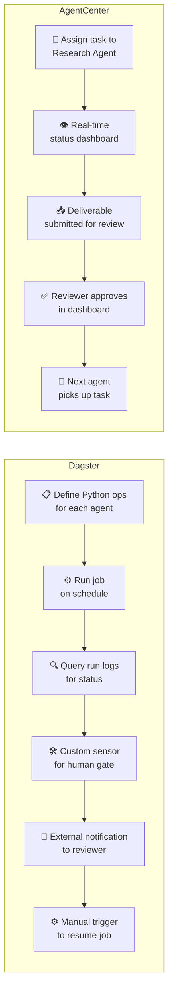

Dagster is a solid tool. Data engineers reach for it to manage ingestion jobs, transformation layers, and asset freshness. It has a real user base, good documentation, and it's actively maintained.

The question is whether it makes sense for teams managing AI agents in production. If you're looking at Dagster as a control plane for your agents, this post will save you a few weeks of frustration.

## What Dagster Does Well

Dagster was built to make data pipeline engineering less painful. For that job, it genuinely works.

- **Software-defined assets**: Pipelines are defined as Python objects. Lineage and dependencies are tracked automatically without extra configuration.
- **Declarative job structure**: Your pipeline graph lives in versioned code alongside your application. No separate YAML files to maintain.
- **Built-in scheduling and sensors**: Trigger jobs on a cron schedule or when new data lands, without a separate scheduling service.
- **Asset catalog**: A browsable inventory of data assets with freshness tracking, metadata history, and dependency visualization.
- **Run observability**: Step logs, failure context, retry handling, and re-execution are all built in.
- **Mature open source ecosystem**: Dagster has been in production at real companies since 2019. The community and plugin library reflect that history.

If your team is running data pipelines, Dagster belongs on the shortlist. The gap becomes visible when you try to manage AI agents with it.

## The Core Problem for AI Agent Teams

Dagster's mental model rests on one assumption: your tasks are deterministic. You define what goes in, what comes out, and in what order. The system executes the graph.

AI agents break this assumption from multiple directions.

An agent doesn't produce output that fits a fixed schema. It might take 40 seconds or 6 minutes depending on what the LLM decides to do. It can fail silently, returning something that looks valid but isn't useful. A human often needs to review that output before it flows downstream to the next agent. And agents have state that pipelines don't: they go idle between tasks, get blocked waiting on a dependency, or need to be reassigned when priorities shift mid-sprint.

None of those behaviors map cleanly to Dagster primitives. There's no native concept of:

- **Agent status**: Is the agent online, idle, working, or blocked right now?
- **Task assignment**: Which agent owns this task, and can I reassign it without touching code?
- **Deliverable review**: What exactly did the agent produce, and did a human sign off on it?
- **Approval gates**: Can downstream work be blocked until a reviewer approves the output?
- **Task-level discussion**: Can a reviewer leave feedback or @mention a teammate on this specific task?
- **Cost attribution**: How much did this particular agent spend completing this task?

Teams have built all of this on top of Dagster using custom sensors, external notification systems, and a lot of Python glue. It works, eventually. The cost is usually several weeks of engineering time to reconstruct functionality that a dedicated control plane ships out of the box.

The other issue is that Dagster's model treats agents like functions: invoke, wait, check result. AI agents in production behave more like employees: they're always running, have ongoing task queues, can be given new work mid-task, and need their output reviewed before it ships.

## AgentCenter vs Dagster: Side by Side

| Feature | Dagster | AgentCenter |
|---|---|---|
| **Primary purpose** | Data pipeline orchestration | AI agent management |
| **Task assignment** | Defined in Python code | Kanban board, direct assignment |
| **Agent status tracking** | No native concept | Real-time: online, idle, working, blocked |
| **Human review gates** | Custom sensor required | Built-in approval workflow |
| **Deliverable review** | Not applicable | Submission, review, version history |
| **Multi-agent coordination** | Asset dependency graph | Task orchestration with handoffs |
| **Per-task discussion** | None | Task-level @mentions and threads |
| **Cost per task** | Not built-in | Per-task cost tracking |
| **Pricing** | Free OSS / $995+/mo cloud | $14–$79/mo |
| **Setup** | Python DSL and infrastructure | Web dashboard and OpenClaw API |
| **Target user** | Data engineers | Developers running AI agents |

## Workflow Comparison

Same scenario, both tools: a research agent gathers data, an analysis agent processes it, a report agent writes the summary. Before that report goes anywhere, a human needs to review it.

### The Dagster path

1. Write Python ops for each agent call
2. Wire them into a job with asset dependencies
3. Build a custom sensor to detect when the report agent finishes
4. Set up an external notification to reach the reviewer (Slack, email, or webhook)
5. Reviewer manually triggers a continuation step to resume
6. Query run logs after the fact to understand where an agent stalled or returned bad output

Each of these steps is buildable. None of them come free. And when the requirements change (a new agent, a new review step, a new stakeholder), you're back in the code.

### The AgentCenter path

1. Register your OpenClaw agents in the workspace
2. Create tasks on the Kanban board and assign them to the right agents
3. Watch [real-time agent status](/features/agent-monitoring) as each agent moves through its work
4. The report agent submits its deliverable when finished
5. The reviewer sees it in the dashboard, approves it or sends it back with comments
6. The next agent picks up the task through [task orchestration](/features/task-orchestration)

No custom sensors. No external notification system. The review gate is part of the workflow, not something you bolt on.

## Can You Use Both?

Yes, and in practice this is how many teams set things up.

Dagster handles the data layer: raw ingestion, quality checks, asset materialization, freshness guarantees. AgentCenter manages the AI agents that sit on top of that data layer, doing analysis, summarization, research, and reporting. They don't overlap much.

If you already have Dagster running your pipelines, you don't need to remove it. AgentCenter connects to your agents through the OpenClaw API and manages them independently. The two tools operate at different layers of your stack.

Where things break down is when teams try to make Dagster do the job of an agent control plane. Managing agent state, coordinating deliverable handoffs, tracking per-task costs, enforcing review gates: that's a different problem from pipeline orchestration. Pulling it into Dagster means writing infrastructure code that will need to grow and be maintained as your agent fleet grows.

## Bottom Line

Dagster is a data orchestration tool. It excels at running deterministic jobs over predictable data with well-defined inputs and outputs. AI agents are non-deterministic reasoning processes that need coordination, human review, real-time visibility, and cost tracking.

If you run both data pipelines and AI agents, both tools have a place. If you're evaluating Dagster specifically because you want to manage AI agents without adding another tool, you'd be starting with the wrong abstraction and building toward a wall. See [pricing](/pricing) to compare what a dedicated control plane costs against the engineering time it replaces.

---

*Dagster is good at what it does. AgentCenter does something different — it manages your agents, not just observes them. [Start your 7-day free trial](/pricing) — no lock-in.*
