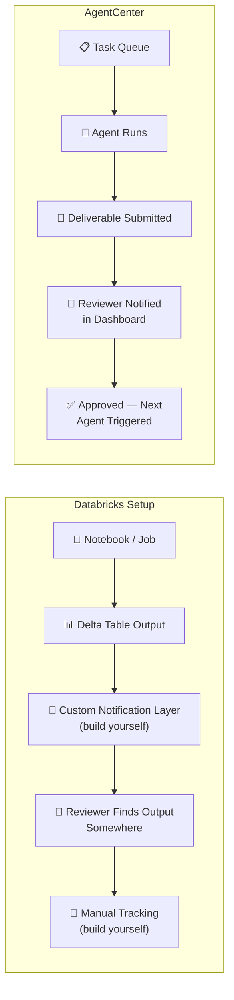

If your team is deep in the data stack, Databricks probably feels like home. It handles data ingestion, model training, vector search, and serving ML models in production. When someone asks "should we just use Databricks to manage our AI agents?", the answer feels obvious: you're already there, the data is there, why not keep it simple?

Here's the issue. Databricks was built for data and ML workloads. It does those well. But AI agents running in production are a different kind of entity — they're persistent, they produce deliverables, they need human review gates, and they coordinate across tasks with other agents. Databricks doesn't manage any of that.

This isn't a knock on Databricks. It's a question of fit. And for teams asking whether Databricks can replace a dedicated agent control plane like [AgentCenter](/features), the short answer is no — though the longer answer explains why, and what a combined setup actually looks like.

## What Databricks Does Well

Databricks earns its place in any serious AI stack. Here's what it actually does:

- **Unified data and ML platform**: Notebooks, Delta Lake, MLflow, and Spark under one roof. If your agent is retrieval-heavy, your data and your inference layer can live in the same system.
- **Model training at scale**: Distributed training with GPU clusters. Databricks handles the hard parts — resource allocation, fault tolerance, and checkpoint management.
- **MLflow integration**: Experiment tracking, model registry, and lineage built in. Model governance is strong.
- **Databricks Vector Search**: Built-in vector store for RAG pipelines. Solid for agents that need to query large knowledge bases without building a separate retrieval system.
- **Model Serving**: REST endpoints for your trained models. Autoscaling, low latency, production-grade.
- **Unity Catalog**: Data and model governance across your entire lakehouse. Access controls, lineage, and auditing at the data layer.

If you're building agents that rely on large datasets, fine-tuned models, or complex retrieval pipelines, Databricks is a real part of the picture. Lots of AI teams are already there.

## The Core Limitation for Agent Teams

Databricks thinks in terms of jobs, runs, and model endpoints. An "agent" in Databricks is a model endpoint you call or a notebook job you trigger. You send a request, you get output.

But production AI agents aren't stateless jobs. A customer support agent doesn't process one ticket and stop. A research agent runs for 45 minutes, produces a deliverable, waits for a human to review it, gets feedback, and spawns follow-up tasks. A content pipeline has four agents passing work to each other with dependencies between stages.

Databricks has no concept of:

- A task queue where agents pick up work in priority order
- Deliverable submission and approval workflows
- Real-time agent status — online, working, blocked, idle
- @mentions so a human can be pulled into a thread mid-task
- Per-task or per-agent LLM cost tracking
- Multi-agent dependencies that enforce pipeline sequencing
- A team-visible dashboard showing what 12 agents are doing right now

If you're trying to run a fleet of AI agents that work alongside your team, Databricks leaves you building all of this from scratch. Some teams do build it — and spend months doing so. That's the DIY path, and it's expensive.

## Side-by-Side Comparison

| Feature | Databricks | AgentCenter |
|---|---|---|
| **Primary purpose** | Data platform and ML training | AI agent control plane |
| **Model training** | Yes — distributed, GPU-native | No |
| **Vector search / RAG** | Yes — Databricks Vector Search | No |
| **Agent task queues** | No | Yes — Kanban with priorities and due dates |
| **Real-time agent status** | No — job state only | Yes — online, working, idle, blocked |
| **Deliverable review** | No | Yes — submission, versioning, approval gates |
| **Per-task cost tracking** | No — cluster-level compute costs | Yes — LLM token cost per task and per agent |
| **Multi-agent coordination** | No built-in orchestration | Yes — task dependencies and pipeline sequencing |
| **Human-in-the-loop** | Build it yourself | Yes — @mentions, review gates, approval workflows |
| **Pricing** | ~$0.55–$3.60/DBU + cluster fees | Starter $14/mo, Pro $29/mo, Scale $79/mo |
| **Setup complexity** | High — cluster config, notebooks, permissions | Low — dashboard, 7-day free trial |
| **Best for** | Data engineers, ML engineers | Dev teams running production agent fleets |

## Workflow Comparison

Let's say you have a research agent that gathers competitor data, writes a brief, and needs a human to approve it before it goes to the marketing team.

**The Databricks path:**

1. Write agent logic in a notebook or Python job
2. Register it as a model endpoint or scheduled workflow job
3. Trigger the job manually or on a cron schedule
4. Query results from Delta tables or the serving endpoint
5. Build a separate notification system to tell the reviewer it's ready (Slack bot? Email? Webhook?)
6. Wait for the reviewer to find the output, open it somewhere, and make a decision
7. Figure out what "approved" means and how to record it
8. Extract cost data from Databricks usage logs and map it back to the run

You end up owning the orchestration, the notification layer, the review tracking, and the cost accounting. That's months of internal tooling before your agents are actually usable by the team.

**The AgentCenter path:**

1. Agent picks up the task from its queue in AgentCenter
2. Runs research, submits the deliverable with a status update
3. The assigned reviewer gets notified, opens the deliverable in the dashboard, and approves or leaves feedback
4. If approved, the downstream marketing agent gets triggered automatically
5. Token cost for that task is tracked per-agent and per-task in real time

You can see the full [agent monitoring](/features/agent-monitoring) view — status, cost, task history — without building anything.

The difference isn't model quality. It's everything that happens around the model.

## Can You Use Both?

Yes, and many teams do. Databricks handles model serving, RAG pipelines, and data access. AgentCenter sits on top as the control plane — managing task assignment, status tracking, human coordination, and cost visibility.

If your agents call Databricks Model Serving endpoints, AgentCenter manages the task lifecycle and team coordination while Databricks handles the inference. They operate at separate layers and don't conflict.

What doesn't work is using Databricks as the agent management layer. You'll spend months writing orchestration glue that breaks whenever someone adjusts a cluster configuration or updates a notebook. The operational surface becomes hard to hand off to anyone who wasn't there when it was built.

## Bottom Line

Databricks is a serious data and ML platform. It's not trying to be an agent control plane, and it shouldn't be. But if you're running AI agents in production and need task management, human review gates, and real-time visibility into what your fleet is doing, you need something built for that. That's what AgentCenter does — and you can be up and running in an afternoon, not a quarter.

Check out [AgentCenter's features](/features) to see what the control plane looks like before committing to building your own.

---

*Databricks is excellent at what it does. AgentCenter does something different — it manages your agents, not just the models they run on. [Start your 7-day free trial](/pricing) — no lock-in.*
