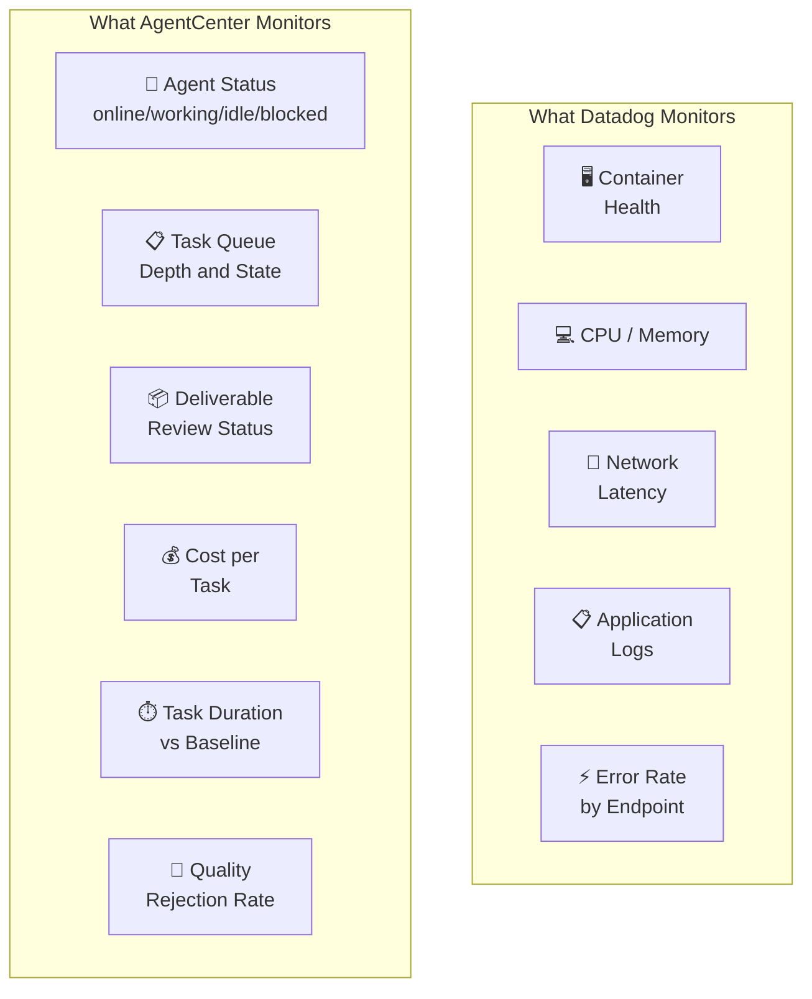

Datadog is one of the best infrastructure monitoring platforms available. If you're running services, containers, or distributed systems, it's hard to beat for visibility. The integrations are extensive, the alerting is configurable, and the dashboards are genuinely useful for operations teams.

So when AI teams ask "can we just use Datadog to monitor our agents?" the answer is: sort of. But not for what matters most.

## What Datadog Does Well

- Infrastructure metrics: CPU, memory, disk, network for containers and services
- Application performance monitoring (APM): traces, latency, error rates for services
- Log aggregation and search at scale
- Alerting and incident management
- Hundreds of integrations with infrastructure and application layers
- Security monitoring and compliance reporting

Datadog is exceptional at infrastructure observability. If you want to know that the server your agent runs on is healthy, Datadog tells you that.

## The Core Limitation for AI Agent Teams

Datadog doesn't know what an agent is. It monitors processes, services, and infrastructure. It can tell you the agent's container is running and healthy. It cannot tell you the agent is stuck on a task, that its output quality has declined, or that it's waiting for human review.

These are fundamentally different things:

- "The container is healthy" (infrastructure state)
- "The agent is blocked waiting for a tool response" (agent state)
- "The agent's last 12 outputs have been rejected at review" (agent quality)
- "This task has been running for 3x longer than the baseline" (agent behavior)

Datadog monitors the first. It doesn't monitor the second, third, or fourth.

You can push custom metrics to Datadog that capture agent state. A lot of teams do this. But you're now building and maintaining a custom monitoring layer on top of Datadog. That's engineering time spent on infrastructure that should be spent on agents.

## Comparison Table

| Feature                             | Datadog                    | AgentCenter         |
| ----------------------------------- | -------------------------- | ------------------- |
| Infrastructure monitoring           | Excellent                  | No                  |
| Container health checks             | Yes                        | No                  |
| Agent status (working/blocked/idle) | No (custom metrics needed) | Yes, built-in       |
| Task queue visibility               | No                         | Yes                 |
| Deliverable review workflow         | No                         | Yes                 |
| Cost per task tracking              | No                         | Yes                 |
| @mentions and team chat             | No                         | Yes                 |
| Agent task assignment UI            | No                         | Kanban board        |
| Quality rejection tracking          | No                         | Yes                 |
| Pricing                             | $15+/host/month            | $14-$79/mo total    |
| Primary use case                    | Infrastructure + APM       | AI agent management |

## Workflow Comparison

**Catching a blocked agent with Datadog:**

1. Write custom metric code in agent to push "agent_status" to Datadog
2. Create a Datadog monitor on that metric
3. Set up alert conditions (status = blocked for X minutes)
4. Alert fires, on-call checks Datadog
5. See the blocked status
6. Go investigate in agent logs to understand what it's blocked on

**Catching a blocked agent with AgentCenter:**

1. Dashboard shows agent status in real time
2. Blocked agents are visually distinct
3. Click through to see what task it's blocked on
4. Resolve the blocker from the same interface

## Can You Use Both?

Yes. The most operationally mature teams do. Datadog monitors the infrastructure your agents run on. AgentCenter manages the agents themselves. They don't overlap.

The practical split:

- Datadog: container health, infrastructure metrics, log aggregation, security
- AgentCenter: agent status, task management, deliverable review, cost per task

If your infrastructure alert fires in Datadog, the first thing you do is check AgentCenter to see which agents are affected and what state they're in. The two tools work together naturally because they're watching different layers.

## Bottom Line

Datadog is not a tool for managing AI agents. It's a tool for monitoring the infrastructure that agents run on. If you're using Datadog custom metrics to track agent state, you're building a management plane on top of a monitoring platform — which works, but costs you ongoing engineering time.

AgentCenter is purpose-built for the agent management layer that Datadog doesn't cover. Use both if your infrastructure complexity warrants it.

_Datadog is good at what it does. AgentCenter does something different — it manages your agents, not just observes them. [Start your 7-day free trial](/pricing) — no lock-in._
