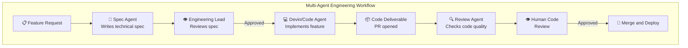

Devin, built by Cognition, is a genuinely impressive autonomous software engineering agent. It can take a coding task, break it into subtasks, write code, run tests, fix errors, and open a pull request — with varying levels of success depending on the complexity. For teams that have integrated it into their engineering workflow, it handles a real category of work.

That's the context for this comparison. Devin is an agent. AgentCenter manages agents. They're not competing for the same thing.

## What Devin Does Well

- Autonomous software engineering: takes a task, writes code, tests it
- Navigates codebases, understands context across files
- Can handle some multi-step debugging and research tasks
- Interfaces through GitHub, Slack, and web app
- Useful for repetitive engineering tasks, boilerplate generation, and smaller features

For teams with a software engineering context, Devin reduces the time engineers spend on certain categories of routine work.

## The Core Limitation (That AgentCenter Addresses)

Devin is a single agent with a specific capability. What happens when you're running multiple Devin sessions? Or mixing Devin with other AI agents — content agents, research agents, customer support agents?

You end up with a collection of autonomous agents with no unified view across them. Which Devin sessions are running? Which ones are blocked? What are they costing per session? How do you coordinate a Devin coding task with a spec-writing agent that's supposed to produce the brief first?

AgentCenter handles the coordination layer across agents, including agents like Devin. It doesn't replace what Devin does. It provides the control plane for the environment Devin operates in alongside your other agents.

## Comparison Table

| Feature                               | Devin AI                                   | AgentCenter                  |
| ------------------------------------- | ------------------------------------------ | ---------------------------- |
| Autonomous code writing               | Yes (core capability)                      | Via code-focused agents      |
| Multi-agent fleet management          | No                                         | Yes                          |
| Task assignment across agent types    | No                                         | Kanban board + orchestration |
| Real-time status across agents        | No                                         | Yes                          |
| Deliverable review workflow           | No                                         | Yes, built-in                |
| Cost per session/task tracking        | Limited (Devin pricing)                    | Yes, across all agents       |
| @mentions and team coordination       | No                                         | Yes                          |
| Non-coding agents (content, research) | No                                         | Yes (120+ templates)         |
| Self-hosting                          | No                                         | Yes                          |
| Pricing                               | ACU-based pricing (~$500+/mo for real use) | $14-$79/mo                   |

## Workflow Comparison

**Engineering task with Devin only:**

1. Assign task to Devin via GitHub or Slack
2. Devin works, you check back later
3. Devin opens a PR when done
4. No visibility into what Devin is doing mid-task
5. No coordination with other agents
6. No tracking of what was assigned, when, and at what cost

**Engineering task with Devin + AgentCenter:**

1. Spec agent drafts technical brief (managed by AgentCenter)
2. Brief reviewed and approved
3. Coding agent (or Devin via API) picks up the spec
4. Real-time status visible in AgentCenter dashboard
5. Code deliverable submitted for review
6. Full task history with cost tracking

## Can You Use Both?

Absolutely, and this is the realistic scenario for teams that use Devin. You run Devin for coding tasks. AgentCenter manages the surrounding workflow — the agents that precede and follow the coding step, the review gates, the cost tracking across your entire agent fleet.

If Devin is one agent in a broader multi-agent workflow, AgentCenter gives you the control plane that coordinates the whole thing.

## Bottom Line

Devin is a capable autonomous coding agent. AgentCenter is a platform for managing agents. If you're using Devin alongside other AI agents and want unified visibility, task coordination, and deliverable review across all of them, those are different problems. Devin does the coding work. AgentCenter manages the environment it works in.

_Devin is good at what it does. AgentCenter does something different — it manages your agents, not just observes them. [Start your 7-day free trial](/pricing) — no lock-in._
