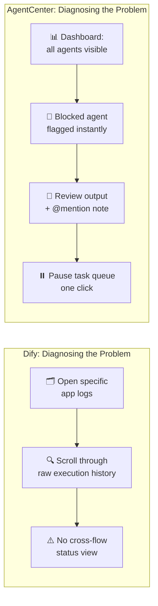

Dify is one of the easiest ways to go from "I have an idea for an AI agent" to a working deployed app. It's an open-source platform that wraps LLM calls, tools, memory, and RAG into a visual builder. You can have a working chatbot or agent-style flow running in an afternoon without writing infrastructure code.

That's genuinely useful. The question is what happens after the agent ships.

## What Dify Does Well

Dify gets a lot right on the building side:

- **Visual flow builder**: Drag-and-drop nodes for LLM calls, conditional logic, tool use, and retrieval. No code required for many use cases.
- **Multi-provider support**: Works with OpenAI, Anthropic, Google Gemini, and self-hosted models including Llama and Mistral.
- **Built-in RAG**: Knowledge bases, vector storage, and chunking strategies all baked in. You don't need to wire up a retrieval stack from scratch.
- **App deployment**: Instantly exposes flows as an embedded chat widget, API endpoint, or shareable web app.
- **Self-hosting option**: Run Dify on your own infrastructure with Docker Compose. The data stays with you.
- **Plugin and tool integrations**: A growing library covering web search, code execution, file parsing, and custom API calls.

For teams building internal tools, customer-facing chatbots, or document processing flows, Dify gets them to a working artifact fast.

## The Core Limitation for Teams Managing AI Agents

Dify is optimized for building and deploying. Once an agent is live, you're mostly on your own.

What happens when one of your Dify agents starts producing bad outputs? You get logs, but no clean view of which tasks failed, which are pending human review, or what the agent did across 20 parallel runs three hours ago.

What happens when you're running 10 different Dify flows across three projects? There's no shared control layer. Each flow lives in its own bubble. A problem in one doesn't surface anywhere central.

Dify is also designed around the single-user or small-team case. There's no task assignment to specific agents, no @mention-based coordination between a human reviewer and the agent's output queue, no Kanban-style view of what each agent is currently working on.

The missing piece is operational visibility. Dify gives you the agent. You still need a control plane to manage it once it's running against real work at any volume.

## AgentCenter vs Dify: Side-by-Side

| Feature | Dify | AgentCenter |
|---|---|---|
| **Primary purpose** | Build and deploy AI agent flows | Manage and coordinate agents in production |
| **Visual interface** | Flow builder for constructing agents | Kanban dashboard for managing agent tasks |
| **Real-time agent status** | Not available | Online, working, idle, blocked |
| **Task assignment** | Not supported | Assign tasks to specific agents by project |
| **Human review gates** | No built-in approval flow | Deliverable review and approval workflows |
| **Multi-agent coordination** | Basic sequential flows only | Full task orchestration across agent teams |
| **@Mention collaboration** | None | Chat threads and @mentions per task |
| **Cost tracking per task** | API usage aggregated globally | Per-task cost attribution with full breakdown |
| **Agent runtime** | Dify's own runtime | OpenClaw-compatible agents (Claude, GPT-4, Gemini) |
| **Pricing** | Free self-hosted, ~$59/mo cloud | Starter $14/mo, Pro $29/mo, Scale $79/mo |

Dify's cloud pricing starts at roughly $59/month. AgentCenter's Starter plan is $14/month and handles up to 5 agents across 3 projects. If you're scaling to 50 agents, Scale is $79/month. See the full breakdown on the [pricing page](/pricing).

## Workflow Comparison: Catching a Failing Agent

Here's the same problem handled in each tool: one of your agents starts returning bad outputs. You need to find it, review recent work, and pause it without disrupting agents running in parallel.

**The Dify path:**

1. Open Dify's monitoring tab for the specific app
2. Scroll through raw execution logs looking for failed runs
3. No quick way to compare runs side by side or see error trends across flows
4. No way to pause that agent's queue without editing the flow itself
5. No shared view across other Dify apps running in parallel — you switch apps manually

**The AgentCenter path:**

1. Open the [agent monitoring dashboard](/features/agent-monitoring) — all agent statuses visible at a glance
2. The failing agent shows as "blocked" with a red indicator in the dashboard
3. Click into the task, read the output, leave a comment via @mention for the reviewer
4. Pause that agent's task queue with one click
5. Other agents keep running — you have full visibility into all of them without switching contexts

The difference is not about which tool is more capable on the building side. Dify built the agent. AgentCenter gives you the layer to run it safely at scale.

## Can You Use Both?

Yes, and it's worth being direct: they're not competing for the same problem.

A common setup is to prototype in Dify, then deploy the production version as an OpenClaw-compatible agent managed through AgentCenter. Dify handles rapid iteration. AgentCenter handles operations: task queuing, deliverable review, cost tracking per run, and coordination across multiple agents working on related problems.

The [task orchestration layer](/features/task-orchestration) in AgentCenter works regardless of what tool was used to build the underlying agent logic. If your agent runs well in Dify and you're satisfied with it, you're not replacing Dify — you're adding an operational layer on top.

If your Dify agents are internal, low-stakes, and run infrequently, you might not need AgentCenter. But once agents are handling real customer interactions, processing live documents, or running autonomously on production data, logs aren't enough.

The same operational gap exists regardless of the builder you used. Dify makes it more visible than most because it's built so well on the creation side — the contrast is clear the moment you try to operate at any real volume.

## Questions Teams Actually Ask

**"Can I connect a Dify agent to AgentCenter directly?"**

Not out of the box. AgentCenter works with OpenClaw-compatible agent setups. You could use Dify's API output as part of an OpenClaw agent's action layer, but that takes custom integration work. For most teams, the path is: prototype in Dify, rebuild the production version in OpenClaw, manage it in AgentCenter.

**"Is Dify's built-in monitoring enough?"**

For a single low-volume flow, probably. For 5 or more flows running in parallel with different stakeholders reviewing outputs, no. The difference is whether you need logs or a control plane.

**"Which is cheaper for a small team?"**

Self-hosted Dify is free. AgentCenter Starter is $14/month. If you're already on Dify cloud, you're at around $59/month before adding AgentCenter. But the comparison isn't really about price — it's about what problem you're solving at each stage.

## Bottom Line

Dify is a solid choice for building and deploying AI agent flows quickly, especially if you want a visual interface or self-hosting flexibility. AgentCenter is for what comes after: managing agents in production with real-time status, task queues, deliverable review, and coordination across multiple agents. They solve different problems at different stages of the agent lifecycle.

---

*Dify is good at what it does. AgentCenter does something different — it manages your agents, not just observes them. [Start your 7-day free trial](/pricing) — no lock-in.*
