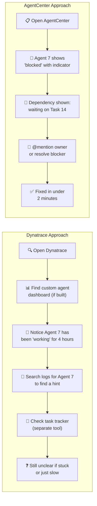

If your team already runs Dynatrace, the question comes up fast once you start deploying AI agents: do we need another tool? You've already got dashboards, anomaly detection, distributed tracing. On paper, it looks like it should cover agent monitoring too.

It doesn't. And understanding why matters before you spend three weeks trying to make it work.

AgentCenter vs Dynatrace isn't really a comparison of two monitoring tools — it's a comparison of two different layers of visibility. One watches your infrastructure. The other manages your agents.

## What Dynatrace Does Well

Dynatrace is a serious piece of software. If your job is keeping services and infrastructure healthy, it earns its place.

- **Full-stack observability**: hosts, containers, services, and databases — all correlated from a single data model
- **Davis AI**: automated anomaly detection that finds performance problems without requiring manual threshold-setting
- **Distributed tracing**: end-to-end traces across microservices give you real latency visibility, not just endpoint averages
- **Log ingestion at scale**: high-volume log pipelines don't slow it down
- **APM for traditional apps**: code-level visibility into response times, error rates, and slow queries
- **Infrastructure integrations**: Kubernetes, AWS, Azure, GCP — all native, not bolt-ons
- **Alerting and incident management**: works with PagerDuty, Slack, ServiceNow, and most on-call stacks

For a backend or DevOps team running services in Kubernetes, Dynatrace covers a lot of ground. That's exactly why teams reach for it when they start adding AI agents. They already have it deployed.

## The Core Limitation for Teams Managing AI Agents

AI agents are not services. A service responds to requests in milliseconds. An agent takes a task, reasons through it over minutes or hours, uses tools, produces deliverables, and sometimes blocks on other agents before continuing.

Dynatrace was built around questions like: "Is this API responding?" and "Is this container healthy?" Those are the right questions for infrastructure. They're the wrong questions for agents.

Here's what you actually need when running agents in production:

- Which agents are working, which are idle, and which are stuck?
- Has this task been in-progress for three hours without any progress update?
- Agent A finished its step — did Agent B actually pick it up?
- Was the deliverable reviewed before it went downstream to the next agent?
- How much did this task cost across the whole pipeline in tokens?

None of those questions have answers in Dynatrace. You'd be writing custom dashboards, Grail DQL queries, and polling scripts to reconstruct what a purpose-built agent control plane gives you out of the box.

One team we heard from ran 12 agents across 3 projects and tried Dynatrace for "agent monitoring" for six weeks. By week three, they had four custom dashboards and a Python script polling agent state every 30 seconds to detect idle agents. It worked — barely. It also took two engineering days to build and broke twice when the agent runtime changed. The monitoring system needed its own monitoring.

## AgentCenter vs Dynatrace: Feature Comparison

| Feature | Dynatrace | AgentCenter |
|---|---|---|
| Real-time agent status | No — agents aren't first-class objects | Yes — per-agent online, idle, working, blocked |
| Task management | No | Yes — Kanban board with priorities, dependencies, due dates |
| Deliverable review and approval | No | Yes — submission workflow with approval gates |
| Per-task cost tracking | No | Yes — token cost tracked per task and per agent |
| Multi-agent coordination | No | Yes — task handoffs, @mentions, blocking dependencies |
| Recurring task automation | No | Yes — scheduled workflows (Pro+) |
| AI-driven anomaly detection | Yes (Davis AI for infra) | No — focused on task and agent management |
| Full-stack infrastructure monitoring | Yes | No — operates above the infrastructure layer |
| Distributed tracing | Yes | No |
| Log ingestion | Yes | No |
| Pricing | Enterprise pricing, contact sales | $14/mo Starter, $29/mo Pro, $79/mo Scale |
| Setup complexity | High — instrumentation agents, config, integrations | Low — API integration, no agents to install |
| Best for | Infrastructure and application performance | Managing, coordinating, and reviewing AI agent work |

## Workflow Comparison: Finding a Stuck Agent

Here's what diagnosing a stuck agent actually looks like with each tool.

**With Dynatrace:**

1. Open the dashboard. If you built a custom one, you see heartbeat metrics for each agent.
2. Notice Agent 7 has been in a "working" state for four hours — unusual.
3. Check logs for that agent. If they're piped to Dynatrace, you might find a hint about what it's doing.
4. The task this agent was assigned isn't in Dynatrace, so you check your task tracker.
5. You can't tell from either place whether the agent is actually stuck or just processing a large batch.
6. You Slack the person who built the agent. They're in a meeting.

**With AgentCenter:**

1. Open the board. Agent 7 shows as "blocked" with a red indicator.
2. Click into the agent. You see the task it's working on, the last status update timestamp, and the dependency blocking it — Task 14 from Agent 3 hasn't been marked complete.
3. Check Task 14. Agent 3 finished its work but the output wasn't reviewed and approved.
4. Approve the deliverable. Agent 7 unblocks and picks up immediately.

Total time: under two minutes. The difference isn't the dashboard design — it's that AgentCenter understands what agents are doing, not just whether their process is alive.

Check out [AgentCenter's agent monitoring features](/features/agent-monitoring) if you want to see what this looks like in practice.

## Can You Use Both?

Yes — and for teams running agents at any real scale, that's usually the right call. They operate at different layers.

Dynatrace owns the infrastructure layer. If your agents run in containers, you want to know when those containers are being throttled, when your LLM API calls spike in latency, or when a downstream dependency goes down. Dynatrace catches those signals. Davis AI will alert you before you know to look.

AgentCenter operates at the agent and task layer, above infrastructure. It knows what each agent is working on, whether deliverables were reviewed, whether task handoffs completed, and whether the overall workflow is progressing toward an outcome.

The signals don't overlap much. A memory spike causing agent slowness shows up in Dynatrace. A task stuck in review for 18 hours shows up in AgentCenter. Both matter. Neither tool gives you both.

The teams that try to use only Dynatrace for agent management end up with custom dashboards that approximate what AgentCenter gives them natively — and those custom dashboards never quite work as well.

## Bottom Line

Dynatrace monitors infrastructure. AgentCenter manages AI agents. If you're running more than a handful of agents in production, you'll hit the gap between those two things quickly. Adding AgentCenter as the control plane layer above your existing Dynatrace setup takes about an afternoon — and you stop losing hours to "which agent is stuck and why." See [pricing](/pricing) — plans start at $14/month with a 7-day free trial.

---

*Dynatrace is good at what it does. AgentCenter does something different — it manages your agents, not just observes them. [Start your 7-day free trial](/pricing) — no lock-in.*
