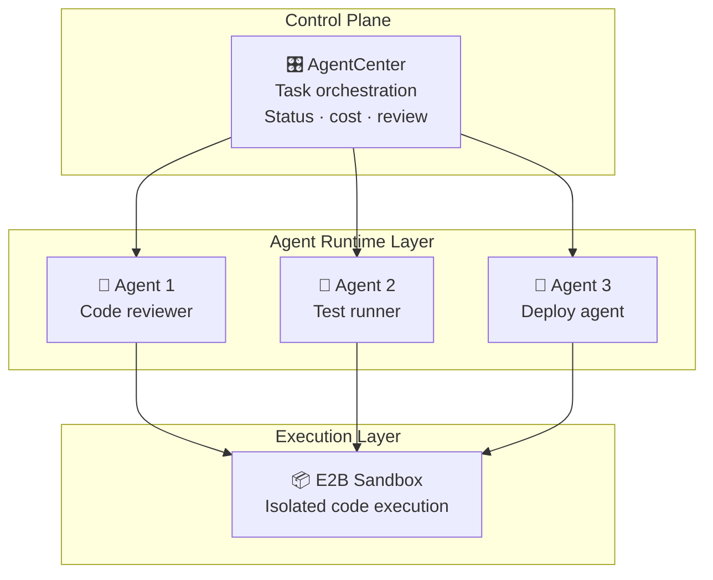
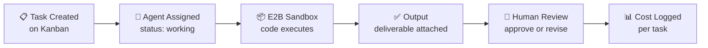

E2B solves a real problem. If you're building an AI coding agent, you need a safe place to execute untrusted code without torching your own servers. E2B handles exactly that: isolated cloud sandboxes, fast spin-up, a clean API. Teams use it to give agents a working Python or Node environment and watch the code run.

So when people ask "AgentCenter vs E2B," they're often comparing tools that don't really compete. But it comes up enough that it's worth explaining what each one does and where the line sits.

## What E2B Does Well

E2B is purpose-built for code execution in AI agent workflows. A few things it gets right:

- **Isolated sandboxes**: Each execution runs in its own environment. No agent pollutes another's filesystem or process space.
- **Fast startup**: Sandbox spin-up is under 300ms. That matters when you're running many agent tasks in parallel.
- **Language support**: Python, Node.js, and more, with support for custom Dockerfiles when you need a specific runtime.
- **Clean API**: The SDK is minimal. You can add sandbox execution to an agent in a handful of lines.
- **Persistent state**: Sandboxes can stay alive between agent turns when you need stateful execution across steps.
- **Framework integrations**: Works with LangChain, AutoGen, and similar frameworks without extra plumbing.

For anyone building a code-executing AI agent, E2B removes a lot of infrastructure headache. You don't have to manage VMs, containers, or network isolation yourself. You call an API, get a sandbox, run code, get results.

## The Core Limitation for Teams Managing AI Agents

E2B is a runtime substrate. It answers: "where does the code run?"

It doesn't answer: "what are all my agents doing right now?", "which agent task failed three hours ago?", "did the output meet the acceptance criteria?", or "who on my team is reviewing that deliverable?"

When you have one agent that runs code, E2B is enough. When you have eight agents running across three projects, all with different task states, outputs queued for review, and costs accumulating per run, you need something that sits above the runtime layer. You need visibility into the agents themselves, not just the sandboxes they use.

That's the gap. E2B manages execution environments. AgentCenter manages the agents.

E2B handles the bottom layer. AgentCenter handles the top. They don't overlap.

## AgentCenter vs E2B: Side by Side

| Feature | E2B | AgentCenter |
|---|---|---|
| Primary purpose | Sandboxed code execution for agents | Control plane for managing AI agent fleets |
| Task management | None | Kanban board across all agents and projects |
| Real-time agent status | None | Online / working / idle / blocked |
| Multi-agent orchestration | None | Task routing and coordination across agents |
| Output review workflows | None | Built-in deliverable review and approval |
| Cost tracking per task | None | Per-agent and per-task cost visibility |
| @Mentions and team threads | None | Per-task collaboration and chat threads |
| Error monitoring and alerts | None | Error tracking and notification workflows |
| Recurring task automation | None | Yes (Pro+ plan) |
| Cloud VM provisioning | None | Yes (Scale plan) |
| Free trial | Free tier available | 7-day free trial on monthly plans |
| Pricing | Usage-based compute billing | $14/mo Starter · $29/mo Pro · $79/mo Scale |

## Workflow Comparison: What Each Tool Actually Changes

### Managing a code-writing agent without AgentCenter

1. A request comes in: "write a Python parser for this CSV format"
2. You trigger the agent manually or via a script
3. Agent writes code, runs it in an E2B sandbox
4. Result comes back to the agent
5. Agent writes output somewhere — maybe a file, maybe a Slack message
6. You check logs to see if it worked
7. If it failed, you find out when someone complains or you happen to look

This works for one agent on one task. It breaks down when you have six agents running, three tasks waiting for review, and someone asks "what did the test runner actually produce this morning?"

### The same workflow through AgentCenter

1. Task created on the AgentCenter Kanban board with clear acceptance criteria
2. Assigned to the code-writing agent
3. AgentCenter shows status in real time: queued, working, done
4. Agent runs, uses E2B sandbox for execution if needed
5. Output lands in the task as a reviewable deliverable
6. A team member gets notified, reviews, approves or requests changes
7. Cost for that task is recorded automatically

The agent does the same work in both flows. What changes is what the team can see, verify, and act on without digging through logs.

## Where Teams Actually Get Stuck

Most teams building coding agents start with E2B and feel fine. Then they add a second agent. Then a third. At some point, they're running parallel tasks and have no unified view of what's working, what's stuck, and what's waiting for a human.

The usual signs:
- Checking agent logs directly in the terminal to find task state
- Pinging team members to see if they've reviewed an output
- No idea which agent is consuming the most tokens or costing the most per week
- A task fails silently and no one finds out for two days

These aren't E2B problems. E2B did its job. They're management and visibility problems. That's the layer AgentCenter covers with [agent monitoring](/features/agent-monitoring) and [multi-agent workflow orchestration](/features/multi-agent-workflows).

## Can You Use Both?

Yes, and it makes sense to.

E2B lives at the execution layer. It's the environment where your agent runs code. AgentCenter lives at the control plane layer. That's where your team sees what agents are doing, reviews their outputs, tracks costs, and coordinates multi-step workflows.

If you're building coding agents, E2B handles the risky "run arbitrary code" problem well. AgentCenter sits on top, giving your team visibility into the agents that use those sandboxes. They operate at different levels of the stack and don't interfere with each other.

The combined setup makes sense for any team past the prototype stage: E2B for safe, fast code execution, AgentCenter for task orchestration and agent oversight. See the [pricing page](/pricing) for plans that fit teams of different sizes.

## Bottom Line

E2B solves a specific infrastructure problem: safe code execution for AI agents in production. It's good at that, and it's not trying to be anything else. AgentCenter solves a different problem: how do you manage, monitor, and coordinate agents once you have more than one running in production? The two tools operate at different layers. If your team is past "single agent proof of concept" and into "fleet of agents doing real work," you'll end up needing both.

---

*E2B is good at what it does. AgentCenter does something different — it manages your agents, not just the sandboxes they run in. [Start your 7-day free trial](/pricing) — no lock-in.*
