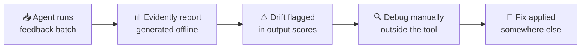
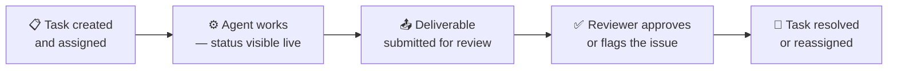

If your AI agents are producing outputs you can't trust, Evidently AI is one of the first tools you'll hear about. It's open-source, well-maintained, and genuinely useful for catching model drift and evaluating output quality at scale. Teams building AI pipelines reach for it early, and for good reason.

But here's the question that comes up around week six: your Evidently dashboard shows output quality dropping on one of your agents. Now what?

That's where Evidently stops and AgentCenter starts.

## What Evidently AI Does Well

Evidently is a Python library and hosted platform built for ML engineers who need to monitor model performance and data quality. It does that job well.

- **Data drift detection**: compares input distributions between a reference dataset and live data to catch distribution shifts before they cause problems
- **Model quality monitoring**: tracks prediction quality over time across classification, regression, and ranking models
- **LLM output evaluation**: newer features let you score text coherence, toxicity, and answer relevance across a batch of agent outputs
- **Visual reports**: generates HTML reports and dashboards that are actually readable, not just raw JSON
- **Open-source core**: free to use, actively maintained, with a large community
- **Integrations**: connects to MLflow, Grafana, and most standard ML pipelines

For teams that care about LLM output quality over time, Evidently is a real tool. If you have agents calling an LLM and you want to know whether response quality is drifting week over week, Evidently gives you that signal.

## The Core Limitation for Teams Running AI Agents

Evidently tells you what's happening with model outputs. It doesn't help you do anything about it, and it has no concept of the work your agents are supposed to be doing.

Say you have eight agents running in production. One is researching leads. Two are writing content. Three are processing documents. Two are handling customer inquiries. Evidently can tell you that the document-processing agent's outputs are drifting. But it can't tell you:

- Which of the 47 documents that agent processed today are affected
- Who owns that agent and needs to be notified
- Whether the task queue has new items waiting that will also produce bad output
- Whether you should pause the agent or let it keep running
- What to do with the deliverables that already went out

Those are control plane questions. Evidently is a monitoring tool, not a control plane. There's a real difference between the two.

Monitoring answers: what happened?
Managing answers: what are we doing about it?

Teams that treat Evidently as their primary interface for AI agent oversight end up writing a lot of custom code around it. Notification scripts. Slack webhooks for drift alerts. Spreadsheets to track which agents own which tasks. That scaffolding becomes its own maintenance problem, and none of it actually gives you the ability to manage the work your agents are doing.

The [agent monitoring](/features/agent-monitoring) problem and the agent management problem are related but different. Knowing your agent's outputs are degrading is useful. Being able to pause that agent, reassign its open tasks, and review everything it produced in the last 24 hours — that's the control plane piece Evidently wasn't built for.

## AgentCenter vs Evidently AI: Side by Side

| | Evidently AI | AgentCenter |
|---|---|---|
| Primary function | ML model and data quality monitoring | AI agent task management and coordination |
| Real-time agent status | No | Yes (online, working, idle, blocked) |
| Task assignment and tracking | No | Yes (Kanban board, task queue, priorities) |
| Multi-agent coordination | No | Yes (dependencies, handoffs, sequencing) |
| Deliverable review and approval | No | Yes (built-in review workflow) |
| Human-agent collaboration | No | Yes (@mentions, task threads per task) |
| Cost tracking per task | No | Yes (per-agent and per-task cost data) |
| Pricing | Free (open-source) / Cloud from $0 | Starter $14/mo, Pro $29/mo, Scale $79/mo |
| Deployment | Python library or hosted cloud | Web dashboard, no setup required |
| Works with OpenClaw agents | No | Yes (built for OpenClaw-compatible agents) |
| Best for | ML engineers monitoring model quality | Developers and teams running agents in production |

## How Each One Handles the Same Scenario

Imagine an agent that's been processing customer feedback for three weeks. You notice something's off with what it's returning.

**With Evidently:**

You see the drift. But you're on your own from there. How many tasks are affected? Are there items in the queue that will also produce bad output? Who's reviewing those outputs before they go anywhere? Evidently doesn't have answers to those questions.

**With AgentCenter:**

Every task has a status. Every deliverable goes through a review step before it's considered done. If the agent's output is off, you see it at review, not after the fact in a batch report. You can pause the agent, flag the affected tasks, and route them elsewhere. The [task orchestration layer](/features/task-orchestration) is where that control lives — and Evidently doesn't have one.

## Can You Use Both?

Yes, and there's a reasonable case for it.

Evidently works at the model output layer. It tells you whether the quality of what your LLM is producing is changing over time, across large batches of outputs. AgentCenter works at the task coordination layer. It tells you what your agents are supposed to do, whether they've done it, and whether a human has signed off on the result.

If you're running agents at scale and care about both operational control and statistical quality signals, you might reach for both. They don't compete directly. They handle different layers of the same stack.

The problem is when teams reach for Evidently as a substitute for agent management. It wasn't built for coordinating multiple autonomous agents doing different types of work across a team. You end up with good monitoring coverage and no actual ability to manage the work.

## Bottom Line

Evidently AI is a real tool for tracking model output quality over time. If you need to know whether your LLM outputs are drifting, it handles that well. But if you need to manage what your agents are working on, track deliverables, coordinate between agents, and get human sign-off before output goes anywhere, Evidently doesn't have those pieces. That's a different job, and it needs a different tool.

---

*Evidently AI is good at catching what's going wrong in your outputs. AgentCenter manages what your agents are doing in the first place. [Start your 7-day free trial](/pricing) — no lock-in.*
