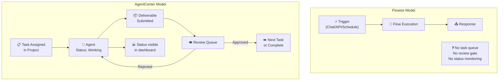

Flowise is a popular open-source tool for building LLM-powered flows through a visual drag-and-drop interface. It lowers the barrier to building agent-like systems considerably — you can wire together a RAG pipeline or an agent with tools without writing code. For prototyping and internal tooling, it's genuinely useful.

The challenge is that Flowise is optimized for building, not operating. And operating is where most production problems occur.

## What Flowise Does Well

- Visual drag-and-drop flow builder for LLM pipelines
- No-code access to LangChain components
- Built-in support for RAG, agents with tools, chatbots
- Self-hostable and open source
- Large community with many shared flows
- Good for rapid prototyping of AI applications

If you need to build a chatbot, a RAG pipeline, or a simple agent flow without writing code, Flowise gets you there quickly.

## The Core Limitation for Production Agent Teams

Flowise flows run when triggered. The trigger fires, the flow executes, you get a result. That execution model works for chatbots and simple one-shot flows.

For teams running multiple agents doing ongoing, reviewable work, Flowise's model has gaps:

There's no concept of task management — assigning work to agents, tracking what each agent is doing, queuing tasks when agents are busy. There's no deliverable review workflow built in. There's no way to see "which agents are currently running and what state are they in?" without building custom tooling.

A team building an internal research tool with Flowise will hit these limits as soon as they have more than one person using the tool and want to track what's been researched, by whom, with what quality.

## Comparison Table

| Feature                     | Flowise                        | AgentCenter                      |
| --------------------------- | ------------------------------ | -------------------------------- |
| Visual flow builder         | Yes                            | Kanban task board                |
| No-code interface           | Yes                            | Yes (for task management)        |
| Open source                 | Yes                            | Partial (self-hosting available) |
| RAG pipeline support        | Built-in                       | Via agents                       |
| Agent status monitoring     | No                             | Real-time                        |
| Deliverable review workflow | No                             | Yes, built-in                    |
| Task queue management       | No                             | Yes                              |
| Multi-agent coordination    | Limited (sequential flows)     | Yes                              |
| Cost per task tracking      | No                             | Yes                              |
| @mentions and team chat     | No                             | Yes                              |
| Self-hosting                | Yes (core product)             | Yes (available)                  |
| Pricing                     | Free self-hosted, $35/mo cloud | $14-$79/mo                       |

## Workflow Comparison

**Running a multi-agent research pipeline with Flowise:**

1. Build flow: trigger, research steps, output
2. Deploy and run
3. Results stored wherever you configured
4. No visibility into which flows are currently running
5. No review step before results go downstream
6. Manual coordination if multiple people use the tool

**Same pipeline with AgentCenter:**

1. Create project, define tasks
2. Research agents pick up tasks from queue
3. Real-time status: working, idle, or blocked
4. Deliverables go to review queue
5. Reviewer approves before next step starts
6. Full task history with cost tracking

## Can You Use Both?

Yes. Flowise excels at building the flow logic for individual agent types — the RAG retrieval, the tool use, the reasoning steps. Once you've built a flow that works, you can deploy that as an agent that connects to AgentCenter for task management.

Use Flowise for prototyping and building. Use AgentCenter for operating. The divide is natural: visual building for the design phase, a management platform for the production phase.

## Bottom Line

Flowise is a great tool for building LLM flows quickly. Once those flows are running in production and you have a team working with them, you need operational infrastructure that Flowise doesn't provide. Task management, deliverable review, and fleet monitoring are the gaps.

_Flowise is good at what it does. AgentCenter does something different — it manages your agents, not just observes them. [Start your 7-day free trial](/pricing) — no lock-in._
