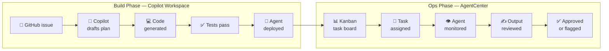

GitHub Copilot Workspace is impressive engineering. You describe what you want to build inside a GitHub issue, and it drafts a plan, writes the code, runs tests, and opens a PR. For a solo developer or a small team shipping features fast, it removes a real chunk of the grind.

But if you're running AI agents in production, not just building them, Copilot Workspace isn't the tool for that job. The distinction matters more than most teams realize when they first try to use a code assistant to manage live agent workloads. AgentCenter vs GitHub Copilot Workspace is really a comparison between two different phases of the same lifecycle.

## What GitHub Copilot Workspace Does Well

It's worth being honest about what this tool actually delivers:

- **Natural language to code**: Describe a task in a GitHub issue. Copilot Workspace produces a plan, writes the implementation, and iterates from your feedback.
- **Multi-file edits**: It can touch multiple files at once, not just a single inline suggestion. Useful when an agent requires changes across prompt files, handler functions, and test cases.
- **Plan preview**: You see the proposed changes before any code is written. If the direction is wrong, you catch it before any tokens are wasted generating bad code.
- **CI integration**: It runs your tests inside the workspace before you merge, so you're not shipping broken logic.
- **GitHub-native**: No separate tool, no context switching. It lives inside the repository workflow your team already uses.
- **Agent scaffolding**: If you're building an OpenClaw-compatible agent from scratch, Copilot Workspace can generate the initial structure, prompt files, and output handlers quickly.

If your team is building AI agents, Copilot Workspace genuinely speeds up the build phase. That's real, and it's worth acknowledging.

## Where It Stops

The problem starts the moment your agent goes live.

Your agent is now running in production. It's processing tasks, calling external APIs, consuming tokens, generating outputs. At this point, Copilot Workspace goes completely silent. It has no concept of agent runtime. It can't tell you if your agent is stuck in a retry loop. It doesn't track how much each task costs. It can't show you which outputs are waiting for a human to review or flag responses that don't match what you expected.

Copilot Workspace is a build tool. Once your agent is deployed, you're outside its scope entirely.

Teams hit this wall around the time they have 5 to 10 agents running. You're checking logs in one tab, watching API cost dashboards in another, and pinging the developer who built a specific agent to ask why it stopped responding. There's no shared view of what's happening. The tooling hasn't grown with the workload.

That's the gap AgentCenter fills. It's not a code assistant. It's a [control plane for AI agents in production](/features/agent-dashboard), the layer that gives your whole team visibility into what agents are doing, what they've produced, and what's costing you money.

## AgentCenter vs GitHub Copilot Workspace

| Feature | GitHub Copilot Workspace | AgentCenter |
|---|---|---|
| **Primary purpose** | AI-assisted code development | Production AI agent management |
| **Use phase** | Build / development | Deployment / operations |
| **Agent task visibility** | None | Real-time Kanban board |
| **Agent status monitoring** | None | Online, working, idle, blocked states |
| **Cost tracking per task** | None | Per-task token and spend tracking |
| **Deliverable review** | Code review via GitHub PR | Human approval workflows per task |
| **Multi-agent coordination** | None | @Mentions, task handoffs, chat threads |
| **Error detection** | CI test failures only | Live error alerts, loop detection |
| **Recurring automation** | None | Scheduled recurring tasks (Pro+) |
| **GitHub integration** | Native | Via OpenClaw webhook and API |
| **Pricing** | Included with Copilot Enterprise ($19-39/user/mo) | $14-$79/mo per workspace |
| **Best for** | Developers building and iterating on agents | Teams managing agents in production |

## The Workflow Gap

This diagram shows where each tool starts and stops in the agent lifecycle.

**Managing agents with only Copilot Workspace:**

1. Developer writes a GitHub issue describing what the agent should do
2. Copilot drafts a plan and generates the code
3. Developer reviews the plan, runs tests, merges the PR
4. Agent deploys and starts processing tasks
5. From here: check logs manually, watch cost dashboards in a separate tab, ask teammates when something looks wrong, and usually catch failures only after they've already caused problems

**Managing agents with AgentCenter post-deployment:**

1. Agent picks up a task and shows as "working" on the Kanban board
2. Task output appears as a deliverable linked directly to the task card
3. Reviewer gets @mentioned and approves or flags the output before it goes downstream
4. Token cost for that task is logged automatically per agent, per run
5. If the agent stalls or loops, an alert fires before it silently drains your budget

Copilot Workspace ends at deployment. [AgentCenter's agent monitoring](/features/agent-monitoring) starts there.

## Can You Use Both?

Yes. This is a realistic workflow for teams that build and operate agents.

Use Copilot Workspace when you're building a new agent or changing how an existing one works. It's good for the development loop: writing prompt logic, implementing tool calls, setting up output parsers, fixing edge cases before they reach production.

Use AgentCenter for everything that happens once the agent is live. Task assignment, status tracking, output review, cost monitoring, failure alerts, recurring task scheduling.

The handoff point is deployment. Copilot Workspace takes you to that line. AgentCenter picks up on the other side.

Teams that try to stretch Copilot Workspace into production operations end up building custom dashboards from scratch or watching their agents run blind and catching failures only after the damage is done. Neither is a good use of engineering time.

## Bottom Line

GitHub Copilot Workspace is a well-designed code assistant that makes the build phase faster. AgentCenter is what you run when you need to know what your agents are doing in production, how much they're costing per task, and which outputs need a human to sign off before they go further. Different tools, different phases, different jobs. Most teams building serious agent workflows need both, just not at the same time.

---

*GitHub Copilot Workspace is good at what it does. AgentCenter does something different — it manages your agents, not just helps you build them. [Start your 7-day free trial](/pricing) — no lock-in.*
