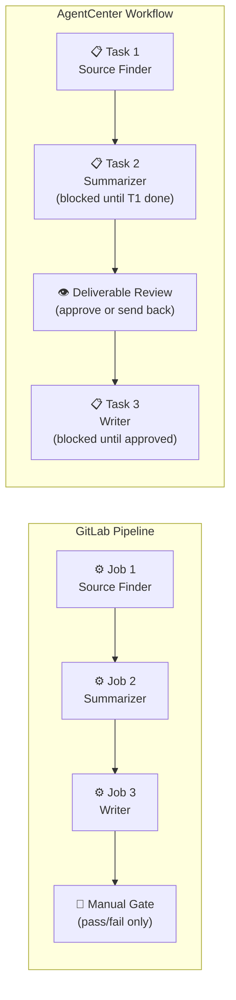

GitLab is one of the best DevOps platforms out there. Issue tracking, CI/CD pipelines, code review, container registry, deployment environments — all integrated. If your team ships software, GitLab earns its place.

Some teams reach for GitLab when they start running AI agents too. It makes sense initially. You've got a `.gitlab-ci.yml` that can trigger a Python script. That script calls an LLM. You have something that looks like an "agent" running on a schedule. You can track related work in GitLab Issues.

But once you have 8 agents running — some triggered on a schedule, some triggered by other agents, some triggered manually — GitLab starts showing its limits. Not because it's bad. Because it was built for software delivery, not for managing what agents do after they're deployed.

## What GitLab Does Well

- **Complete DevOps in one place** — Source code, pipelines, environments, container registries, and deployment rules all talking to each other. Nothing else comes close for unified software delivery.
- **CI/CD pipelines handle real complexity** — Multi-stage workflows, parallel jobs, manual approval gates, artifact passing between stages, environment variables. Mature and reliable.
- **GitLab Issues work** — You can track tasks, assign them to team members, set milestones, and organize work on boards. Solid, if not specialized.
- **Self-hosting is straightforward** — If your org has data residency requirements, GitLab's self-managed option is one of the better-maintained ones.
- **Merge request workflows are strong** — Diff tools, review apps, approval rules, threaded code comments. Code review is where GitLab really shines.

## The Core Problem for Teams Running AI Agents

GitLab pipelines can trigger an agent. What they can't do is tell you what that agent produced and whether it was any good.

When you run an agent through CI/CD, the pipeline knows three states: started, passed, failed. That's the full picture. You don't know if the agent is halfway through a 400-task batch run, whether it got confused on task 37 and started producing bad output, or whether the deliverable it just submitted actually answers the question it was asked.

Here's what that looks like in practice. You set up a GitLab scheduled pipeline that runs a research agent each morning. The pipeline passes. Green checkmark. You check the output file later and realize the agent only covered 3 of the 8 assigned sources. The job exited with code 0, so GitLab marked it as successful. You found out because someone noticed the report was short.

GitLab has no concept of a task queue for agents. No per-task cost tracking. No deliverable review workflow. No way to see that three agents are waiting on the same upstream dependency. No way to tell an agent to redo its last output and explain why.

Teams hit this ceiling around 5-10 agents. Before that, a pipeline and a shared doc works fine. After it, you're debugging failures by downloading artifact files and writing Slack messages like "did the summarizer agent actually finish all the sections?"

## AgentCenter vs GitLab: Side by Side

| Feature | GitLab | AgentCenter |
|---|---|---|
| Primary purpose | Software delivery and DevOps | AI agent task management and monitoring |
| Real-time agent status | Pipeline status (started / passed / failed) | Online, working, idle, blocked — per agent |
| Task visibility | CI/CD job logs | Kanban board per agent with full task detail |
| Deliverable review | Manual artifact download | Built-in submission, review, and approval workflow |
| Per-task cost tracking | Not available | Cost logged per task, per agent |
| Multi-agent coordination | Manual (trigger one pipeline from another via API) | Task dependencies, blocking relationships, sequential chains |
| @Mentions for agent work | Comment on issues or merge requests | @mention an agent in a task thread to reassign or clarify |
| Recurring agent tasks | Scheduled pipelines (cron syntax) | Recurring task templates with per-run state |
| Requires OpenClaw | No | Yes |
| Starting price | Free tier on GitLab.com; $29/user/mo (Premium) | $14/mo (5 agents, 3 projects) |

## How Each Handles a Multi-Agent Pipeline

Say you have three agents: one finds sources, one summarizes them, one writes a draft. You want them to run in sequence, with a human reviewing the draft before it goes anywhere.

**The GitLab approach:**

You write three CI jobs. Job 1 runs the source-finder agent and saves output as an artifact. Job 2 depends on Job 1, reads that artifact, runs the summarizer, saves its own artifact. Job 3 depends on Job 2 and runs the writer. You add a manual "gate" stage for human review before the final pipeline stage runs.

When something goes wrong — say the summarizer produced two paragraphs instead of ten — the pipeline still passes. Job 3 runs on bad input. The draft comes out short and unusable. You find out hours later when someone tries to send it.

**The AgentCenter approach:**

You create three tasks on a Kanban board with dependencies set. Task 2 is blocked until Task 1 completes. Task 3 is blocked until Task 2's deliverable passes review. When the summarizer submits, its output goes into a review queue. You spot that it only covered three of eight sources, leave a comment, and send it back. Task 3 stays blocked until the summary is approved.

The difference is feedback at the task level. GitLab tells you the pipeline ran. AgentCenter tells you whether the work was actually good before the next agent starts.

## Can You Use Both?

Yes, and some teams do.

GitLab handles the deployment side: building containers, running tests, pushing updated agent code to production. AgentCenter handles the operations side: what agents are doing right now, what they've produced, what needs review, what's over budget.

A common pattern is GitLab deploying updates to your agents (new prompt versions, updated tool dependencies) while AgentCenter monitors and coordinates the agents once they're live. They cover different ground and rarely overlap.

If you're running two or three agents with simple tasks and no deliverable review step, you may not need AgentCenter yet. A scheduled pipeline and a shared doc is fine at that scale. But if you're regularly downloading CI artifacts to check whether agent output was actually correct, you're doing manual work that a proper control plane should handle.

## Bottom Line

GitLab runs your agents. AgentCenter manages them.

GitLab is for shipping code and triggering automations. AgentCenter is for knowing what your agents are doing right now, catching bad output before it reaches the next step, and tracking what each task costs. For teams past about 5 agents, you'll likely need both — or you'll spend time writing custom monitoring scripts that rebuild what AgentCenter already provides.

Check out [AgentCenter's agent monitoring features](/features/agent-monitoring) or see which [plan fits your current fleet size](/pricing).

---

*GitLab is good at what it does. AgentCenter does something different — it manages your agents, not just runs them. [Start your 7-day free trial](/pricing) — no lock-in.*
