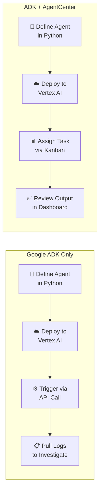

Google ADK is worth your attention. It's a well-built open-source framework for writing AI agents in Python, and if you're building on Google Cloud with Gemini models, it handles a lot of the plumbing you'd otherwise wire together yourself.

But comparing AgentCenter vs Google ADK isn't really a head-to-head between two platforms doing the same job. One is a framework for building agents. The other is a control plane for managing them once they're running in production. If you're evaluating both for a real deployment, here's what actually separates them.

## What Google ADK Does Well

Google ADK came out of Google's work on multi-agent systems, and the design reflects that. It's a serious SDK with real capabilities.

- **Multi-agent composition**: Wire agents together in sequential, parallel, or loop patterns using clean Python abstractions. The orchestration logic is explicit, readable, and lives in version control alongside your application code.
- **Built-in tools**: Search, code execution, and function calling ship with the framework. You're not writing boilerplate wrappers before you can get to the actual agent logic.
- **Vertex AI integration**: Deploying to Google Cloud is genuinely simple if your infrastructure is already on GCP. Credentials, compute, and scaling go through familiar Google Cloud tooling.
- **Streaming support**: ADK handles streaming responses from Gemini natively. For long-running tasks that return incremental output, this is a real practical advantage.
- **Open source**: The code is publicly available. You can read it, fork it, and extend it. That matters when you need to debug edge cases in production.

It's a solid choice for teams that want a structured way to build agents and want to stay in the Google ecosystem.

## The Core Limitation for Teams Managing AI Agents in Production

Here's where things get harder. ADK is a build-time tool. It helps you define agent behavior, compose workflows, and deploy to Vertex AI. Once those agents are running live workloads, ADK has almost nothing to offer on the operational side.

There's no live dashboard showing which agents are active, idle, or blocked. No task-level tracking. No way for a second engineer to see what an agent delivered last Tuesday without digging through code and logs. No approval step before an agent's output goes downstream to another system or a customer.

Consider this scenario: you have 10 agents running in production. One starts producing low-quality outputs because a prompt change introduced a subtle regression. There's no signal. You'd pull GCP Cloud Logging, correlate entries with your storage layer, and manually reconstruct what happened — and that assumes you even noticed something was wrong in the first place.

That's not a gap Google ADK will close. It wasn't designed to. ADK is the framework that builds the agents. It doesn't tell you how the fleet is performing once it's running.

The operational visibility layer — real-time status, task history, team coordination, deliverable review — is what AgentCenter adds. Not a replacement for ADK. The layer that makes production operations manageable once agents are live.

## AgentCenter vs Google ADK — Feature Comparison

| Feature | Google ADK | AgentCenter |
|---|---|---|
| Primary purpose | Build and deploy agents | Manage and monitor agents in production |
| Real-time agent status | No (logs only) | Yes — online, working, idle, blocked |
| Task tracking | No | Kanban board with full task history |
| Human-in-the-loop workflows | Not built-in | Approval workflows and deliverable review |
| Team collaboration | No | @Mentions and chat threads per task |
| Per-agent cost tracking | Aggregate via GCP billing | Per-task and per-agent cost breakdown |
| Error visibility | GCP Cloud Logging | Activity feed with surfaced errors |
| Model support | Gemini-first | Any OpenClaw-compatible provider |
| Pricing | Free (pay for GCP compute) | $14/mo Starter, $29/mo Pro, $79/mo Scale |
| Recurring task automation | No | Yes (Pro and Scale plans) |
| Multi-project support | Single deployment unit | Up to 50 projects on Scale |

## Workflow Comparison: Their Way vs AgentCenter

### Running a research agent with Google ADK only

```
1. Define agent logic in Python with ADK
2. Deploy to Vertex AI — agent is now live
3. Trigger agent via API call or ADK runner
4. Wait for completion — no live status visible
5. Retrieve output from your storage layer
6. If something went wrong, pull Cloud Logging
7. Manually reconstruct what happened and when
8. No record of who reviewed the output or whether it was accepted
```

### The same agent managed through AgentCenter

```
1. Connect your agent to AgentCenter via OpenClaw
2. Create and assign a task from the Kanban board
3. Watch real-time status: pending → running → completed (or blocked)
4. Review the deliverable directly in the dashboard
5. Approve it, or send it back to the agent with a comment
6. Full audit trail: who reviewed, when, what the output was
7. If the agent errors, the activity feed surfaces it with context
```

The agent code is identical in both scenarios. The difference is the operational layer wrapped around it.



## Can You Use Both?

Yes — and this is the common setup for teams that are serious about production operations.

Google ADK handles the build side: agent logic, multi-agent composition, tool wiring, and deployment to Vertex AI. AgentCenter handles the operational side: task assignment, real-time monitoring, team coordination, and deliverable review. They don't overlap.

ADK runs at build and deploy time. AgentCenter runs at runtime. You can add AgentCenter without rewriting your ADK agent definitions. It's a layer on top, not a fork in the road.

The practical question is when to add it. If you have one or two agents in early development, ADK alone is probably fine. Once you're past five agents running real workloads — especially with multiple people responsible for outputs — the visibility gaps compound fast. That's usually when teams reach for [dedicated agent monitoring](/features/agent-monitoring) to get operational control back.

AgentCenter also works with agents built on frameworks other than ADK. It supports any OpenClaw-compatible provider, so if your team uses a mix of Gemini and Claude or GPT-4 agents, you can manage them all in one place. You can review the [full feature list](/features) to see what the control plane adds at runtime beyond what any build framework provides.

One more thing worth noting: AgentCenter's recurring task automation (on Pro and Scale plans) lets you run agents on a schedule without building your own scheduling layer. That's infrastructure you'd otherwise write on top of ADK yourself.

## Bottom Line

Google ADK is a well-designed framework. If you're shipping Gemini-powered agents to Vertex AI, it does the job and does it cleanly.

AgentCenter solves a different problem: what happens after the agent ships. Task tracking, real-time status, team review workflows, per-agent cost visibility — none of that comes with ADK. If your agents are in production and you've ever spent an afternoon in Cloud Logging trying to figure out what went wrong, that's exactly the problem AgentCenter was built to fix.

---

*Google ADK is good at what it does. AgentCenter does something different — it manages your agents once they're live, not just while you're building them. [Start your 7-day free trial](/pricing) — no lock-in.*
