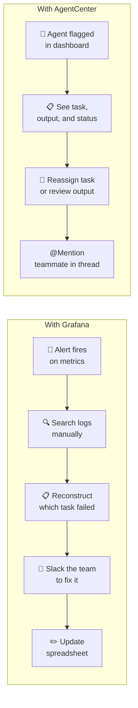

The AgentCenter vs Grafana question comes up more than you'd expect. Grafana is everywhere in engineering stacks. It's the default for dashboards, alerts, and infrastructure metrics. When teams start running AI agents in production, it's natural to ask: can't I just wire my agents into the same system I already use?

Sometimes yes. Often no. Here's the difference.

## What Grafana Does Well

Grafana is genuinely good at infrastructure observability. It's been refined over years of production use by thousands of engineering teams, and it shows.

- **Metrics at scale** — hundreds of panels per dashboard, multiple time ranges, variable-driven filtering across environments
- **Wide data source support** — Prometheus, Loki, Tempo, PostgreSQL, Elasticsearch, Cloudwatch, and 50+ others in one view
- **Alerting** — threshold rules, anomaly detection via ML plugins, Pagerduty and Slack routing
- **Logs and traces** — Loki for log aggregation, Tempo for distributed tracing, correlated with metrics in a single panel
- **Open-source** — free to self-host, active plugin community, huge ecosystem of pre-built dashboards
- **Shared team access** — role-based permissions, public dashboards, embeddable panels

If you're running agents on VMs or containers, Grafana gives you the infrastructure picture: host CPU, memory, latency, error rates. That's legitimate visibility, and you probably want it.

## The Core Limitation for Teams Running AI Agents

Grafana knows what your infrastructure is doing. It doesn't know what your agents are doing.

Those aren't the same thing. An agent running on a healthy pod with normal latency can still produce garbage outputs, get stuck in a retry loop on a bad task, hand off wrong data to the next agent in a pipeline, or silently do nothing for six hours because its task had a bad input.

None of that shows up in an infrastructure metric. Grafana has no concept of a task. No concept of a deliverable. No model of what an agent is supposed to produce, or whether what it produced was any good.

When agent 7 fails, Grafana might show you a latency spike or a process restart. Then you're on your own:

1. Search Loki for logs from that agent process
2. Trace back through timestamps to figure out which task it was running
3. Check if any output was written before the failure
4. Manually figure out whether that output went downstream
5. Slack whoever owns the downstream system
6. Manually reassign the task or mark it failed

Teams that try to close this gap by pushing custom metrics into Grafana end up maintaining a monitoring layer on top of their monitoring layer. It works, partly, until someone leaves and the custom panels break and nobody knows what they're showing anymore.

## AgentCenter vs Grafana: Feature Comparison

| Feature | Grafana | AgentCenter |
|---|---|---|
| Real-time agent status | Possible with custom metrics | Built-in |
| Task assignment and queues | No | Yes |
| Deliverable submission and review | No | Yes |
| Approval workflows | No | Yes |
| Cost per agent and per task | No (requires custom build) | Built-in |
| @Mentions and task threads | No | Yes |
| Multi-agent coordination | No | Yes |
| Kanban board | No | Yes |
| Agent lifecycle management | No | Yes |
| Infrastructure metrics | Yes | No |
| Log and trace visualization | Yes | No |
| Alerting on thresholds | Yes | Basic notifications |
| Open-source option | Yes (OSS) | No |
| Pricing | Free OSS / Cloud from $0 to ~$8/user/mo | Starter $14/mo, Pro $29/mo, Scale $79/mo |
| Best for | Infrastructure observability | AI agent operations |

## Workflow Comparison: Handling an Agent Failure

This is where the difference is most concrete. Here's what diagnosing an agent failure looks like with each tool.

**With Grafana:**

1. Alert fires on error rate or latency spike
2. Open Loki, search for agent process logs by pod or container name
3. Trace timestamps back to the task that was running at the time
4. Check whether any output was written before the failure
5. Slack the developer who owns that agent
6. Developer manually reassigns or retries the task
7. Update the tracking spreadsheet or Jira ticket

**With AgentCenter:**

1. Agent shows as failed or blocked in the [agent dashboard](/features/agent-dashboard)
2. Click into the task — see what it was working on, what output it produced, where it stopped
3. Flag the deliverable for review or reassign the task in two clicks
4. @Mention a teammate in the task thread — context is already there
5. Per-task cost updates automatically

The Grafana path involves four tools (your metrics system, Loki, Slack, and a tracker) and several minutes of manual reconstruction. The AgentCenter path is one place.

## Can You Use Both?

Yes, and for many teams that's the right answer.

Grafana handles the infrastructure layer: host metrics, container health, external API latency, raw log volumes. If you're running agents on Kubernetes or behind a service mesh, Grafana gives you the cluster health picture you need.

AgentCenter handles the agent operations layer: who's working on what, what got produced, did it pass review, how much did it cost. See [agent monitoring](/features/agent-monitoring) for what that looks like in practice.

These two layers don't compete. They sit at different levels of the stack. A team running 20 agents on self-managed infrastructure might use Grafana for infra visibility and AgentCenter for agent task management and deliverable review. That's a sensible setup.

The teams that run into trouble are the ones trying to use Grafana for both jobs. You end up with a custom dashboard project that partially works, maintained by one person, and breaks every time the agent's output schema changes.

## When Grafana Is the Right Starting Point

If you're still in the experimental phase with two or three agents, Grafana is a reasonable starting point. Wire up some basic metrics, set a latency alert, and move on.

When you have more than five agents running tasks in production, or when the output quality of those agents matters to anyone downstream, you need something that understands what an agent produces. Grafana won't get you there without significant custom work.

The gap becomes obvious fast. An infrastructure alert tells you the agent crashed. It doesn't tell you what task it was on, what it output before it crashed, or whether the output was valid. That context is what [multi-agent workflows](/features/multi-agent-workflows) at scale actually require.

## Bottom Line

Grafana is built for infrastructure observability. It does that well. It's not built for managing AI agents in production. If you need to assign tasks, review deliverables, coordinate agent handoffs, and track costs per task, you need a control plane built for agents. See [AgentCenter pricing](/pricing) for plans starting at $14/month.

---

*Grafana is good at what it does. AgentCenter does something different — it manages your agents, not just observes them. [Start your 7-day free trial](/pricing) — no lock-in.*
