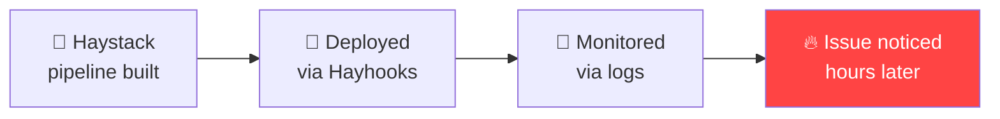
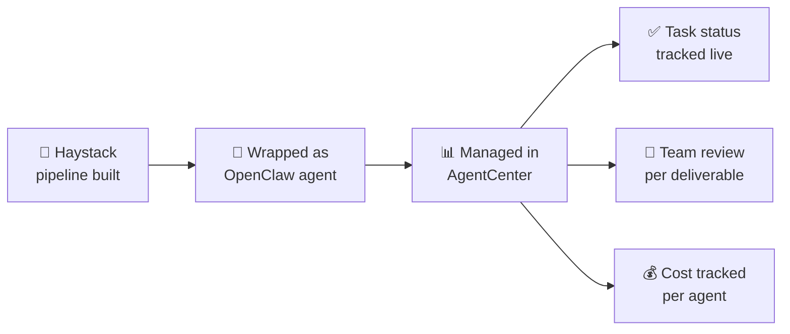

If you've built anything with Haystack, you know it's a solid framework for wiring together LLM components. Pipelines, retrievers, generators, agent graphs — the abstractions feel right. The question isn't whether Haystack is worth using. It is. The question is: once those agents are live in production, how do you know what they're actually doing, whether they're stuck, and what they're costing you?

That's a different problem. And Haystack doesn't solve it.

## What Haystack Does Well

Haystack is an open-source Python framework by deepset, originally built for NLP and document retrieval, now a full platform for LLM apps and agent workflows. It earns its place in a lot of stacks.

- **Component-based pipeline design**: You define components — retrievers, generators, embedders, custom nodes — connect them, and run the graph. It keeps complex logic readable.
- **Broad LLM provider support**: Works with OpenAI, Anthropic, Google, Cohere, and most self-hosted models. Swap providers without rewriting your pipeline logic.
- **Native RAG support**: Document stores, vector retrieval, hybrid search — all first-class. If your agents need to retrieve context before acting, Haystack handles it well.
- **Hayhooks for REST deployment**: Turn your Haystack pipeline into an HTTP endpoint in a few lines. Makes shipping a working agent feel achievable.
- **OpenClaw compatibility**: Haystack agents can run as OpenClaw-compatible agents, which means you can connect them to AgentCenter without rearchitecting your pipeline.
- **Active open-source community**: Regular releases from deepset, growing third-party ecosystem, decent documentation.

If the job is building well-structured agent pipelines, Haystack is a good tool for that job.

## The Problem When Agents Go Live

Here's what teams find out the hard way.

Haystack builds the agent. It doesn't manage it. After your pipeline is deployed, there's no built-in dashboard showing which tasks are running, which are stuck, which finished, and what they produced. No cost breakdown per agent. No task history a teammate can browse. No way to route a specific deliverable for review before it goes downstream. No alert when an agent has been working on the same task for three hours straight.

We saw this with a team running six Haystack agents for a document summarization workflow. Everything worked in dev. In production, two agents started producing low-quality summaries — not errors, just bad outputs. They found out three weeks in when a client complained. They had logs. They didn't have visibility.

Haystack is a build-time tool. AgentCenter is a runtime tool. The boundary is at deployment: Haystack owns what the agent does, AgentCenter owns what's happening to the agent while it runs.

## AgentCenter vs Haystack: Feature Comparison

| Feature | Haystack | AgentCenter |
|---|---|---|
| Build agent pipelines and graphs | Yes | No |
| Declarative component architecture | Yes | No |
| Real-time agent task status | No | Yes |
| Kanban board for task management | No | Yes |
| @Mentions and comment threads per task | No | Yes |
| Deliverable review and approval workflows | No | Yes |
| Per-agent cost and token tracking | No | Yes |
| Recurring task automation | No | Yes (Pro+) |
| Multi-agent coordination | Via pipeline graph | Via task orchestration |
| Cloud VM provisioning | No | Yes (Scale only) |
| Open-source | Yes (community edition) | No |
| Pricing | Free (community) / Enterprise pricing on request | Starter $14/mo · Pro $29/mo · Scale $79/mo |

## How the Workflow Differs

### Running Haystack agents without a control plane

You deploy a Haystack pipeline to Hayhooks. Your agent runs, produces output, and logs to a file. If a task fails silently or produces bad output, you find out from a log alert — or when someone notices the result is missing downstream. Debugging means reconstructing what the agent was doing from trace data after the fact.

### Running Haystack agents with AgentCenter

Your Haystack agent is wrapped as an OpenClaw agent and connected to AgentCenter once. The same task now appears on your team's Kanban board with a live status. A teammate can leave a comment on a specific deliverable. The agent's cost shows up in the [agent monitoring dashboard](/features/agent-monitoring). If the agent stalls, the status changes and you're notified — not hours later, not after a client complaint.

The pipeline code doesn't change. You add a management layer on top of what Haystack already does.

## Can You Use Both?

Yes. For most teams running Haystack in production, this is the right answer.

Haystack owns the build layer: pipeline structure, component configuration, model routing, retrieval logic. AgentCenter owns the operations layer: task visibility, team coordination, deliverable tracking, cost attribution.

There's no overlap to resolve. A Haystack agent running as an OpenClaw agent shows up in AgentCenter the same way any other agent does. You get the same [task orchestration features](/features/task-orchestration) regardless of what framework built the underlying agent.

Some teams add AgentCenter when they hit their first production incident — a stuck agent, a missed deliverable, a billing surprise. Others add it before the first agent ships. The second path involves a lot less cleanup.

If you're already using Haystack and want to know what to add for the management layer, the [AgentCenter plans](/pricing) show what each tier covers.

## What About Haystack Enterprise?

Deepset offers Haystack Enterprise with additional tooling for teams: deployment management, monitoring integrations, and support. If you're building entirely within the deepset stack and want pipeline observability tightly coupled to your framework, that's a reasonable path.

AgentCenter is framework-agnostic. It manages OpenClaw-compatible agents regardless of how they were built — Haystack, LangChain, custom Python, anything OpenClaw-compatible. If you're running agents across different frameworks, or don't want your operations tooling tied to a single pipeline vendor, AgentCenter fits that pattern better.

## Bottom Line

Haystack is a solid framework for building LLM pipelines and agent graphs. It doesn't manage them once they're running. AgentCenter fills that gap: task visibility, team coordination, cost tracking, and deliverable review across your agent fleet. One tool builds the agent, the other keeps it from becoming a mystery after it ships.

---

*Haystack is good at what it does. AgentCenter does something different — it manages your agents, not just builds them. [Start your 7-day free trial](/pricing) — no lock-in.*
