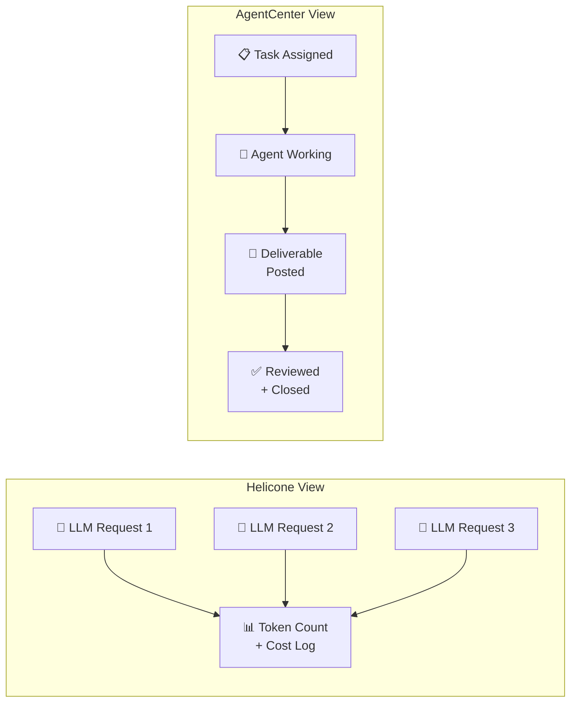

Helicone is one of the most widely used LLM observability tools out there, and for good reason. You add a single line to your existing API call, and every LLM request gets logged: tokens in, tokens out, latency, cost per call. If you're building anything that hits an LLM, you can get useful data in about 10 minutes.

After running it for a few weeks, though, you notice something. You can see every token your agent spent last Thursday. You can tell which prompts are slow and which are expensive. But you still don't know whether the agent finished its task, whether the output was any good, or who's responsible if it failed silently.

That's the gap between LLM observability and agent management.

## What Helicone Does Well

Helicone operates at the LLM request layer. It captures everything that passes through your API calls and makes it queryable.

- Logs every LLM request with full payloads, headers, and responses
- Tracks token costs per model, per user, and per prompt template
- Shows latency percentiles and request volumes over time
- Adds a caching layer that cuts costs on repeated identical requests
- Supports prompt versioning and comparison across different prompt variants
- Lets you set rate limits per user or application key
- Attributes spend by user ID, project, or any custom property you define

If your goal is understanding what's happening at the API level — what you're paying per call, which prompts are bloated, where latency spikes — Helicone handles that job well.

## The Core Limitation for Agent Teams

Helicone sees your LLM calls. It doesn't see your agents.

That distinction matters the moment you're running agents in production. An agent is not a single API call. It's a process: it receives a task, makes decisions, calls tools, fires off multiple LLM requests across multiple steps, and eventually produces output. Helicone will log every one of those LLM calls. But it has no concept of the task the agent was working on, whether that task succeeded, or whether anyone reviewed what came out.

Run 12 agents across 4 projects, and here's what Helicone shows you: 847 API calls, $4.20 in spend, average latency 1.2 seconds. Here's what it doesn't show you: which agent is stuck, which one completed its task two hours ago and nobody looked at the deliverable, and which one has been retrying the same failing tool call for 45 minutes.

For individual developers building and tuning a single agent, Helicone covers a lot of ground. For teams managing multiple agents doing real work, the request log alone isn't enough.

## AgentCenter vs Helicone at a Glance

| Feature | Helicone | AgentCenter |
|---|---|---|
| LLM request logging | Yes | No |
| Cost tracking per model | Yes | Per-agent task cost |
| Latency monitoring | Yes | Task completion time |
| LLM response caching | Yes | No |
| Prompt versioning and A/B testing | Yes | No |
| Rate limiting per user | Yes | No |
| Agent task status (active/idle/blocked) | No | Yes |
| Kanban board for agent work | No | Yes |
| Task assignment and ownership | No | Yes |
| @Mentions and team coordination | No | Yes |
| Deliverable review and approval | No | Yes |
| Multi-agent orchestration | No | Yes |
| Recurring task automation | No | Yes (Pro+) |
| Pricing | Free tier; paid plans scale with usage | Starter $14/mo, Pro $29/mo, Scale $79/mo |

## How the Workflows Differ

Say you have an agent that produces a competitor research summary every Monday morning.

**With Helicone only:**

1. Agent kicks off and fires multiple LLM calls
2. Helicone logs each call: model used, tokens consumed, latency
3. You see aggregate cost and request count for the session
4. You have no visibility into whether the task was assigned, in progress, completed, or failed
5. If the agent produced low-quality output, you find out when someone downstream asks why the report is wrong

**With AgentCenter:**

1. Task is created on the board and assigned to the agent, with due date and acceptance criteria
2. Agent picks it up, status changes to "working" in the [agent dashboard](/features/agent-dashboard)
3. Agent posts its deliverable to the task thread when done
4. A team member reviews and approves — or requests a revision — directly in the thread
5. Task closes with a tracked output, timestamps, and who signed off

Helicone answers: what did my LLM calls cost? AgentCenter answers: did my agent actually do its job?

## What Each Tool Is Missing Without the Other

Neither tool is trying to do what the other does, which is worth saying plainly.

Helicone doesn't track agent tasks, and it's not trying to. It's purpose-built for LLM infrastructure: costs, caching, rate limits, prompt performance. If you're burning money on repeated API calls or need to know which prompt version performed better on latency, Helicone gives you that data.

AgentCenter doesn't log LLM requests, and it's not trying to either. It manages agents as workers: who's assigned what, what they've produced, whether that output was reviewed, and what happens when something breaks. The [agent monitoring features](/features/agent-monitoring) focus on task state and output quality, not API-level details.

Teams that care about both layers end up needing both tools — or at minimum, they need to be clear about which layer they're optimizing for right now.

## Can You Use Both?

Yes. The combination makes sense if you're operating at scale and care about controlling costs while also keeping agent work visible and accountable.

Helicone handles the LLM infrastructure layer: caching, prompt tuning, spend attribution, rate limits. AgentCenter handles the [multi-agent workflow coordination](/features/multi-agent-workflows) layer: task assignment, status, deliverables, team collaboration. They sit at different points in your stack and don't overlap much.

A practical split: use Helicone when you're actively optimizing prompts or debugging expensive API patterns. Use AgentCenter for day-to-day management of what your agents are working on and whether results are getting reviewed. At around 5 or more active agents, the lack of task-level visibility starts costing more time than the tooling costs money.

## Bottom Line

Helicone gives you LLM-level visibility: tokens, costs, latency, prompt performance. AgentCenter gives you agent-level control: tasks, status, deliverables, ownership, and coordination across your whole fleet. If your goal is knowing what your agents are actually doing in production — not just what API calls they're making — that's a different job. See the [pricing page](/pricing) to find the plan that fits your team size.

---

*Helicone is good at what it does. AgentCenter does something different — it manages your agents, not just their API calls. [Start your 7-day free trial](/pricing) — no lock-in.*
