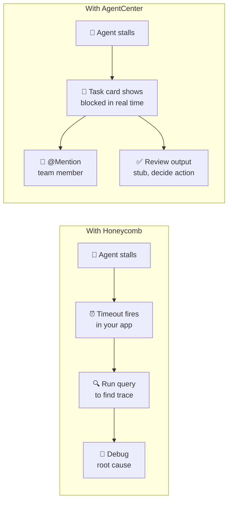

Honeycomb is genuinely good. If you've needed to find why one percent of requests are 10x slower across a distributed backend with 20 services, Honeycomb's high-cardinality querying will save you hours. BubbleUp alone is worth the subscription for teams running complex distributed systems.

So when teams start managing AI agents in production, Honeycomb feels like a natural first move. You're already sending traces from your app. You add agent execution events. You can query them. Problem solved, right?

The gap shows up around the 6-agent mark. You can see what happened inside a trace. But you can't tell which agent is blocked right now, who on your team should handle it, or what it cost to get to this point. Honeycomb doesn't answer those questions.

## What Honeycomb Does Well

To be clear about what we're comparing:

- **High-cardinality event queries**: Filter a billion events by any attribute combination in seconds. Honeycomb's columnar storage and query engine handle this better than any tool in the space.
- **BubbleUp analysis**: Automatically highlights which trace dimensions correlate with slow or error-prone behavior. Useful when you suspect something is wrong but don't know where to look.
- **Structured event model**: Unlike metric-based tools, Honeycomb lets you log arbitrary key-value pairs per event. That fits AI agent execution data well — tokens used, model version, tool calls, latency per step.
- **Trace correlation**: Link spans across services with trace IDs. If your agent calls three external APIs, you can follow the full request path.
- **Collaborative debugging**: Share query links, annotate boards, comment on specific findings. The DX is unusually good.

If your question is "why did this agent run take 45 seconds instead of 8, and which step caused it?", Honeycomb will answer it well.

## The Core Limitation for Agent Teams

Honeycomb tells you what happened after it happened.

That's not a criticism — it's the design intent. You instrument your code, events flow into Honeycomb, you query them. The whole model is retrospective: observe, query, debug.

When you're running 15 agents across 5 projects with a team of 4 engineers, you need something different. You need to know:

- Which agents are working right now vs stuck vs idle
- Which specific task has been blocked for the last two hours
- Who on your team needs to review the agent's output before it ships to a customer
- What each agent task cost to run, not as a query but as a running total per project

None of that comes from trace data. Honeycomb stores what your code instrumented. It doesn't know about task ownership, team coordination, or deliverable approval.

Here's how the two workflows look when a task gets stuck:

The Honeycomb flow ends at diagnosis — after the task has already failed. The AgentCenter flow catches the problem while there's still time to act.

## AgentCenter vs Honeycomb — Feature Comparison

| Feature | Honeycomb | AgentCenter |
|---|---|---|
| Distributed tracing | Excellent | Not applicable |
| High-cardinality event queries | Yes | No |
| Live agent status board | No | Yes — online, working, idle, blocked |
| Task management (Kanban) | No | Yes, per project |
| @Mentions and task threads | No | Yes, per task |
| Deliverable review and approval | No | Yes |
| Cost tracking per agent/task | Manual query required | Built in |
| Multi-agent workflow coordination | No | Yes |
| Recurring task automation | No | Yes (Pro+) |
| Cloud VM provisioning | No | Yes (Scale plan) |
| Pricing entry point | Free; Team from ~$20/mo | Starter $14/mo |
| Max managed agents | No agent concept | 5 / 15 / 50 by plan |
| Built for AI agent management | No | Yes |

## Workflow Comparison: A Task That Goes Silent

Scenario: Agent B processes customer support tickets. It's been running for 50 minutes with no output. Something is wrong.

**With Honeycomb:**

1. Your app timeout fires (or you notice manually)
2. Open Honeycomb and write a query to find traces from that agent in the last hour
3. Locate the trace — find where the span tree stops
4. Use BubbleUp to check if any attributes correlate with the stall
5. Identify the cause: rate limit, context overflow, bad tool response
6. Fix it in code, redeploy, update your runbook

That's six steps. You learn what went wrong. But the task is already dead, the output is lost, and no one on your team knew it was happening until you went looking.

**With AgentCenter:**

1. Kanban card for the task flips to "blocked" automatically
2. Open the task — see elapsed time, cost so far, last action the agent took
3. @Mention the engineer who owns this workflow
4. They decide: retry the task, reassign it, or escalate
5. Task resumes or gets handled within minutes

Three steps. The team is in the loop before the task fails completely. [Agent monitoring](/features/agent-monitoring) in AgentCenter surfaces this state as it happens, not after you run a retrospective query.

The difference matters more at scale. At 5 agents you can watch them manually. At 20 you can't — you need a board that shows you which ones need attention right now.

## Can You Use Both?

Yes. Several teams do.

Honeycomb and AgentCenter answer different questions. Honeycomb answers: "What happened inside this execution at the code level?" AgentCenter answers: "What is happening with my agents right now, and what does my team need to do about it?"

If you're running serious distributed systems and your agents call multiple external services, Honeycomb is valuable for deep trace debugging. AgentCenter handles the layer above that: task coordination, team visibility, deliverable review, and cost tracking by project.

They're not competing for the same function. A common pattern for teams past 20 agents: Honeycomb for deep post-incident debugging; AgentCenter as the control plane the team opens every morning during standup.

Smaller teams — say 5 to 15 agents — usually skip Honeycomb entirely. The [agent monitoring](/features/agent-monitoring) built into AgentCenter covers most visibility needs without requiring you to instrument and query separately. At that scale, you don't need high-cardinality trace analysis. You need to know which agent is stuck and why.

## Bottom Line

Honeycomb is one of the better observability tools available. It's not an agent management platform, and it was never meant to be.

If your main problem is "I can't tell what my agents are doing, who owns each task, or what they cost," that's not a tracing gap. It's a coordination gap. [See how AgentCenter handles it](/features).

---

*Honeycomb is good at distributed tracing. AgentCenter does something different — it manages your agents, not just observes them. [Start your 7-day free trial](/pricing) — no lock-in.*
