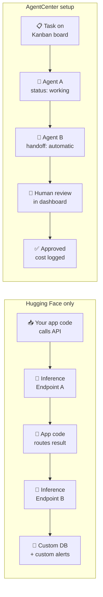

Hugging Face is where most teams start with AI. The model hub, the Spaces playground, Inference Endpoints — it's one of the best ecosystems for working with machine learning models. If you're picking a foundation model, hosting a Gradio demo, pulling a fine-tuned Llama variant into a pipeline, or benchmarking open-source options against proprietary APIs, Hugging Face is the obvious first stop.

But when you're managing AI agents in production — multiple agents, running real tasks, handing work between each other, with real people waiting on real outputs — Hugging Face stops being the right tool. Not because it's poorly built. Because it's solving a different problem.

This post isn't about which platform is better in some abstract sense. It's about which one belongs in your stack for agent operations, and what the gap looks like once you try to use a model host as a control plane.

## What Hugging Face Does Well

It's worth being direct about where Hugging Face genuinely shines:

- Over 500,000 models in the hub, searchable by task, license, architecture, and language
- Inference Endpoints for one-click hosted API access to any model on the hub
- Spaces for running Gradio and Streamlit applications, free for public demos
- Dataset repositories with versioning for training and evaluation workflows
- AutoTrain for fine-tuning without writing custom training loops
- Active open-source community, model cards, and public leaderboards
- A free tier that's actually useful, not just a 14-day trial

For model research, selection, and early prototyping, Hugging Face is hard to beat. If your team isn't already using it for the model layer, you probably should be.

## The Problem When You're Running Agents

Here's where the gap opens up. Hugging Face knows about your model calls. It doesn't know about your agent tasks.

Once you cross the line from "run this model" to "this agent is doing real work for my team," you need something different. You need to know which tasks are in progress, which ones completed, which ones failed, and why. You need to assign tasks to specific agents, review their outputs before they ship, get notified when something breaks, and see what the whole fleet is doing in one place.

Hugging Face doesn't do any of that. You get API logs and token usage stats, but there's no task board, no approval workflow, no @mention system, no per-task cost breakdown, and no way for a non-engineer on your team to know what's running.

A team running ten agents through Inference Endpoints ends up building a management layer themselves. Usually it's a mix of spreadsheets, a Slack bot, and one engineer who "knows what's running." That scales until something breaks at 11pm — and then you spend an hour in logs trying to figure out which agent dropped the ball.

## AgentCenter vs Hugging Face: Side-by-Side

| Feature | Hugging Face | AgentCenter |
|---|---|---|
| Model hosting | Yes — 500k+ models, Inference Endpoints | No — connects to any OpenClaw-compatible provider |
| Agent task tracking | No | Yes — task board with status, history, and ownership |
| Multi-agent coordination | No | Yes — task routing between agents, dependency handling |
| Kanban task management | No | Yes — visual board, custom columns, drag-and-drop |
| Real-time agent status | API logs only | Live per-agent status: online, working, idle, blocked |
| @Mentions and threads | No | Yes — per-task comment threads and team mentions |
| Deliverable review and approval | No | Yes — review gates before outputs reach stakeholders |
| Cost tracking | Token usage per API call | Cost per task, per agent, per project |
| Error alerting | None built-in | Configurable alerts by agent, project, and error type |
| Human-in-the-loop support | Not supported | Built in — escalation, review gates, manual override |
| Analytics and activity feed | Basic usage dashboard | Full activity feed, performance history per agent |
| Pricing | Free / ~$9 per endpoint per hour | Starter $14/mo, Pro $29/mo, Scale $79/mo |
| Best for | Model hosting and ML research | Teams managing agents in production |

## How the Same Workflow Looks on Each Platform

Suppose you have two agents: one that processes incoming customer queries and extracts structured data, and a second that drafts follow-up responses based on that data.

**With Hugging Face only:**

1. Your code calls Inference Endpoint A with the raw query
2. You parse the JSON response in your own application code
3. Your code routes the result to Inference Endpoint B
4. Agent B returns a draft — stored wherever your app puts it
5. You notify a human reviewer through some other tool (email, Slack DM, a webhook you built)
6. The human reviews the output in whatever interface you've set up
7. No visibility into failure state, latency, cost per query, or backlog depth unless you instrumented everything yourself upfront

**With AgentCenter:**

1. A task appears on the [Kanban board](/features/task-orchestration) — assigned to Agent A
2. Agent A picks it up, status updates to "working" in real time
3. Agent A completes processing, hands off structured context to Agent B automatically
4. Agent B drafts the response, task moves to the review queue
5. Your teammate gets notified, reviews the draft in AgentCenter, approves it
6. Task closes — cost logged against the project, completion time recorded
7. If Agent A fails midway, the board shows it instantly. You see which task, which agent, what it was doing

The difference isn't which models are running. It's everything that happens before and after the model call.

## What About Spaces?

Some teams use Hugging Face Spaces to build lightweight UIs for their agents — a Gradio app where a team member can trigger an agent and see the output. That's a reasonable prototype approach.

The problem is Spaces are stateless. Each run is isolated. There's no persistent task history, no way to track what ran last Tuesday and why it failed, no approval workflow, no multi-agent coordination, and no cost attribution across the team.

Spaces work for demos. They don't work as an operations layer for a team running agents in production. Trying to stretch them into that role means building the control plane yourself, which is the thing you were trying to avoid.

## Can You Use Both?

Yes — and this is actually the most common setup for teams that want the best of both.

Hugging Face is a strong compute layer for open-source models. If your OpenClaw agents call Llama 3, Mistral, or a fine-tuned variant via Inference Endpoints, that works fine. AgentCenter sits above the agent runtime, managing [task orchestration](/features/task-orchestration) and [monitoring](/features/agent-monitoring) regardless of which models the agents use underneath.

The two aren't in competition. Hugging Face handles the model compute. AgentCenter handles the task lifecycle — creation, assignment, status tracking, review, cost, and alerting.

Where they genuinely conflict is when a team tries to use Hugging Face as both the model host and the operations dashboard. That's not what it's designed for, and you'll hit the ceiling fast as soon as you have more than a couple of agents running real work.

## Bottom Line

Hugging Face is one of the best places to host and run AI models, especially if you need open-source options. AgentCenter is built for what comes after the model call: tracking tasks, coordinating agents, reviewing outputs, and giving your whole team visibility into what's running. They sit at different layers of the stack. Teams that understand that distinction usually end up running both.

---

*Hugging Face is a great model host. AgentCenter manages your agents, not just your models. [Start your 7-day free trial](/pricing) — no lock-in.*
