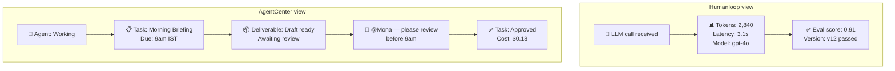

You ship a prompt that works. Evals look solid. Model comparison checks out. Then it goes into production inside an agent, and a week later someone asks: "Is that agent still running? Did it finish that task? What did it actually output yesterday?"

Humanloop has no answer for that. It wasn't built for it.

That's not a knock on Humanloop. It does a specific job well. But there's a gap between "my prompt is high quality" and "my agent is running well in production." These are different problems. Treating one tool as a substitute for the other costs you visibility at the worst possible time.

## What Humanloop Does Well

Humanloop is a prompt engineering and evaluation platform. Teams use it to build reliable prompts before those prompts go into agents.

- **Prompt versioning**: every change to a prompt is tracked, comparable, and reversible. You can see who changed what and roll back when something breaks
- **Model comparison**: run the same inputs against different providers and evaluate outputs side by side, with scoring
- **Evaluation pipelines**: define quality criteria and run automated evals when a prompt changes, so regressions get caught before they ship
- **Dataset management**: store and version your test cases so you can replay them after updates or model changes
- **LLM call logging**: capture inputs, outputs, latency, and cost data from production calls, organized by prompt version

If you're iterating on prompts across a team, or you need to know whether switching models degrades output quality, Humanloop handles that well. It gives you a structured way to make prompt development less guesswork and more repeatable.

## The Problem Once Agents Go to Production

Here's what changes when that prompt is running inside an agent doing real work.

You stop asking "is this prompt good?" You start asking:

- Which agent is running right now?
- Is it stuck, or making progress on the task?
- Did it produce a deliverable that someone needs to review?
- Which task is it working on, and when is it due?
- How much did it spend on tokens this week compared to last?
- Why did it fail at 3am, and what was it doing when it failed?

Humanloop captures LLM calls. It does not know what task the agent was completing when it made those calls. There's no status board showing you "Agent A is working, Agent B is idle, Agent C is blocked." No task queue. No deliverable tracking. No human approval step.

You end up knowing that your prompt performs well in evals and having no idea what your agents are actually doing today.

## Feature Comparison

| Feature | Humanloop | AgentCenter |
|---|---|---|
| Prompt versioning | Yes | No |
| Model A/B testing | Yes | No |
| Automated eval pipelines | Yes | No |
| LLM call logging | Yes | No |
| Agent status board | No | Yes |
| Real-time task tracking | No | Yes |
| Task assignment and @Mentions | No | Yes |
| Deliverable review and approval | No | Yes |
| Multi-agent workflow coordination | No | Yes |
| Per-agent cost tracking | No | Yes |
| Recurring task automation | No | Yes (Pro+) |
| Kanban board for agent tasks | No | Yes |
| Free option | Limited free tier | 7-day free trial |
| Starting price | Usage-based | $14/mo (5 agents, Starter) |

## How Each Tool Sees a Running Agent

To make this concrete: imagine you have a research agent that runs every morning, pulls relevant news, and writes a briefing. Here is what you see in each tool.

Humanloop tells you the call worked and the prompt scored well. AgentCenter tells you what work got done, who reviewed it, and what it cost.

### What the Humanloop Workflow Looks Like

1. Agent runs, makes LLM calls in the background
2. Calls appear in Humanloop with inputs, outputs, and metadata
3. Eval scores are visible — you can see if quality held up vs previous versions
4. If a prompt was updated recently, run the eval dataset to check for regressions

What you don't see: whether the agent completed its task, whether the output was reviewed by a human, whether anything is blocked, or what the agent is doing right now.

### What the AgentCenter Workflow Looks Like

1. Task created on the [Kanban board](/features/task-orchestration): "Morning Briefing — due 9am"
2. Agent picks it up, status updates in real time: Working
3. Agent posts the draft briefing to the task thread
4. Team member gets @mentioned, reviews the output inside AgentCenter
5. Output approved, task moves to Done
6. Cost, latency, and performance data rolls up to the [agent monitoring view](/features/agent-monitoring) for the week

The task is the unit of work. Everything else — status, output, cost, review — tracks back to it.

## Can You Use Both?

Yes. This is the honest answer.

They operate at different stages. Humanloop is most useful during development: you're iterating on prompts, comparing models, and building eval datasets before agents go live. It answers "does this prompt produce reliable output?"

AgentCenter is what you reach for once those agents are in production. It answers "is my agent doing its job right now, and how do I know when something goes wrong?"

Some teams build and validate their prompts in Humanloop, then put the agents into AgentCenter when they move to production. That workflow makes sense. You're not duplicating work.

The teams that run into problems are the ones treating Humanloop as their only production tool. When something breaks in production, they have logs and eval scores. They don't have task history, agent status context, or any record of which human made what decision at which point. That gap gets expensive.

## Bottom Line

Humanloop is built for prompt quality. AgentCenter is built for agent operations. If you're still developing and testing prompts, Humanloop is worth your time. If you have agents running in production and you can't answer "what is Agent 3 doing right now," that's the problem to fix. Check what a [dedicated control plane actually provides](/features).

---

*Humanloop is good at what it does. AgentCenter does something different: it manages your agents, not just observes their LLM calls. [Start your 7-day free trial](/pricing) — no lock-in.*
