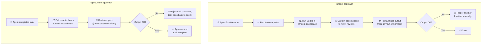

When comparing AgentCenter vs Inngest, the first thing to understand is that they're solving adjacent problems. Inngest is a strong tool. If you need durable, event-driven function execution — long-running AI workflows, retries, step orchestration, fan-out/fan-in patterns — it handles the hard parts well. Their focus on AI agent use cases is genuine, and the developer experience is clean.

So it's not surprising that teams reach for Inngest when they start running OpenClaw agents in production. It's positioned for exactly this kind of work.

But there's a gap that shows up around the second month of running agents in production. Inngest tells you *that* your agent functions ran. AgentCenter helps your team manage *what* those agents are actually doing.

## What Inngest Does Well

To be fair: Inngest solves real engineering problems.

- **Durable execution**: functions survive failures, restarts, and deploys without losing state mid-run
- **Step functions with retries**: each step can fail and retry independently without re-running prior steps
- **Long-running tasks**: no timeout ceiling, so multi-step agent pipelines finish even when they take hours
- **Event-driven triggers**: agents can kick off based on Stripe webhooks, database events, or custom triggers
- **Fan-out patterns**: one event can spawn many parallel agent runs cleanly
- **TypeScript and Python SDKs**: well-typed, idiomatic code in both ecosystems
- **Observability for functions**: run history, step-level logs, retry counts, duration

For the execution layer, Inngest is genuinely capable. Teams running agent-heavy workloads get real value from it.

## The Gap for Teams Managing AI Agents

Here's what shows up when you're running agents at any real scale.

You have 12 agents. They're all running via Inngest. The functions are executing. Retries are happening automatically. From Inngest's perspective, everything looks healthy.

But you don't know:

- Which agent produced a deliverable your team needs to review before it ships
- Who on the team is responsible for the output of agent 7
- That agent 3 and agent 9 are both working on a research task that only needs one of them
- That the same agent is now costing twice as much per run as it did last week
- That a task was flagged "complete" by the function, but the output was wrong

We had 18 agents running through function orchestration for two months. Every function was instrumented. We had no visibility into what our agents were actually producing or whether anyone was reviewing it. The function graph showed us execution status. It couldn't show us team workflow.

That's the gap. Inngest is built for engineering reliability. AgentCenter is built for team operations around AI agents. Those are different problems.

## AgentCenter vs Inngest: Side-by-Side

| Feature | Inngest | AgentCenter |
|---|---|---|
| Durable function execution | Yes, core product | Via OpenClaw agent runtime |
| Step functions with retries | Yes | Via task orchestration |
| Agent task management | No | Yes, kanban board per project |
| Live agent status | Function status only | Online / working / idle / blocked |
| Deliverable review workflow | No | Yes, approve or reject outputs |
| Multi-agent coordination | Fan-out/fan-in patterns | @mentions, threads, handoffs |
| Task ownership and assignment | No | Yes, per-task assignees |
| Cost tracking per agent task | No | Yes, token costs logged per task |
| Human-in-the-loop approvals | Not native | Yes, built into the workflow |
| Agent performance analytics | No | Yes, error rates, latency, output trends |
| Recurring agent automation | Yes (cron triggers) | Yes (Pro+ plan) |
| Pricing | Free tier plus usage-based | Starts at $14/mo (Starter), up to $79/mo (Scale) |
| Best for | Reliable AI function execution | Managing AI agents and teams in production |

## Workflow Comparison: Catching a Bad Agent Output

Here's where the two tools diverge in practice. An agent runs a research task and produces a summary. Before that summary gets used downstream, someone needs to check it.

**The Inngest path**: your function runs. You know it succeeded. Then you need to build your own notification system, your own review interface, and your own logic for what happens when output gets rejected. That's real engineering work on top of your agent infrastructure — weeks of custom plumbing before your team can actually collaborate around agent output.

**The AgentCenter path**: the agent's deliverable lands on the [kanban board](/features/task-orchestration) automatically. The reviewer gets an @mention. They approve or reject with a comment. If it's rejected, the task goes back to the agent with feedback. No custom plumbing required.

The gap isn't a flaw in Inngest — it's not what Inngest is built for. But if your team is trying to operate agents in production, that gap costs you significant time and engineering effort.

## What Teams End Up Building on Top

Teams that use Inngest for agent workflows usually end up writing their own:

- Slack notifications when agent functions finish
- A tracking spreadsheet or Notion doc for deliverable review status
- Manual cost tracking via LLM provider dashboards
- A second approval step modeled as another function
- Some informal system to track which agent outputs have been reviewed

Each of these is a solved problem in AgentCenter. Building them yourself is possible, but it's time you're not spending on the actual work your agents are supposed to do.

## Can You Use Both?

Yes. For some teams, this is the right architecture.

If your OpenClaw agents run inside Inngest functions because you specifically need Inngest's durability guarantees, fan-out patterns, or event-driven triggers, you can still put AgentCenter in front as the management layer. AgentCenter handles task tracking, review workflows, cost visibility, and team coordination. Inngest handles the reliable execution underneath.

The trade-off: you're running two systems and paying for both. For most teams, this overhead isn't worth it unless Inngest is solving a specific execution problem that OpenClaw's agent runtime doesn't handle natively.

If your agents run via OpenClaw directly, the [agent monitoring](/features/agent-monitoring) and task orchestration in AgentCenter cover scheduling and coordination without a second tool.

## Bottom Line

Inngest is a capable platform for durable AI function execution. It's not a team management layer for AI agents, and it doesn't try to be. If you have agents running in production and you need your team to track deliverables, review outputs, see what's happening in real time, and know what things cost, that's a different tool.

See [the full feature set](/features) before you spend a month building management logic on top of a function platform.

---

*Inngest is good at running agent functions reliably. AgentCenter does something different — it manages your agents, not just executes them. [Start your 7-day free trial](/pricing) — no lock-in.*
